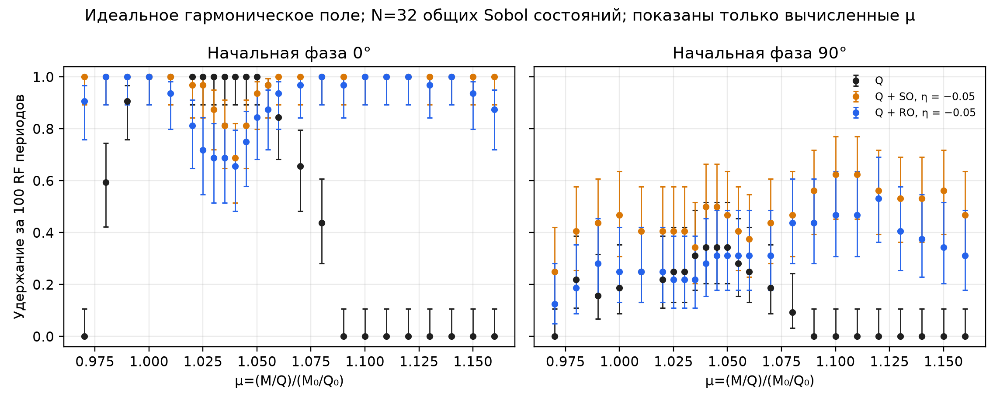
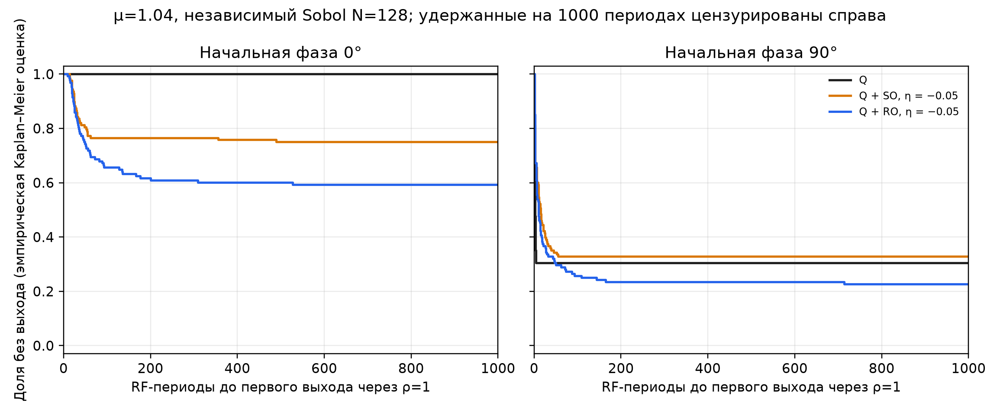
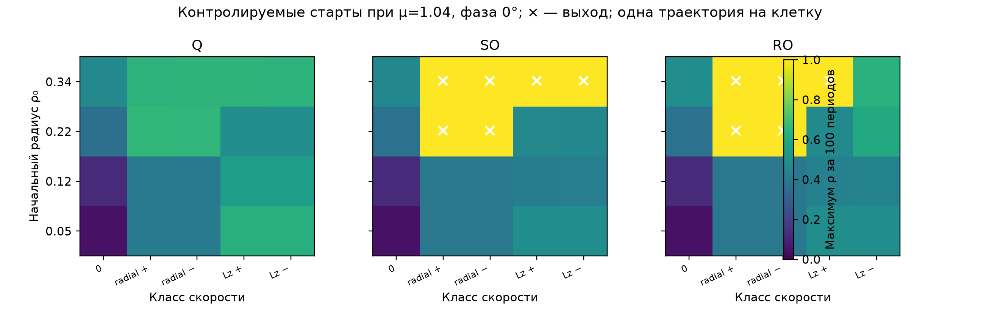
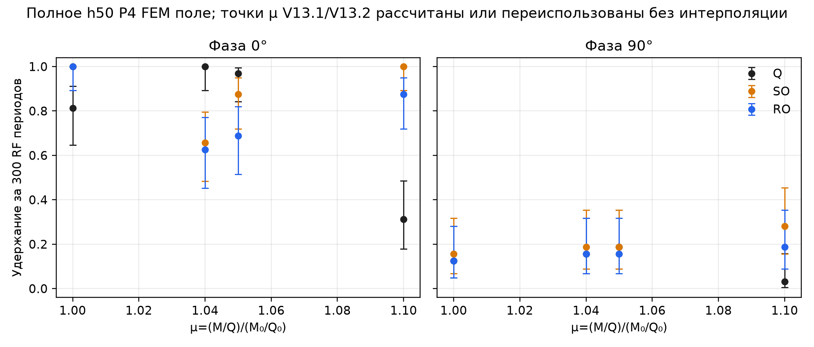

# V13.2 — этап A: массовый отклик и нелинейный провал удержания

## Постановка и протокол

Исследован конечновременный выход поперечной траектории через апертуру `ρ=1` в идеальной безразмерной модели Q, Q+SO и Q+RO. Это вероятность двумерного поперечного удержания, а не передача через фильтр конечной длины.

В опорной точке `μ=1` использованы `α₀=0.0270000131579`, `β₀=0.175`, `η=κ/β=−0.05`; при изменении массы все коэффициенты масштабируются как `1/μ`. Начальные состояния — 32 общих scrambled Sobol старта V13.1, seed 131, в прямоугольнике `x,y∈[−0.25,0.25] R`, `vₓ,vᵧ∈[−0.04,0.04] RΩ`. Действительные радиусы выборки составляют `0.0535–0.3269 R`, то есть это не диск радиусом `0.25 R`. Каждое состояние запускалось при фазах `0°` и `90°` во всех трёх моделях.

Первичный скан: `μ=0.97…1.16`, шаг `0.01`, горизонт 100 RF-периодов. Совпавшие точки `μ=1.00,1.05,1.10` и 576 trajectory/phase/model ячеек взяты из неизменённых точных V13.1 результатов. В области провала добавлены `μ=1.025,1.035,1.045,1.055`, поэтому от `1.02` до `1.06` имеется шаг `0.005`. Для независимой оценки использована отдельная scrambled Sobol выборка `N=128`, seed 1322, при `μ=1.04`. Эти же 128 траекторий без сброса координат, скорости или RF-фазы продолжены до 300 и 1000 периодов.

## Первичный скан

Для фазы `0°` таблица показывает число удержанных состояний из 32. Все ячейки вычислены непосредственно; между ними нет интерполяции.

| μ | Q | Q+SO | Q+RO | `P_RO−P_Q` | `P_RO−P_SO` |
|---:|---:|---:|---:|---:|---:|
| 0.97 | 0/32 | 32/32 | 29/32 | +0.906 | −0.094 |
| 0.98 | 19/32 | 32/32 | 32/32 | +0.406 | 0.000 |
| 0.99 | 29/32 | 32/32 | 32/32 | +0.094 | 0.000 |
| 1.00 | 32/32 | 32/32 | 32/32 | 0.000 | 0.000 |
| 1.02 | 32/32 | 31/32 | 26/32 | −0.188 | −0.156 |
| 1.025 | 32/32 | 31/32 | 23/32 | −0.281 | −0.250 |
| 1.03 | 32/32 | 28/32 | 22/32 | −0.312 | −0.188 |
| 1.035 | 32/32 | 26/32 | 22/32 | −0.312 | −0.125 |
| 1.04 | 32/32 | 22/32 | 21/32 | −0.344 | −0.031 |
| 1.045 | 32/32 | 26/32 | 24/32 | −0.250 | −0.063 |
| 1.05 | 32/32 | 30/32 | 27/32 | −0.156 | −0.094 |
| 1.055 | 31/32 | 31/32 | 28/32 | −0.094 | −0.094 |
| 1.06 | 27/32 | 32/32 | 30/32 | +0.094 | −0.063 |
| 1.08 | 14/32 | 32/32 | 32/32 | +0.563 | 0.000 |
| 1.10 | 0/32 | 32/32 | 32/32 | +1.000 | 0.000 |

`Q+RO` имеет локальный участок пониженного удержания около `μ≈1.025–1.045`, тогда как Q остаётся полностью удерживающим большую часть этого интервала. Однако SO тоже теряет значительную долю стартов; относительное преимущество RO над SO неоднородно и минимально в точке `μ=1.04`. При фазе `90°` удержание и парные различия заметно иные: например, при `μ=1.04` результаты равны Q `11/32`, SO `16/32`, RO `9/32`; при `μ=1.00` — `6/32`, `15/32`, `8/32` соответственно. Начальная RF-фаза не может быть опущена из интерпретации.

Увеличение в области локального провала: [PNG](stage_a_mass_scan_zoom.png), [PDF](stage_a_mass_scan_zoom.pdf), [SVG](stage_a_mass_scan_zoom.svg). Точки с Wilson 95% интервалами показаны как дискретные результаты ансамбля `N=32`.

## Независимая реплика и длительный горизонт

При `μ=1.04`, `N=128`, seed 1322, фаза `0°`, на 100 периодах получено Q `128/128` (Wilson 95%: `[0.971,1]`), SO `98/128` (`[0.685,0.831]`) и RO `84/128` (`[0.570,0.733]`). Парная разность RO−SO равна `−0.109` с 95% нормальным парным интервалом `[−0.164,−0.055]`; RO−Q равна `−0.344` (`[−0.426,−0.261]`). При фазе `90°` разность RO−SO равна `−0.070` (`[−0.120,−0.021]`), а RO−Q `−0.047` (`[−0.108,0.014]`).

| Горизонт | Фаза | Q | Q+SO | Q+RO | RO−SO, парно, 95% CI |
|---:|---:|---:|---:|---:|---:|
| 100 | 0° | 128/128 | 98/128 | 84/128 | −0.109 `[−0.164,−0.055]` |
| 300 | 0° | 128/128 | 98/128 | 78/128 | −0.156 `[−0.219,−0.093]` |
| 1000 | 0° | 128/128 | 96/128 | 76/128 | −0.156 `[−0.219,−0.093]` |
| 100 | 90° | 39/128 | 42/128 | 33/128 | −0.070 `[−0.120,−0.021]` |
| 300 | 90° | 39/128 | 42/128 | 30/128 | −0.094 `[−0.144,−0.043]` |
| 1000 | 90° | 39/128 | 42/128 | 29/128 | −0.102 `[−0.154,−0.049]` |

Таким образом, идеальная гармоническая модель воспроизводит длительную потерю части RO ансамбля при `μ=1.04`, и разность RO−SO сохраняется до 1000 периодов. Это конечновременная потеря нелинейных стартов, не доказательство хаоса и не масс-разрешение прибора.

График — эмпирическая Kaplan–Meier оценка времени до первого выхода; состояния, удержанные до 1000 периодов, цензурированы справа. Полные времена выхода и `max ρ` каждой траектории находятся в CSV.

## Амплитудные и скоростные страты

Контролируемая выборка из 20 состояний использовала `ρ₀={0.05,0.12,0.22,0.34}`, `v=0` или `0.03 RΩ` радиально наружу/внутрь и по касательной с обоими знаками `L_z`. Наибольший радиус расположен по диагонали внутри исходного квадрата. При `μ=1.04`, фазе `0°`, Q удержал `20/20`, SO `14/20`, RO `15/20`. Все 4 нулевые скорости удержались в каждой модели; потери возникли только при ненулевой скорости и преимущественно на больших радиусах. Различие RO−SO в этой маленькой контролируемой выборке всего одно состояние. Поэтому наблюдаемая особенность амплитудно-зависима, но эта одиночная сетка не является оценкой вероятности для непрерывной входной эмиттанс-области.

В неавтономном RF-поле механическая энергия не сохраняется; в таблице начальных условий фиксируются отдельно `ρ₀`, скорость и начальная кинетическая энергия `|v₀|²/2`, без объявления её полным интегралом движения.

## Проверка на полном h50 P4 FEM поле

Новая точка `μ=1.04` рассчитана на полном h50 P4 FEM поле с сохранёнными m=4 и m=2 базисами, `N=32`, фазами `0°/90°`, горизонтом 100→300. При фазе `0°` на 300 периодах Q дал `32/32`, SO `21/32`, RO `20/32`; парное RO−SO равно `−1/32=−0.031`, 95% парный интервал `[−0.093,+0.030]`. При фазе `90°` значения `5/32`, `6/32`, `5/32`; RO−SO также `−1/32` с тем же интервалом. В точке `μ=1.04` FEM подтверждает нелинейный спад обеих октупольных схем относительно Q при фазе `0°`, но не подтверждает сильную RO-специфичную разность независимой идеальной реплики.

Для контекста переиспользованы без повторного счёта соответствующие полные FEM результаты V13.1 на 300 периодах, фаза `0°`: при `μ=1.00` Q/SO/RO=`26/32,32/32,32/32`; `μ=1.05` — `31/32,28/32,22/32`; `μ=1.10` — `10/32,32/32,28/32`. При `μ=1.05` разность RO−SO равна `−6/32` (V13.1 парный 95% интервал `[−0.330,−0.045]`). Вне линейной полосы Q октупольные модели сохраняют высокое удержание; например, при `μ=1.10` RO удерживает `28/32`, тогда как Q — `10/32`. Это исключает трактовку локального спада как уже установленной узкой полосы фильтрации.

На графике только рассчитанные точки `μ=1.00,1.04,1.05,1.10`. Для новых 22 пограничных FEM траекторий шаг уменьшен вдвое с `2π/64` до `2π/128`: на горизонтах 100 и 300 статусы совпали во всех случаях; максимальная разность времени выхода — `3.92 RF-периода`. Это проверка классификаций, а не точности каждой траектории по времени.

## Вывод этапа A

Есть воспроизводимый амплитудно-зависимый локальный спад идеального Q+RO ансамбля около `μ≈1.03–1.05`; при `μ=1.04` в независимой выборке он сохраняется до 1000 периодов. Но полное FEM поле показывает, что количественная разность RO−SO в этой центральной точке гораздо меньше и статистически неразрешима при `N=32`; более выраженное RO−SO отличие V13.1 относится к соседней `μ=1.05`. Кроме того, SO и RO имеют высокое удержание и вне центральной полосы Q.

На этом этапе не определяются FWHM и `R_m`: измеренная передача не является функцией конечного фильтра, локальный отклик немонотонен и фазозависим, а FEM масса-сетка пока разрежена. Перспективен только дальнейший поиск механизма локального нелинейного потерь/резонансов. Результат не доказывает улучшения разрешающей способности, передачи или аксептанса Q+RO.

Данные: `stage_a_trajectory_results.csv`, `stage_a_retention_summary.csv`, `stage_a_fine_trajectory_results.csv`, `stage_a_fine_retention_summary.csv`, `stage_a_replica128_mu104_horizon1000.csv`, `stage_a_replica128_mu104_long_summary.csv`, `stage_a_amplitude_strata_trajectory_results.csv`, `stage_a_full_fem_mass_retention.csv`. Параметры и стартовые состояния сохранены в соседних JSON/CSV.
