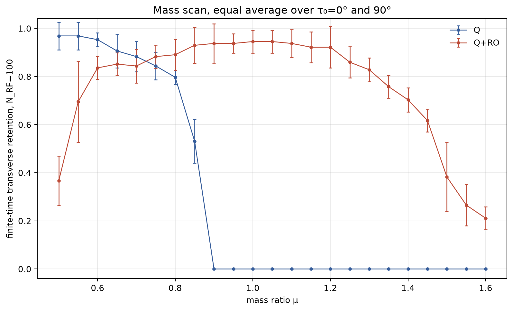
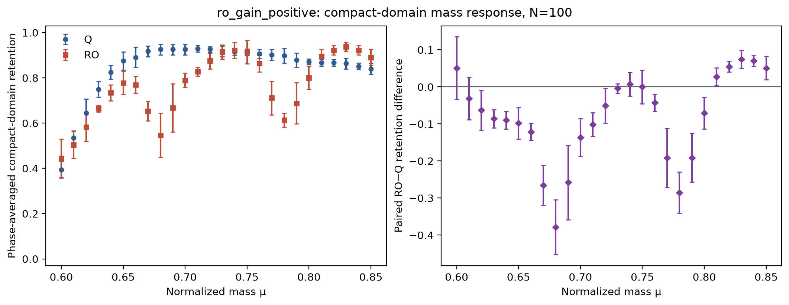
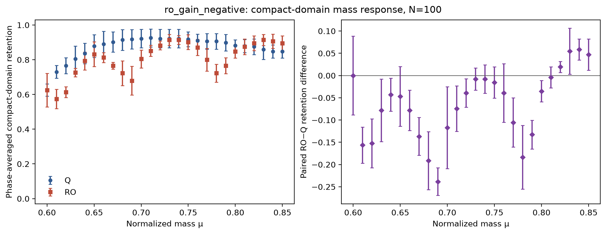

# V13.3 — предварительные массовые характеристики

## Определение массового скана

При фиксированных напряжениях
`(α,β,κ)=(α₀,β₀,κ₀)/μ`, где `μ=(M/Q)/(M₀/Q₀)`. В Q полагается `κ=0`; в Q+RO сохраняется знак и относительная амплитуда `κ₀`. Отношение `η=κ₀/β₀` постоянно вдоль каждого луча. Напряжения и RF-частота на луче не меняются, поэтому фактический пиковый электродный предел совпадает с базовой точкой. Четыре точки ниже лежат между 144 и 245 В по максимальному мгновенному напряжению.

Это скан **конечновременного поперечного удержания**, не передача иона через прибор конечной длины. Здесь нет осевого пролёта, входных краевых полей или модели источника. Во всех сравнениях Q/RO используются те же восемь начальных безразмерных состояний V13.1 seed-131 и обе фазы `τ₀=0°,90°`; при `μ=1` совпадающие траектории переиспользованы напрямую из основной карты, прочие точки рассчитаны на сетке `μ=0.80…1.20`, шаг `0.025`, горизонт `100 RF`.

## Четыре фиксированно-напряжённых луча

| Луч | `(α₀,β₀,κ₀)` | `η` | `max |Vj|`, В | Интерпретация первичного атласа |
|---|---|---:|---:|---|
| `ro_gain_negative` | `(0.0125,0.1125,−0.005625)` | −0.05 | 144.42 | RO удерживает около μ≈1 и до μ≈1.125, когда Q уже теряет ансамбль; эффект похож на расширение высокой массовой границы, а не на узкий пик. |
| `ro_gain_positive` | `(−0.0125,0.1125,+0.005625)` | +0.05 | 144.42 | Сходное расширение удержания к большим μ; умеренная фазовая зависимость. |
| `ro_loss_negative` | `(−0.025,0.175,−0.00875)` | −0.05 | 230.69 | В области, где Q имеет широкое удержание, RO сильно его подавляет; слабая ограниченная структура RO около μ≈1.0–1.1 требует уточнения. |
| `ro_loss_positive` | `(0.025,0.175,+0.0175)` | +0.10 | 244.23 | RO подавляет удержание на большей части массовой полосы Q. |

Наиболее выразительные фазоусреднённые пилотные доли для `ro_gain_negative`: при `μ=1.000…1.050` Q дал `0/16`, RO — `12/16`; при `μ=1.125` Q — `0/16`, RO — `3/16`; при `μ=1.150` обе модели — `0/16`. Это нелинейное расширение конечновременного удержания RO, но его нижняя граница ниже диапазона текущего скана и узкая фильтровая полоса не установлена.

Для `ro_loss_negative` Q дал фазоусреднённые доли `0.50` при μ=1.000, `0.625` при 1.025–1.075 и `0.25` при 1.175. RO дал `0.125` при 1.000, `0.25` при 1.025–1.050, `0.188` при 1.075–1.100 и ноль при 1.150–1.200. Этот режим может создавать ограниченный максимум, но пока пропускает меньшую долю и не доказывает улучшения компромисса «селективность/удержание».

Все числа — пилот `n=8` для каждой фазы. Две фазовые доли усреднены только описательно; Wilson-интервалы в таблицах рассчитаны по восьми стартам на фазу и не являются независимыми репликатами randomized QMC. Немонотонные участки и максимум при N=8 нельзя считать установленным резонансом или достоверной масс-полосой.

## Уточняющий массовый скан

Для кандидата `ro_loss_negative` завершён независимый скан `μ=0.95…1.20`, шаг `0.01`, четыре независимых scrambled-Sobol реплики по 32 состояния, обе фазы, Q и RO парно, `N_RF=100`. Стартовый безразмерный домен тот же, что в V13.2: `x,y∈[−0.25,0.25]`, `vx,vy∈[−0.04,0.04]`. Все 13 312 траекторий разрешены. Затем завершён локально уточнённый скан `.965…1.175` с шагом `.005`, 64 состояния на реплику: 44 032 траектории, 0 неразрешённых исходов. По 16 из 64 начальных состояний каждой реплики в точках `μ=1.05,1.10,1.15` завершено продолжение 100→300→1000 периодов без сброса RF-фазы.

Результаты пилота: `mass_ray_trajectory_results.csv`, `mass_ray_retention_summary.csv`, `mass_ray_paired_differences.csv`, `mass_ray_paired_summary.csv`, `mass_ray_sampled_extrema.csv`, `mass_ray_manifest.json`. Рисунки: `mass_ray_pilot_phase_0deg.{png,pdf,svg}` и `mass_ray_pilot_phase_90deg.{png,pdf,svg}`. Независимое уточнение сохраняет отдельные исходные условия и checkpoint в `fine_mass_scan/`.

## Вывод по исходному 32-state пилоту

Исходный 32-state профиль показал расширение удержания на одном луче RO и подавление около максимума Q на другом. В отдельном первом проходе для `ro_loss_negative` получилась ограниченная `FWHM`, но интервалы `R_m` перекрывались. Этот низкоразмерный результат заменён более плотным независимым уточнением, приведённым ниже. Длинные продолжения и проверка на FEM/4D области остаются необходимыми; экспериментальная передача не рассчитывалась.

## Линейные границы вдоль массовых лучей

В обеих поперечных координатах повторно вычислена матрица монодромии с более строгими допусками на `μ=0.80…1.20`, шаг `0.005`; переходы между соседними статусами уточнены скобочным поиском. Максимальная ошибка `|det M−1|` составила `3.86×10⁻¹²`. Поскольку октуполь не входит в линейную силу, границы Q и Q+RO совпадают:

| Луч | Интервал строгой линейной устойчивости по μ |
|---|---:|
| `ro_gain_negative` и `ro_gain_positive` | `0.80…0.990675` |
| `ro_loss_negative` и `ro_loss_positive` | `0.958305…1.181417` |

Это границы линейной устойчивости центра, не предсказание конечновременной доли удержания. В пилотной карте Q+RO сохраняет часть конечных амплитуд вне линейной области на лучах усиления. Сводные записи — `mass_ray_floquet.csv`, `mass_ray_floquet_boundaries.csv`, `mass_ray_floquet_metadata.json`; график траекторий лучей в трёхмерном параметрическом пространстве — `mass_rays_in_parameter_atlas.{png,pdf,svg}`.

## Новые кандидаты из трёхмерного адаптивного атласа

Уточнение выявило дополнительную пару массовых лучей, не входившую в первоначальные четыре грубые траектории. При M₀/Q₀=3200.04652261404 Th/e, f=100 kHz, R=8 mm параметры (α,β,κ)=(+0.00625,0.075,−0.015) (η=−0.20) соответствуют U₂=81.43 V, VDC=+6.79 V, U₄=−23.22 V; максимальный непрерывно-фазовый пик среди электродов — 111.43 V. Зеркальный знаковый режим (−0.00625,0.075,+0.015) (η=+0.20) имеет тот же пик. Оба лежат далеко внутри лимита 250 V.

На фиксированных параметрах в этих узлах центральная Floquet-динамика Q неустойчива, но на заданном малом безразмерном ансамбле Q+RO удерживает при N=1000 от 0.781 до 0.988 (зависит от режима и τ₀=0°/90°); Q удержал 0 протестированных состояний в обеих фазах. Это сильная конечновременная нелинейная структура, а не узкая массовая полоса: ширина ещё не измерена. Лучи через эти узлы должны быть проверены отдельно на массе, полном FEM-поле и большем физическом ансамбле.

Текущие пилотные высокоразрешённые массовые сканы остаются рассчитанными вдоль прежних четырёх фиксированно-напряжённых точек. Новые атласные точки не подменяют их данные и не дают права оценивать FWHM или экспериментальную передачу.

## Точная линейная граница на новом нелинейном луче

Для пары новых кандидатов (±α, β=0.075, κ=∓0.015) при фиксированных напряжениях все параметры масштабируются как 1/μ. Матрицы монодромии x/y дали границу строгой линейной устойчивости при μ=0.8890764675; при меньших μ центр строго устойчив, при больших μ — неустойчив. Оба знаковых режима имеют одну границу, как требует симметрия линейного квадруполя; κ не входит в линеаризацию. Максимальная ошибка det(M)−1 на сетке μ=0.8…1.2 составила 2.28×10⁻¹².

Опорное состояние μ=1 находится в линейно неустойчивой области, где идеальный Q теряет ансамбль, а нелинейный Q+RO сохраняет большую часть начальных состояний даже на 1000 RF. Это делает луч приоритетным для проверки массовой структуры, но само по себе не устанавливает ограниченную массовую полосу. Узкая FWHM, разрешение и выигрыш по передаче не рассчитываются, пока массовые сканы этого луча не завершены.

Таблица и границы: mass_ray_floquet_adaptive.csv и mass_ray_floquet_adaptive_boundaries.csv. Результаты точны только для линейного центра; конечновременные нелинейные карты идут отдельными данными.

## Завершённый предварительный 32-state массовый проход

Строгая проверка числа лобов и разрешения массовой сетки изменила интерпретацию первоначальной грубой выборки `fine_mass_scan`:

| Модель | Пик удержания `P_ret` (95% t-интервал) | `μ_peak` | Replicates с допустимой одиночной FWHM | FWHM / `R_m` |
|---|---:|---:|---:|---|
| Q | 0.711 (0.659–0.763) | 1.055 | 4/4 | 0.1795 / 5.88 |
| Q+RO, `η=−0.05` | 0.227 (0.179–0.274) | около 1.06 | 3/4 для фазового среднего | Не сообщаются |

Ранее выведенная для RO фазово-средняя `FWHM=0.1279` и `R_m=8.57` не принимается: один из четырёх репликатных профилей не проходит новую проверку одиночного ограниченного пика. Для отдельной фазы `τ₀=0°` все четыре профиля проходят, но при `90°` — только два из четырёх. Поэтому старый phase-averaged `R_m` по шагу `0.01` отозван; парные разности удержания при `μ=1.05` остаются валидными и отрицательными: `−0.703` при `τ₀=0°` и `−0.305` при `τ₀=90°`.

Подробный вывод теперь опирается на завершённую 64-state сетку с шагом `0.005` ниже. В обеих сериях значения относятся к конечновременному удержанию идеальной гармонической модели, а не к передаче через конечный фильтр.

Для воспроизводимости сохранены `fine_mass_scan/manifest.json`, `initial_conditions.csv`, `replicate_retention.csv`, `retention_summary.csv`, парные таблицы и `fwhm_per_replica.csv`/`fwhm_summary.csv`. Полные 13 312 строк траекторий и append-only checkpoint остаются локально; суммарные кривые доступны как `retention_{0deg,90deg,phase_average}.{png,pdf,svg}`. Скрипты сводки и условной FWHM: `scripts/summarize_v13_3_fine_mass_scan.py` и `scripts/estimate_v13_3_mass_fwhm.py`.

## Высокоразрешённый скан точки подавления `ro_loss_negative`

Завершён скан `μ=0.965…1.175` с шагом 0.005: 43 массы, 64 общих Sobol-старта на каждую из четырёх независимых скремблированных реплик, две инжекционные RF-фазы (`τ₀=0°,90°`), Q и Q+RO парно. Все 44 032 исхода разрешены; каждый из 22 016 пар Q/RO сохранён. Начальный домен и интегратор совпадают с предыдущим V13.3 массовым сканом.

Для равновесной смеси только двух вычисленных фаз (`0°` и `90°`) фазово-средний профиль имеет одну ограниченную полувысотную компоненту во всех четырёх репликах обеих моделей. Оценки ниже используют FWHM отдельной реплики и `Rₘ=μ_peak/FWHM`; интервалы — 95% Student-t по четырём независимым scrambled-Sobol оценкам. Пересечения линейно интерполированы только между фактически рассчитанными соседними узлами:

| Модель | Пик `P_ret` (95% ДИ) | `μ_peak` | FWHM (95% ДИ) | `Rₘ` (95% ДИ) |
|---|---:|---:|---:|---:|
| Q | 0.711 (0.691–0.731) | 1.0544 | 0.1799 (0.1723–0.1876) | 5.86 (5.61–6.11) |
| Q+RO, `η=−0.05` | 0.211 (0.191–0.231) | 1.0625 | 0.1377 (0.1323–0.1431) | 7.72 (7.42–8.02) |

При данных двух фазах RO даёт на этой сетке примерно на 23% меньшую FWHM и на 32% больший условный `Rₘ`, но пик удержания снижается до 30% от Q. Поэтому это наблюдаемый компромисс «ширина/удержание», а не однозначное улучшение фильтра. Парная разность при `μ=1.05` остаётся отрицательной отдельно для обеих фаз: `−0.699` (95% ДИ `−0.750…−0.648`) при `τ₀=0°` и `−0.324` (`−0.404…−0.245`) при `τ₀=90°`.

Для отдельного среза `τ₀=90°` условная FWHM/Rₘ RO намеренно не сообщается: только 2 из 4 реплик прошли критерий одиночного ограниченного пика, разрешённого массовой сеткой. У фазово-средней оценки выше фазы усреднены с равным весом, а не проинтегрированы по непрерывному равномерному распределению. Нужна проверка `τ₀=180°,270°`, большего горизонта, независимого начального фазового объёма и полного FEM-поля до физической интерпретации разрешения.

Идеальная модель показывает локально более узкий условный массовый отклик Q+RO, но не выигрывает одновременно по ширине и доле удержания. Это конечновременное двумерное поперечное удержание (`N_RF=100`), не пропускание прибора конечной длины. Исходные точки, парные разности, распределения времени выхода и рисунки сохранены в `fine_mass_scan_ro_loss_negative_refined/`; многолобовые и недостаточно разрешённые профили исключены из `Rₘ` скриптом `scripts/estimate_v13_3_mass_fwhm.py`.

Для трёх выбранных масс продолжение изменило классификацию `0` из 768 состояний на каждом из горизонтов `N_RF=300,1000`; доли удержания этого подансамбля совпали между 100, 300 и 1000 RF-периодами. На 16 состояниях из каждой реплики фазоусреднённая парная RO−Q разность составила `−0.492` (`μ=1.05`, 95% t-ДИ `−0.602…−0.382`), `−0.445` (`μ=1.10`, `−0.530…−0.360`) и `−0.383` (`μ=1.15`, `−0.507…−0.258`). Это подтверждает отсутствие позднего возврата/выхода в данном подансамбле, но не устанавливает асимптотическую устойчивость: состояния — подвыборка первоначальных 64, только фазы `0°,90°`, идеальное поле. Продолженные траектории и квантильные сводки находятся в `fine_mass_scan_ro_loss_negative_refined/continuation_*` и `horizon_*.csv`.

## Завершённый массовый скан луча широкого RO-удержания `ro_gain_positive`

Для точки `(α₀,β₀,κ₀)=(−0.0125,0.1125,+0.005625)`, `η=+0.05`, `max|V_j|=144.42 V` рассчитаны 36 масс `μ=0.85…1.20` с шагом `0.01`, четыре независимые scrambled-Sobol реплики по 32 общих старта, `τ₀=0°,90°`, Q/RO парно, `N_RF=100`. Разрешены все 18 432 исхода. При фазовом среднем по двум рассчитанным фазам:

| `μ` | Q: `P_ret` (95% t-ДИ) | Q+RO: `P_ret` (95% t-ДИ) |
|---:|---:|---:|
| 0.85 | 0.840 (0.816–0.864) | 0.891 (0.855–0.926) |
| 0.90 | 0.680 (0.648–0.712) | 0.852 (0.819–0.884) |
| 0.95 | 0.449 (0.418–0.481) | 0.727 (0.679–0.774) |
| 1.00 | 0.000 | 0.691 (0.654–0.729) |
| 1.05 | 0.000 | 0.582 (0.545–0.619) |
| 1.10 | 0.000 | 0.328 (0.274–0.382) |
| 1.15 | 0.000 | 0.023 (0.009–0.038) |
| 1.20 | 0.000 | 0.000 |

Это выраженное расширение конечновременного удержания Q+RO в область `μ>0.990675`, где центр чистого квадруполя уже теряет строгую Floquet-устойчивость; около `μ=1` обычный Q не удержал ни одного тестового старта, RO — примерно 69%. На `μ=0.90` и `0.95` парный выигрыш RO над Q также положителен. Но профиль RO достигает максимума на нижней границе расчётного диапазона `μ=0.85`; половинное пересечение слева не измерено. Поэтому FWHM и `R_m` для этого луча не вычисляются. Это широкая асимметричная область удержания, а не доказанная узкая масс-полоса. Массовый диапазон ниже `0.85` нужно расширить перед оценкой возможной границы.

Результат пока относится к идеальной ведущей гармонике, `N_RF=100`, малому квадратному стартовому домену V13.2 и равному среднему `τ₀=0°,90°`; это не экспериментальная передача. Выбранные точки `μ=0.90,1.00,1.10` продолжаются до 300/1000 периодов с теми же состояниями и абсолютной RF-фазой. Полная таблица, парные интервалы, критерии FWHM, настройки и кривые находятся в `fine_mass_scan_ro_gain_positive/`.

## Завершённый массовый скан противоположного знака `ro_gain_negative`

Для зеркальной точки `(α₀,β₀,κ₀)=(+0.0125,0.1125,−0.005625)`, `η=−0.05`, с тем же пределом `144.42 V` и протоколом рассчитаны 36 масс `μ=0.85…1.20`, четыре независимые реплики по 32 старта, две фазы и Q/RO парно. Все 18 432 исхода разрешены. Фазово-средняя доля удержания:

| `μ` | Q: `P_ret` (95% t-ДИ) | Q+RO: `P_ret` (95% t-ДИ) |
|---:|---:|---:|
| 0.85 | 0.848 (0.810–0.885) | 0.895 (0.852–0.937) |
| 0.90 | 0.797 (0.762–0.832) | 0.879 (0.848–0.910) |
| 0.95 | 0.617 (0.558–0.676) | 0.816 (0.774–0.859) |
| 1.00 | 0.000 | 0.828 (0.788–0.869) |
| 1.05 | 0.000 | 0.770 (0.714–0.825) |
| 1.10 | 0.000 | 0.426 (0.394–0.457) |
| 1.15 | 0.000 | 0.051 (0.008–0.093) |
| 1.20 | 0.000 | 0.000 |

В области строгой неустойчивости центра Q (`μ>0.990675`) Q+RO сохраняет высокий уровень конечновременного удержания и при обоих знаках октупольной амплитуды. В этой точке при `μ=1.00` и `τ₀=0°` все 128 RO-стартов удержались против 0/128 Q; при `τ₀=90°` RO удержал 84/128 против 0/128 Q. Однако фазово-средний массовый профиль достигает максимума на нижнем крае `μ=0.85`; половинный пик слева не ограничен. По этой причине FWHM и `Rₘ` не публикуются. Следующий обоснованный шаг — расширить оба gain-луча ниже `μ=0.85`, а не называть наблюдаемую область ограниченной полосой.

Эта воспроизводимая картина относится к двум инжекционным фазам и идеальному гармоническому полю. Она показывает широкое масс-зависимое нелинейное удержание вне центральной области Floquet, но пока не узкую масс-селективность и не пропускание фильтра. Настройки, таблицы парных исходов и рисунки сохранены в `fine_mass_scan_ro_gain_negative/`.

### Продолжение `ro_gain_negative` до 1000 RF-периодов

Для `μ={1.00,1.05,1.10}` те же первые 16 состояний каждой из четырёх Sobol-реплик и фаз `τ₀=0°,90°` продолжены непрерывно по фазе от N=100 до 300 и 1000 RF-периодов. Для каждого горизонта рассчитано по 768 Q/RO исходов; `unresolved=0`. Q потерял все 384 состояния на каждом горизонте. У Q+RO доли удержания:

| μ | N=100 | N=300 | N=1000 | RO-статусы изменились 100→1000 |
|---:|---:|---:|---:|---:|
| 1.00 | 0.828 (0.764–0.892) | 0.828 (0.764–0.892) | 0.828 (0.764–0.892) | 0/128 |
| 1.05 | 0.758 (0.683–0.832) | 0.742 (0.657–0.827) | 0.727 (0.664–0.789) | 4/128 |
| 1.10 | 0.391 (0.236–0.545) | 0.313 (0.205–0.420) | 0.227 (0.102–0.351) | 21/128 |

Скобки показывают 95% Student-t ДИ по четырём независимым репликатным средним с равным весом фаз. В целом между N=100 и N=1000 классификация изменилась у 25 из 768 запусков, все поздние потери относятся к Q+RO при μ=1.05 и 1.10. Таким образом, усиленное удержание около μ=1 воспроизводится до 1000 периодов, но верхняя часть массовой характеристики сужается при увеличении времени наблюдения. Это конечновременный дрейф/выход выбранных траекторий, не доказательство асимптотической устойчивости и не массовая передача через фильтр.

Продолжение использует подвыборку 16 из первоначальных 32 стартов на реплику, только две фазы, идеальное поле и малый V13.1 квадратный домен. Его нельзя напрямую переносить на физический 4D домен `r≤7.5 mm`, `E⊥≤5 eV`: первый A₄-пилот на этом более широком домене удержал лишь 12.7% Q+RO фазового объёма при μ=1. Исходные сегменты, manifest, репликатные оценки и график N=100/300/1000 сохранены в `fine_mass_scan_ro_gain_negative/`.

## Дополнительный скан высоко-нелинейного луча A9

Для узла `a9_b2_e0`, `(α₀,β₀,κ₀)=(0.00625,0.075,−0.015)`, `η=−0.20`, рассчитан независимый первичный скан `μ=0.80…1.20` с шагом 0.025. Напряжения фиксированы: `U₂=81.43 V`, `VDC=6.79 V`, `U₄=−23.22 V`; максимальное мгновенное напряжение любого электрода равно `111.434 V`. Использованы четыре независимых scrambled-Sobol реплики по 16 состояний, фазы инжекции 0° и 90°, парные модели Q/Q+RO и `N_RF=100`. Все 4352 исхода разрешены.

| μ | Q: `P_ret` | Q+RO: `P_ret` (95% t-ДИ по 4 репликам) |
|---:|---:|---:|
| 0.80 | 0.797 | 0.891 (0.826–0.955) |
| 0.90 | 0.000 | 0.938 (0.856–1.019) |
| 1.00 | 0.000 | 0.945 (0.898–0.993) |
| 1.20 | 0.000 | 0.922 (0.836–1.008) |

В пределах проверенного окна Q+RO образует широкое плато удержания, а не замкнутый массовый пик: максимальное рассчитанное значение приходится на `μ=1.00`, и профиль не падает до половины этого уровня с обеих сторон. Поэтому FWHM и условное `Rₘ` не определены. Это сильное нелинейное удержание при линейно неустойчивом центре, но само по себе оно не означает масс-фильтрацию. Сейчас продолжается расширение этого луча до `μ=0.50…1.60`, чтобы проверить, где плато ограничено и существует ли вообще конечная полоса.

Результат относится к идеальному ведущегармоническому полю и указанному малому квадратному ансамблю V13.3, а не к полному FEM-полю или передаче через прибор конечной длины. Компактные настройки и сводки с парными разностями и неопределённостями находятся в `adaptive_mass_ray_a9_b2_e0/`; полный append-only checkpoint и массив траекторий остаются локальными.

### Продолжение зеркального луча `ro_gain_positive`

Для зеркальной точки `η=+0.05` продолжены те же 16 стартов на реплику до N=100/300/1000 RF при `μ={0.90,1.00,1.10}`. На каждом горизонте рассчитано 768 парных Q/RO исходов, `unresolved=0`. Фазоусреднённые `P_ret` Q+RO с 95% Student-t ДИ по четырём репликам:

| μ | N=100 | N=300 | N=1000 | RO-статусы изменились 100→1000 |
|---:|---:|---:|---:|---:|
| 0.90 | 0.820 (0.726–0.914) | 0.805 (0.757–0.852) | 0.789 (0.741–0.837) | 4/128 |
| 1.00 | 0.703 (0.674–0.732) | 0.688 (0.647–0.728) | 0.672 (0.643–0.701) | 4/128 |
| 1.10 | 0.305 (0.194–0.415) | 0.250 (0.180–0.320) | 0.148 (0.086–0.211) | 20/128 |

Q не изменил классификацию ни одного из 384 выбранных стартов: при μ=0.90 удержались 86/128 состояний на каждом горизонте, при μ=1.00 и 1.10 Q удержаний не было. В сумме классификация изменилась у 28 из 768 Q/RO исходов от 100 до 1000 RF; все изменения — поздние выходы Q+RO. Как и для отрицательного знака η, широкий gain-профиль сужается при увеличении времени, особенно около μ=1.10. При μ=1.00 конечновременное удержание сохраняется до N=1000, но не подтверждает асимптотическую устойчивость.

Продолжение использует подвыборку 16/32 стартов каждой реплики, только две инжекционные фазы, идеальное поле и малый квадратный стартовый домен. Полные исходы, seeds/source manifest, репликатные оценки и графики находятся в `fine_mass_scan_ro_gain_positive/`.

## A9: расширенный массовый луч μ=0.50…1.60

Завершён ранее начатый скан `a9_b2_e0` по 23 массам с шагом 0.05 при фиксированных физических напряжениях, N=100 RF и двух фазах инжекции 0°/90°. Протокол: идеальное ведущее гармоническое поле, четыре независимые Sobol-реплики по 16 общих Q/RO-состояний, компактный безразмерный стартовый домен `xρ,yρ∈[−0.25,0.25]`, `vxρ′,vyρ′∈[−0.04,0.04]`; пиковое напряжение 111.434 V. Получены 5 888 уникальных разрешённых исходов, 2 944 пары Q/RO; unresolved=0.

Фазово-средняя оценка RO образует широкое плато около `P_ret≈0.94` для `μ≈0.85…1.15`, тогда как Q падает до нуля начиная с `μ=0.90`. На низкой стороне Q сохраняет высокий уровень, а RO-выигрыш меняет знак: при μ=0.50 Q=0.97, RO=0.37; при μ=0.55 Q=0.97, RO=0.70; у μ=0.85 Q=0.53, RO=0.93. На верхней стороне RO постепенно снижается: μ=1.40 — 0.70, 1.45 — 0.62, 1.50 — 0.38, 1.55 — 0.27, 1.60 — 0.21. Все оценки и 95% интервалы по четырём репликам находятся в `adaptive_mass_ray_extended_a9_b2_e0/retention_summary.csv`.

Средний профиль пересекает половину своего максимума по обе стороны внутри исследованного окна, поэтому здесь впервые выявлен кандидат на ограниченную конечновременную mass-retention полосу. Но крайняя сетка 0.05 и лишь 16 стартов на независимую реплику не разрешают надёжно задать FWHM: верхние интервалы у μ=1.50 ещё широки, а нижний переход лежит между 0.50 и 0.55. Массовое разрешение пока не публикуется. Следующий шаг — уточнить нижний участок около μ=0.50…0.56 и верхний около μ=1.44…1.54, увеличить ансамбль, затем проверить края на N=300/1000 и полном FEM.

Это не противоречит 4D-физическому домену A₄: там при μ=0.9…1.1 Q+RO сохраняет лишь 21–27% широкого физического фазового объёма, против ≈92–94% удержания компактного безразмерного стартового ансамбля. Метрики отвечают разным распределениям начальных условий. Ни одна из них не является передачей фильтра конечной длины.

## Полный h50 FEM: A9 на широком физическом 4D домене

Для проверки влияния реальных высших гармоник рассчитано парное Q/Q+RO A₄ при `μ={0.50,0.55,0.85,1.00,1.15,1.45,1.50,1.55}`, `N=100`, полном h50 P4 поле и одинаковом для моделей домене `r₀≤7.5 mm`, `E⊥≤5 eV`. Использованы четыре RF-фазы инжекции, четыре независимых scrambled Sobol реплики, 16 состояний на реплику, DOP853 и апертура `ρ=1`; все 4 096 исходов разрешены. При μ=1 в общей таблице берётся ранее выполненный ансамбль на 32 состояния/реплику, если сравнивается масса с центральным FEM продолжением.

В грубом широком срезе RO хуже Q при μ=0.50 (`ΔP=−0.0977`, 95% ДИ `[−0.1350,−0.0604]`) и μ=0.55 (`−0.0742`, `[−0.1115,−0.0369]`), но лучше при μ=0.85 (`+0.0781`, `[+0.0430,+0.1133]`) и μ=1.00 (`+0.0566`, `[+0.0447,+0.0685]`, центральный больший ансамбль). Это воспроизводит перемену знака добавочного октупольного эффекта на физическом поле и широком фазовом объёме. При μ=1.15–1.55 средняя разность убывает от `+0.0391` до `+0.0039`, но все соответствующие интервалы включают ноль; наличие верхнего края положительного RO-эффекта пока не установлено.

Здесь сравнивается фазовый объём для фиксированного определения D, а не 2D компактный ансамбль предыдущих mass-retention сканов. Сильная разница между доменами сохраняется: компактный старт может давать очень высокую долю удержания, в то время как физическая 4D область удерживается лишь небольшой долей. Поэтому это A₄-кривая по M/Q, не массовая передача конечного фильтра. FWHM и `R_m` остаются неопределёнными. Первичные таблицы и график: `acceptance_4d_fem_h50_a9_mass_edges_N100/`, `acceptance_4d_fem_mass_profile_h50_a9_edges_N100/`.

## Полные low-μ сканы компактного стартового домена

Завершены два ранее запущенных пилотных скана `μ=0.60…0.85` с шагом 0.01: `ro_gain_positive` (`α₀=−0.0125, β₀=0.1125, κ₀=+0.005625`) и `ro_gain_negative` (`α₀=+0.0125, β₀=0.1125, κ₀=−0.005625`). Для каждого узла использованы четыре независимые scrambled-Sobol реплики по 32 состояния, две фазы инжекции `0°,90°`, общие Q/RO старты и `N_RF=100`; начальное окно `xρ,yρ∈[−0.25,0.25]`, `vxρ′,vyρ′∈[−0.04,0.04]`. Каждый набор содержит 13 312 уникальных траекторий, unresolved=0. Интегратор DOP853: `rtol=2×10⁻¹⁰`, `atol=2×10⁻¹²`, `max_step=2π/64`.

Обе кривые компактного домена имеют резкие, немонотонные провалы RO относительно Q вблизи `μ≈0.67–0.80`, за которыми появляется RO-прирост ближе к `μ=0.81–0.85`. Например, для `ro_gain_positive` парное изменение при μ=0.68 равно `−0.379` (95% ДИ `[−0.453,−0.305]`), а при μ=0.83 `+0.074` (`[+0.050,+0.098]`). Для `ro_gain_negative` значения составляют `−0.191` (`[−0.257,−0.126]`) при μ=0.68 и `+0.055` (`[+0.003,+0.106]`) при μ=0.83. Эти структуры согласуются по положению на двух выбранных лучах, но они не являются доказанными резонансами: это лишь выходная/удерживающая характеристика малого безразмерного квадрата при двух фазах и 100 RF. Наиболее сильные провалы не следует превращать в заявленную хаотическую или резонансную динамику без отдельной спектральной проверки.

Репликатные retention и paired RO−Q оценки, 95% интервалы, медианное время выхода и статистика разрешённости сформированы скриптом `scripts/summarize_v13_3_lowmu_mass_scan.py`; исходные состояния, манифесты и все trajectory rows лежат в соответствующих каталогах `fine_mass_scan_ro_gain_*_lowmu/`. Результат описывает чувствительность конечновременного удержания к M/Q, но компактное окно стартов не является 4D фазовым объёмом, а само удержание — передачей прибора конечной длины.
