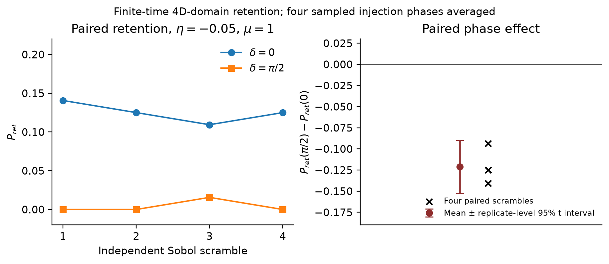

# V13.3 — предварительная проверка относительной фазы октуполя

## Назначение

Фаза инжекции `τ₀` задаёт, в какой момент RF-цикла стартует ион. Относительная фаза `δ` поворачивает октупольную бегущую гармонику относительно стоячего RF-квадруполя. Это разные параметры: в данном сравнении для каждой точки интегрировалась одна и та же четырёхточечная квадратура инжекции `τ₀={0°,90°,180°,270°}`, а менялась только `δ`.

## Парный пилот `ro_gain_negative`, `μ=1`, `N_RF=100`

Сопоставлены `δ=0` и `δ=π/2` на идеальном ведущем гармоническом поле. Использованы те же четыре независимые scrambled-Sobol реплики (seed `513217, 883391, 20261114, 941029`), те же первые 16 точек каждой реплики, одна и та же область стартов (`r₀≤7.5 mm`, равномерно по площади; `E⊥≤5 eV`, равномерно по площади скоростного диска), одинаковая апертура 8 mm, четыре равновесные фазы инжекции и один и тот же DOP853 протокол. Совпадение координат и скоростей проверено для всех пар с допуском `10⁻¹⁴` в безразмерной нормировке. Итого сопоставлено 256 запусков RO и 256 запусков Q.

| Модель | `P_ret`, δ=0 | `P_ret`, δ=π/2 | Парное изменение `π/2−0` |
|---|---:|---:|---:|
| Q | 0/256 = 0 | 0/256 = 0 | 0 статусов изменилось |
| Q+RO | 32/256 = 0.1250 | 1/256 = 0.003906 | −0.121094; 95% t-интервал по четырём парным репликам [−0.152379, −0.089809] |

По репликам RO разности `P(π/2)−P(0)` равны `−0.140625, −0.125000, −0.093750, −0.125000`. Всего 31 из 256 пар RO поменяли статус, все изменения — удержание при `δ=0` в выход при `δ=π/2`; один RO-старт удержался при обеих фазах. Для Q все 256 пар уже выходили при обеих фазах. Поскольку `Vol(D)=167.3891393 m⁴ s⁻²` одинаков для сравниваемых фаз, парная разность `A₄` равна `−20.26978 m⁴ s⁻²`, 95% интервал по репликам `[−25.50656, −15.03300] m⁴ s⁻²`. Соответствующие точечные оценки `A₄(δ=0)=20.92364` и `A₄(δ=π/2)=0.653864 m⁴ s⁻²` относятся только к подансамблю из 16 состояний на реплику.

Оценка фазы `π/2` имеет малую выборку; её обычный t-интервал для абсолютной доли может выйти за физический диапазон `[0,1]`. Поэтому для фазового эффекта основная статистика — парная разность между независимыми репликами, а не интерпретация отдельного интервала абсолютной вероятности. Результат показывает сильную фазовую чувствительность выбранной конечновременной нелинейной области, но не задаёт универсальную фазовую зависимость и не является оценкой пропускания конечного масс-фильтра.

## Симметрии и предел вывода

Алгебраически `δ→δ+π` эквивалентно `κ→−κ` при неизменных остальных параметрах. Совместные отражение координаты `y` и обращение RF-времени отображают `δ→−δ`, но также меняют ориентацию потока и начальные скорости; равенство конкретных конечных ансамблевых выборок не следует без парного преобразования стартов. Поэтому `δ=π` не следует считать независимой моделью при парном изменении знака `κ`, а `δ=3π/2` нельзя автоматически отождествить с `π/2` для произвольной несимметричной инжекции. В основном атласе зафиксировано `δ=0`; этот пилот `δ=π/2` служит отдельной проверкой фазовой чувствительности, а не четвёртым измерением атласа.

`a9_b2_e0` также рассчитан при `δ=π/2`, но для данного 4D запуска фазо- и Sobol-парный результат при `δ=0` пока ожидает завершения активного основного батча. Удельного вывода о влиянии `δ` для этой точки пока нет. Ни массовые лучи, ни основной массовый атлас не пересчитаны по `δ`.

## Воспроизводимость

Первичные манифесты и траектории находятся в `acceptance_4d_pilot_ro_gain_negative/` (`δ=0`) и `acceptance_relative_phase_pi2_N100/` (`δ=π/2`). Парная сверка создаётся `scripts/compare_v13_3_relative_phase.py`; скрипт проверяет mesh/field mode, список фаз инжекции, seeds, объёмы домена, уникальность ключей и совпадение начальных состояний. Сводка реплик строится без объединения Sobol-точек в искусственные независимые испытания. График строится `scripts/plot_v13_3_relative_phase.py`.

