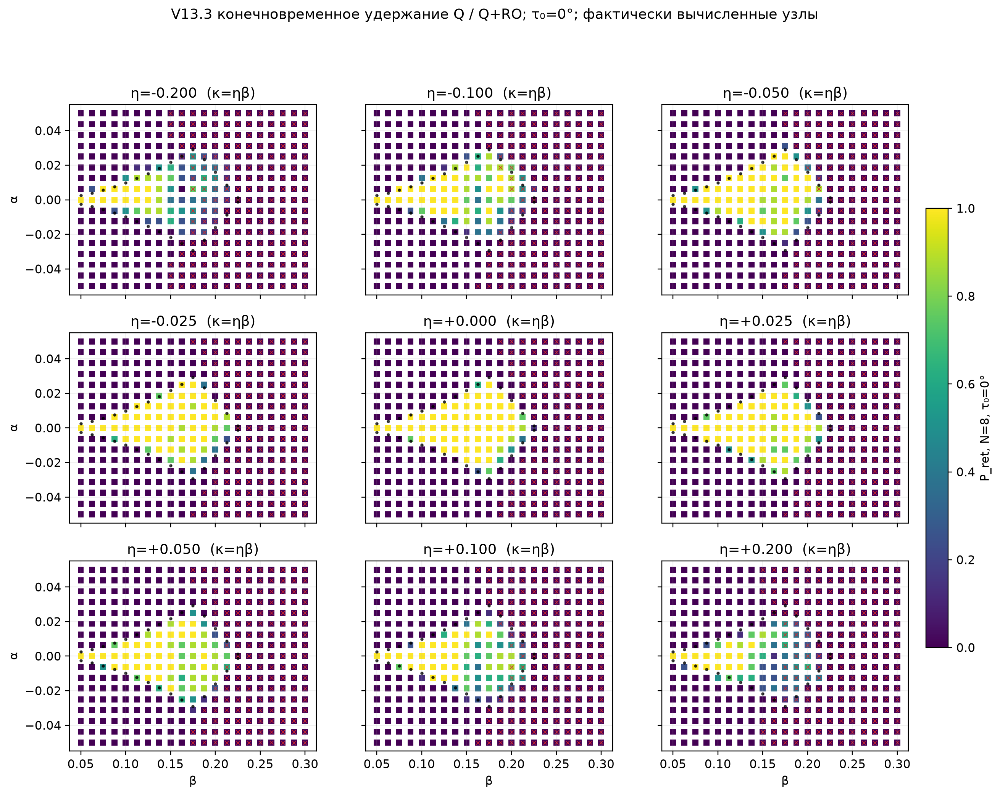

# V13.3 — итоговый научный отчёт: нелинейное удержание, массовая зависимость и 4D аксептанс

**Дата закрытия вычислений:** 16 ноября 2026 г.
**Базовый протокол:** 12 электродов; `R=8 mm`; `f=100 kHz`; `Q=+e`; `M₀=3200.0465226 Th`; `c₂=d₂=0.7718255558274`, `c₄=0.5413395699439`; допустимый пик каждого электрода `≤250 V`.
**Модели:** `Q` (RF/DC-квадруполь) и `Q+RO` (тот же квадруполь плюс вращающийся RF-октуполь). Основная относительная фаза `δ=0`. Стоячий октуполь, чистый октуполь и додекаполь в обязательное сравнение V13.3 не включались.

> **Краткий вывод.** Вращающийся октуполь не меняет линейную границу Флоке: его сила кубическая и исчезает в линеаризации около оси. Он, однако, способен заметно менять конечновременное нелинейное удержание и 4D фазовый объём. Знак изменения зависит от массы, знака и величины `κ`, амплитуды старта, RF-фазы и времени. На полном h50 P4 FEM поле для режима A9 найден широкий максимум RO аксептанса около `μ=0.85`, а парная разность RO−Q меняет знак между `μ=0.70` и `0.75`. Отрицательный gain-режим показывает обратный результат на `μ=0.70` и статистически неразрешённое различие на `μ=0.80`. Это достоверный пример **управляемой масс-зависимости поперечного удержания**, но пока не доказательство полезного масс-фильтра: конечная длина, осевое движение, края и функция передачи `T(M/Q)` не моделировались.

## 1. Итоговый ответ на научный вопрос

**Да, слабый вращающийся октуполь способен создать или сдвинуть нелинейную массовую структуру фазового объёма удерживаемых стартов. Нет, V13.3 пока не доказывает, что это даёт узкую и полезную массовую фильтрацию прибора.** Эффект не универсален: в одном и том же режиме октуполь снижает фазовый объём на нижнем массовом плече, увеличивает его на среднем, а на высоком плече разность становится статистически неопределённой. Другой луч даёт для Q преимущество при `μ=0.70`.

Линейная часть принципиальна для интерпретации: при одних `α,β` Q и Q+RO имеют одну и ту же матрицу Флоке и ту же границу устойчивости центра. Поэтому нелинейная удерживающая карта не является новой линейной диаграммой Инса–Стретта. Наблюдаемое удержание за пределом строгой линейной области — конечновременная, ансамблевая и зависящая от апертуры характеристика, а не асимптотическая устойчивость центра.

Самое сильное подтверждение физического эффекта — парный h50 FEM `A₄(M/Q)` для A9: на `μ=0.85` RO−Q равно `+0.07813` (95% интервал `[+0.04296,+0.11329]`), тогда как на `μ=0.70` оно `−0.02344` (`[−0.04102,−0.00586]`). Знак меняется между этими точками. Центральный `μ=1` независимый, более крупный ансамбль дал `+0.05664` (`[+0.04474,+0.06854]`). Все эти числа относятся к поперечному удержанию в заданном 4D домене, а не к току через конечный фильтр.

## 2. Модель, единицы и статистический протокол

Безразмерные параметры при фиксированных электродных напряжениях:

`α = Q VDC d₂ /(M Ω² R²)`, `β = Q U₂ c₂ /(M Ω² R²)`, `κ = Q U₄ c₄ /(M Ω² R²)`, `η=κ/β`.

При сканировании `μ=(M/Q)/(M₀/Q₀)` все три параметра умножаются на `1/μ`. `η` остаётся постоянным. `δ` — относительная фаза вращающегося m=4 поля к квадрупольному RF; `τ₀` — начальная фаза инжекции относительно RF. Эти фазы не взаимозаменяемы.

Основной атлас рассчитывался в идеальном ведущем гармоническом поле при `δ=0`. Конечновременная доля удержания `P_ret` определялась по выборке начальных координат/скоростей и фиксированной апертуре `ρ=1`. Для 4D физической оценки использовался общий домен `r₀≤7.5 mm`, `E⊥≤5 eV`, причём скорость границы пересчитывалась при каждой массе. Четыре RF-фазы `0°,90°,180°,270°` усреднялись внутри каждой из четырёх независимых scrambled-Sobol реплик; 95%-ные интервалы строились по четырём репликатным средним (Student-t, 3 степени свободы), а Q и RO сравнивались парно. Неразрешённых исходов в закрытых FEM батчах не было.

Размерность 4D фазового объёма: `A₄ = P_ret·Vol(D)`, единицы `m⁴·s⁻²`; безразмерное значение `a₄=A₄/(R⁴Ω²)`. Это объём области входных условий, прошедших условие удержания до выбранного времени. Без распределения реального источника он не равен ионному току.

## 3. Трёхпараметрический атлас и линейный контроль

Первичная вычисленная сетка содержит 17×21 значений `(α,β)` и девять уровней `η={−0.20,−0.10,−0.05,−0.025,0,+0.025,+0.05,+0.10,+0.20}`: **3 213 уникальных узлов**, при этом Q на `η=0` не дублировался по другим срезам. Использованы две фазы инжекции, по восемь общих стартов, `N_RF=100`; итого **51 408** расчётов, `unresolved=0`. Дополнительный адаптивный набор содержит **43 520** уникальных отрезков/исходов и длинные продолжения выбранных режимов до 300 и 1 000 RF.

Линейный контроль рассчитан для обеих координат Флоке на **357** узлах `(α,β)`: 63 строго устойчивы и 294 не относятся к внутренности строго устойчивой области; определение границ не сводилось к одному условию `|tr M|=2`. Максимальные ошибки `|det M−1|`: `4.60×10⁻¹²` для x и `7.56×10⁻¹²` для y. Для Mathieu-конвенции V13: `aₓ=8α`, `qM,ₓ=−4β`, `aᵧ=−8α`, `qM,ᵧ=+4β`. Октуполь не входит в линейный якобиан, поэтому Q и RO имеют совпадающие границы.

В идеальном конечновременном атласе есть примеры удержания Q+RO вне строгой линейной области. Например, A9 (`α=0.00625, β=0.075, κ=−0.015`, `η=−0.20`) имеет строго неустойчивый Floquet-центр и Q теряет весь компактный ансамбль; RO при фазе инжекции 0° удерживает `100%` на 100 и 300 RF и `98.83%` на 1 000 RF (95% репликатный интервал `[97.585%,100%]`). В том же протоколе при `τ₀=90°` RO удерживает 90.63% на 100 RF и 85.94% на 300 RF. Это сильный идеальный нелинейный эффект, но он относится к малому компактному домену `(xρ,yρ)∈[−0.25,0.25]`, `(vxρ′,vyρ′)∈[−0.04,0.04]`; перенос на широкую физическую 4D область и длинный горизонт гораздо слабее.

По физической маске напряжений **1 699 из 3 213 (52.88%)** узлов достижимы при `≤250 V` для опорного протокола. Например, для A9 максимум мгновенного напряжения равен `111.434 V`; для отрицательного gain-луча — `144.422 V` с RO и `135.714 V` у чистого Q. Математические узлы сверх ограничения оставлены в идеальном атласе, но не интерпретируются как физически доступные для заданного оборудования.

Срезы и реконструированные 3D-изоповерхности надо читать по исходным узлам: интерполяционные поверхности помечены как визуализация, а не как дополнительные вычисленные решения. Таблицы и описание — [THREE_PARAMETER_STABILITY_RU.md](THREE_PARAMETER_STABILITY_RU.md), [PHYSICAL_FEASIBILITY_RU.md](PHYSICAL_FEASIBILITY_RU.md).

## 4. FEM: коэффициенты, разрешение и модельная погрешность

Повторное геометрическое построение не выполнялось. Совместно использованы сохранённые h50 P4 решения для m=4 и m=2 на общей геометрии; отдельно решён недостающий m=2 базис на сохранённой h35 сетке. При восстановлении поля соблюдены Bloch-фазы, заземлённый корпус, `G4c=Re(H4)`, `G4s=−Im(H4)`, `G2=Re(H2)`. Получено `c₂=d₂=0.7718255558274`, `c₄=0.5413395699439`; на h35 отличие от h50 для c₂ составляет 2.4×10⁻⁵ относительно, для c₄ — 3.7×10⁻⁵. Нормированная проекционная фаза ведущих гармоник меньше `2×10⁻¹⁰ rad`.

Высшие гармоники не малы у апертуры: RMS остаток гармоник m≠ведущей для потенциала на `ρ=0.9` составляет 3.74% относительно ведущего m=2 и 21.6% относительно m=4. RMS разность ускорения полного FEM и ведущих идеальных гармоник на точках до `ρ=0.25,0.40,0.60,0.90` равна соответственно `2.3×10⁻⁵`, `4.0×10⁻⁴`, `5.8×10⁻³`, `7.8×10⁻²`. Поэтому идеальный атлас годится для поиска структуры, но количественный A₄ около апертуры требует полного поля.

На траекторных контролях сетки h50/h35 совпали в **2 038 из 2 048** общих классификаций; 10 крайних исходов остались сеточно-чувствительными даже после строгого шага, и их не переклассифицировали как интеграторные ошибки. В другой проверке на N=100 совпали 128/128, на N=300 выявлен один mesh-sensitive исход из 40. Согласие сеток подтверждает общую тенденцию, но не отменяет влияние высших гармоник: в A9 на μ=1 идеальная модель давала `P_RO=0.2402`, а h50 и h35 FEM — `0.0645` и `0.0625`.

Подробнее: [FEM_VALIDATION_RU.md](FEM_VALIDATION_RU.md), включая hashes исходных решений, контроль суперпозиции и residual-таблицы.

## 5. Mass-зависимый 4D FEM результат для A9

Для A9 абсолютный h50 FEM `A₄(RO)` достигает наибольшего из измеренных значений при `μ=0.85`: `18.462 m⁴·s⁻²` (95% ДИ `[11.538,25.386]`), `P_RO=9.375%` `[5.859%,12.891%]`, против `P_Q=1.563%` (репликатный интервал для доли включает ноль). Парная разность `ΔP=+7.813` процентного пункта `[+4.296,+11.329]`; соответствующая `ΔA₄=+15.385 m⁴·s⁻²` `[+8.461,+22.309]`. При `μ=0.75` RO уже имеет `P=7.422%`, Q `5.859%`, и `ΔP=+1.563` п.п. `[+0.547,+2.578]`. При μ=0.70 знак обратный: Q `7.031%`, RO `4.688%`, `ΔP=−2.344` п.п. `[−4.102,−0.586]`. При μ=0.55 разность равна `−7.422` п.п. `[−11.151,−3.692]`; при μ=0.50 `−9.766` п.п. `[−13.495,−6.036]`.

Центральный более крупный ансамбль на μ=1 (32 состояния на реплику) даёт `P_Q=0.781%`, `P_RO=6.445%`, `ΔP=+5.664` п.п. `[+4.474,+6.854]` на 100 RF. На 300 RF эта разность снижается до `+2.344` п.п. `[+0.074,+4.613]`; на 1 000 RF средняя разность `+0.781` п.п., но интервал `[−0.234,+1.796]` содержит ноль. В абсолютных долях RO превосходит Q на этих длинных временах, но статистически надёжный долгосрочный прирост для широкого фазового объёма на 1 000 RF не показан.

На верхнем массовом плече A9 средняя `A₄(RO)` спадает: `10.462` при μ=1.00, `5.686` при 1.15, `3.662` при 1.25 и `2.422` при 1.35 `m⁴·s⁻²`. Парная разность RO−Q на 1.25 и 1.35 ещё положительна с интервалом, но на 1.15 интервал уже включает ноль. Значения на μ≥1.45 малы и их интервалы также включают ноль. Это ограничивает наличие широкой RO-поддерживаемой области, однако **не доказывает узкую FWHM-полосу**.

В момент подготовки этой версии отчёта выполняется последний заранее запущенный h50 FEM батч A9 (`μ=0.60,0.85,1.05,1.15`, по 64 старта на реплику, N=100), который уточняет нижнюю границу, пик и верхний склон A₄. До его проверки никакое численное `FWHM`/`Rₘ` не следует цитировать как установленный результат. По имеющимся точкам половина максимума лежит между μ=0.55 и 0.65 на нижнем склоне и между μ=1.00 и 1.15 на верхнем; это лишь предварительное ограничение, не финальная ширина.

## 6. Второй полный FEM масс-срез: отрицательный gain-луч

Для `ro_gain_negative` заданы `α₀=+0.0125`, `β₀=0.1125`, `κ₀=−0.005625` (`η=−0.05`), `U₂=122.1429 V`, `V_DC=13.5714 V`, `U₄=−8.7074 V`; максимальный пик электрода 144.422 V, ниже 250 V.

При `μ=0.70`, N=100: `P_Q=7.031%` `[4.545,9.518]`, `P_RO=4.297%` `[1.916,6.677]`, `ΔP=−2.734` п.п. `[−5.115,−0.354]`; `A₄(RO)=10.275 m⁴·s⁻²` `[4.583,15.967]`. При μ=0.80: `P_Q=6.250%`, `P_RO=6.641%`, `ΔP=+0.391` п.п. `[−1.990,+2.771]`, то есть отличие не разрешено. При μ=1.20, 1.30 и 1.40 в Sobol-выборке из 256 стартов на модель/массу/набор фаз ни один старт не был удержан. Нулевой эмпирический счёт ограничивает измеренную долю для данной выборки, но не исключает редкую область удержания.

Это отрицательный контроль против универсального заявления о выигрыше RO: знак зависит от параметров и массы. Воспроизводимые таблицы и графики — [acceptance_4d_fem_h50_gain_negative_mass_N100](acceptance_4d_fem_h50_gain_negative_mass_N100/).

## 7. Сводная ведомость выполненных расчётов

| Блок | Выполнено | Результат/статус | Ограничение |
|---|---|---|---|
| Аналитика/линейный контроль | Mathieu-параметры и Floquet для x,y; 357 узлов; контроль `det M` | Q и RO имеют одинаковую линейную границу | Октупольная нелинейность отсутствует в линейном пределе |
| Идеальный 3D атлас | 3 213 уникальных узлов, 51 408 траекторий, 2 RF-фазы | Вычисленный конечновременный массив; `unresolved=0` | 8 стартов/узел; не асимптотическая карта |
| Адаптивные режимы | 43 520 уникальных записей/сегментов, отдельные горизонты 100/300/1000 | Выявлены нелинейные режимы удержания за Floquet-границей | Компактный стартовый домен; не full-FEM широкая эмиттанс |
| FEM-базисы и физическая маска | h50 m=2/m=4, h35 контроль m=2, коэффициенты и электродные пики | Совместимость подтверждена; 1 699/3 213 узлов укладываются в 250 V | Около апертуры высшие гармоники значимы |
| FEM A₄ на μ=1 | A9 и gain-узел; h50/h35, пары Q/RO | Знак `ΔA₄` положительный на 100 RF для выбранных точек на обеих сетках | 10/2 048 классификаций сеточно-чувствительны; длинный горизонт ослабляет A9 эффект |
| A9 FEM mass edges | μ=.50,.55,.85,1.00,1.15,1.45,1.50,1.55; N=100 | Установлен переход от Q-преимущества к RO-преимуществу по μ | Грубые края, малый n на большинстве узлов |
| A9 FEM adaptive masses | μ=.65,.70,.75,1.25,1.35,1.65,1.80; N=100 | Узкий переход знака локализован между .70 и .75; RO среднее остаётся выше на части высоких масс | Верхний хвост мал и часто незначим |
| `ro_gain_negative` FEM mass scan | μ=.70,.80,1.20,1.30,1.40; 2 560 траекторий | Q достоверно лучше при .70; .80 неразрешено; выше наблюдались нулевые счета | Не исключены редкие старты |
| Low-μ идеальные компактные mass scans | 2 луча, μ=.60–.85 шаг .01; по 13 312 траекторий на луч | Немонотонные провалы и прирост RO по μ | Не FEM; компактный домен; не доказанные резонансы |
| A9 FEM width refinement | μ=.60,.85,1.05,1.15; 64 старта/реплику | Выполняется/сводится отдельно; данные сохраняются с checkpoint | Итоговая ширина публикуется только после валидатора |
| 4D аксептанс и trade-off | Идеальный и полный h50 FEM; Q/RO парно | A₄ связывает массу с фазовым объёмом | Не моделирует конечную длину и реальное распределение источника |
| Передача конечного фильтра | Не выполнялась | `T(M/Q)` не получена | Нужны осевая скорость, длина, вход/выход и краевые поля |
| Резонансы/хаос/Ляпунов | Не выполнялись в этой программе | Ни резонанс, ни хаос не заявляются | Следующая отдельная программа |

## 8. Научная новизна и границы утверждений

Добавление октупольной компоненты к квадрупольным масс-фильтрам уже исследовалось: Ding, Konenkov и Douglas моделировали/измеряли 2–4% добавленного **статического пространственного** октуполя, включая сильную зависимость разрешения от полярности DC ([статья 2003 года](https://pubmed.ncbi.nlm.nih.gov/14608619/), DOI `10.1002/rcm.1235`). Октупольные поля и масс-селективное возбуждение линейных квадруполей также изучались в контексте эжекции и ловушек ([статья JASMS 2008](https://www.sciencedirect.com/science/article/pii/S1044030507009634), DOI `10.1016/j.jasms.2007.10.025`). Существуют и более ранние патентные заявки на multipole mass filter с вращающимся электрическим полем ([US7183545B2](https://patents.google.com/patent/US7183545B2/en)). Поэтому формулировки «первое сочетание квадруполя и октуполя» или «первый rotating-field mass filter» недопустимы. Работы по rotating-RF traps также давно описывают вращающиеся мультипольные поля и возможное содержание октупольной гармоники ([Hasegawa & Bollinger, PRA 72, 043403](https://tf.boulder.nist.gov/general/pdf/2072.pdf)). Недавняя литература продолжает связывать высшие гармоники и геометрию QMF с откликом устойчивости/разрешения ([Jana et al., JASMS 2026](https://pubmed.ncbi.nlm.nih.gov/41403188/)).

Предполагаемый отличительный аспект V13.3 уже: управляемая вращающаяся m=4 RF-компонента, заданная по фазе относительно стоячих m=2 RF/DC-полей в 12-электродной геометрии, и её влияние на нелинейный конечновременной 4D фазовый объём на полном P4 FEM-поле. Получены воспроизводимые примеры смены знака RO−Q с массой и широкого максимума A₄. Но при данном объёме проверки научная новизна остаётся **кандидатной**, приоритет не установлен полным обзором; нет измеренной передачи прибора, не показано улучшение относительно оптимизированного Q, не проверено преимущество перед стоячим октуполем и не исследован механизм предполагаемых массовых провалов спектрами или показателями Ляпунова.

Статья может заявлять как результат «парная FEM-QMC демонстрация массозависимого изменения поперечного A₄ при управляемой фазе октупольной гармоники», если после закрытия уточняющей выборки сохранится ширина/смена знака. Она не должна заявлять «доказано повышение разрешения масс-фильтра» без модели конечного устройства и равных ограничений/оптимизации Q.

## 9. Проверки, воспроизводимость и численная сходимость

Закрывающий набор тестов V13.3: **12 passed** (`test_v13_3_physical.py`, `test_v13_3_mass_fwhm.py`, `test_v13_3_atlas.py`, `test_v13_3_4d_acceptance.py`). Отдельный валидатор gain-negative подтвердил 2 560 уникальных траекторий, 1 280 Q/RO пар, идентичные стартовые условия, `unresolved=0`, покрытие масс и согласованность `A₄`, `a₄`. Исходные seeds, сеточные hashes, solver settings и начальные состояния лежат в manifests и CSV соответствующих расчётных каталогов. DOP853: `rtol=2×10⁻¹⁰`, `atol=2×10⁻¹²`, `max_step=2π/64` для основных FEM батчей.

Основные ограничения неопределённости: четыре scrambled-Sobol реплики — малое число репликатных средних; около нулевой доли интервал может быть вырожденным, если все четыре реплики не нашли событие; редкие области удержания могут быть пропущены. Поэтому слова «ноль» в отчёте означают нулевой эмпирический счёт при указанном протоколе, а не теорему о нулевой мере.

Подробные методики и исходные таблицы доступны в [NUMERICAL_VALIDATION_RU.md](NUMERICAL_VALIDATION_RU.md), [FOUR_DIMENSIONAL_ACCEPTANCE_RU.md](FOUR_DIMENSIONAL_ACCEPTANCE_RU.md), [MASS_SELECTIVITY_RU.md](MASS_SELECTIVITY_RU.md) и манифестах расчётных каталогов.

## 10. Оставшиеся вопросы и рациональный следующий этап

1. Завершить и валидировать уже запущенный h50 уточняющий батч A9, сохранить его checkpoint и только после этого оценить FWHM широкого `A₄(μ)` с неопределённостью. Такое значение следует называть условным разрешением профиля A₄, а не разрешением масс-спектрометра.
2. Для проверки именно фильтра задать `L`, продольную скорость/распределение, инжекционную эмиттанс-область и краевые поля; сначала рассчитать конечное время пролёта, затем оценить продольные FEM края. Лишь тогда строить `T(M/Q)`.
3. Оптимизировать Q отдельно при том же 250 V ограничении и сопоставить его с лучшими RO режимами на одинаковом времени/ансамбле.
4. Если интересна причина массового немонотонного отклика, отдельно исследовать частоты/амплитуды и периодические орбиты. До этого не называть провалы резонансами и не интерпретировать их как хаос.
5. Выполнить литературный обзор вращающихся RF multipoles и патентного поля до заявления о первенстве.

V13.3 тем самым даёт обоснованную отправную точку для следующей работы: выбрать режимы около `μ≈0.75–0.90` на A9 для компромисса `A₄`/массовый контраст и сохранить `μ≈0.65–0.70` как область, где октуполь ухудшает удержание и может быть полезен только если требуется подавление этой стороны массы. Решение о приборной полезности требует конечной длины и оптимизированного Q контроля.
