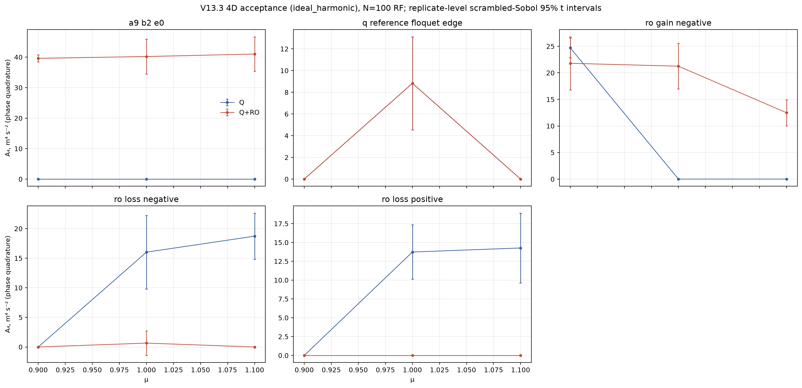

# V13.3 — совместная оценка масс-зависимого удержания и A₄ (пилот N=100)

## Протокол

Выполнен полный пилот по пяти выбранным физически допустимым лучам и `μ={0.9,1.0,1.1}`. Для каждой пары «режим–масса» использовались 32 scrambled-Sobol старта в каждой из четырёх независимых реплик, четыре фазы инжекции `τ₀={0°,90°,180°,270°}`, общие координаты и скорости для Q и Q+RO. Всего 15 360 уникальных траекторий: 7 680 пар Q/RO, N=100 RF-периодов. Неразрешённых исходов нет. Интегратор — DOP853 (`rtol=2×10⁻¹⁰`, `atol=2×10⁻¹²`, `max_step=2π/64`), идеальные ведущие гармоники, `δ=0`, апертура `ρ=1`.

Начальный четырёхмерный домен: равномерный по площади диск `r₀≤7.5 mm` и равномерный по площади скоростной диск с `E⊥≤5 eV` при каждой массе. Поэтому `A₄=P_ret×Vol(D)`, но `Vol(D)` зависит от `μ`: 185.9879, 167.3891 и 152.1719 `m⁴ s⁻²` для 0.9, 1.0 и 1.1. Безразмерный аксептанс `a₄=A₄/(R⁴Ω²)` сохранён в исходной таблице. Интервалы рассчитываются по четырём независимым средним Sobol-реплик; пары не объединяются в псевдо-независимую биномиальную выборку.

## Результаты по массе

В таблице `ΔP` — парная Q+RO−Q разность, а CI — 95% t-интервал по четырём парным репликам. `A₄(Q)` и `A₄(Q+RO)` даны в `m⁴ s⁻²`. Нулевой Q-аксептанс оставляет отношение `A₄(Q+RO)/A₄(Q)` неопределённым, а не бесконечным.

| Узел | μ | P(Q) | P(Q+RO) | ΔP, 95% CI | A₄(Q) | A₄(Q+RO) |
|---|---:|---:|---:|---:|---:|---:|
| A9, η=−0.20 | 0.9 | 0.0000 | 0.2129 | 0.2129 [0.2067, 0.2191] | 0.00 | 39.60 |
| A9, η=−0.20 | 1.0 | 0.0000 | 0.2402 | 0.2402 [0.2060, 0.2745] | 0.00 | 40.21 |
| A9, η=−0.20 | 1.1 | 0.0000 | 0.2695 | 0.2695 [0.2322, 0.3068] | 0.00 | 41.02 |
| Floquet reference, η=0 | 0.9 | 0.0000 | 0.0000 | 0 | 0.00 | 0.00 |
| Floquet reference, η=0 | 1.0 | 0.0527 | 0.0527 | 0 | 8.83 | 8.83 |
| Floquet reference, η=0 | 1.1 | 0.0000 | 0.0000 | 0 | 0.00 | 0.00 |
| Gain, η=−0.05 | 0.9 | 0.1328 | 0.1172 | −0.0156 [−0.0522, 0.0210] | 24.70 | 21.80 |
| Gain, η=−0.05 | 1.0 | 0.0000 | 0.1270 | 0.1270 [0.1013, 0.1526] | 0.00 | 21.25 |
| Gain, η=−0.05 | 1.1 | 0.0000 | 0.0820 | 0.0820 [0.0660, 0.0981] | 0.00 | 12.48 |
| Loss, η=−0.05 | 0.9 | 0.0000 | 0.0000 | 0 | 0.00 | 0.00 |
| Loss, η=−0.05 | 1.0 | 0.0957 | 0.0039 | −0.0918 [−0.1289, −0.0547] | 16.02 | 0.65 |
| Loss, η=−0.05 | 1.1 | 0.1230 | 0.0000 | −0.1230 [−0.1487, −0.0974] | 18.72 | 0.00 |
| Loss, η=+0.10 | 0.9 | 0.0000 | 0.0000 | 0 | 0.00 | 0.00 |
| Loss, η=+0.10 | 1.0 | 0.0820 | 0.0000 | −0.0820 [−0.1036, −0.0605] | 13.73 | 0.00 |
| Loss, η=+0.10 | 1.1 | 0.0938 | 0.0000 | −0.0938 [−0.1242, −0.0633] | 14.27 | 0.00 |

## Интерпретация и границы вывода

- В широкой физической области стартов `a9_b2_e0` создаёт заметный RO-аксептанс на всех трёх опробованных массах, где Q-ансамбль дал ноль удержаний. Q/RO отношение A₄ здесь не определено. Это конечновременное нелинейное удержание идеальной модели, не доказательство узкой масс-полосы.
- На `ro_gain_negative` RO даёт положительное парное изменение около μ=1 и 1.1, но у μ=0.9 парная разность совместима с нулём и средний аксептанс даже меньше Q. Значит, знак изменения зависит от участка массового луча.
- Два подавляющих узла дают статистически разрешённое уменьшение A₄ около μ=1–1.1. Дополнительный октуполь может быть настроечным средством подавления выбранной области масс, одновременно снижая доступный фазовый объём целевой частицы.
- Контроль при `κ=0` совпадает для Q и RO по построению и служит регрессионной проверкой сводчика; он не добавляет независимый физический режим.
- На этой сетке нет ограниченного пика A₄ по обе стороны. FWHM, разрешение и отношение селективности к аксептансу не рассчитывались.
- Для выбранных точек остаётся обязательна прямая проверка на полном h50 P4; отдельные малые FEM-срезы уже показали чувствительность удержания к высшим гармоникам. Никакая строка таблицы не является экспериментальным пропусканием конечной длины.

## Воспроизводимость

Полная таблица траекторий и входов: `acceptance_4d_core_N100/trajectory_results.csv`, `initial_conditions.csv`, `manifest.json`. Репликатные сводки, парные разности и графики хранятся в той же папке. `scripts/validate_v13_3_4d_acceptance.py --directory acceptance_4d_core_N100 --horizon 100` проверяет 15 360 уникальных ключей, 7 680 пар, общие стартовые условия, объёмные преобразования и сводные таблицы.

## Условная массовая полоса A9 в компактном старте

Расширенный N=100 скан A9 в малом стартовом квадрате показывает широкое плато RO около 0.94, ограниченное грубо ниже μ≈0.50…0.55 и выше μ≈1.45…1.50; Q имеет высокий retention на низкой стороне и нулевой около μ≥0.90. Этот кандидат выглядит ограниченным по половинному уровню только для данного компактного ансамбля. 4D-аксептанс на физическом диске координат/энергии около μ=1 гораздо меньше; перенос ширины на реальный входной фазовый объём пока не обоснован. FWHM отложен до уточнения краёв и увеличения выборки.

## FEM-контроль 4D фазового объёма

На полном h50/h35 P4 поле идеальные оценки A₄ на двух выбранных gain-точках сильно уменьшились, но на обоих mesh сохраняется положительный парный RO−Q эффект около `ΔP=0.057` при μ=1. На A9 идеальное Q+RO удерживает 24.0% широкого физического домена, а h50/h35 — около 6.3–6.4%; на `ro_gain_negative` — 12.7% в идеале и около 7.0–7.4% на FEM. Характерный эффект переживает смену h50→h35, но индивидуальные статусы могут различаться; 10/2 048 совпадающих FEM запусков поменяли статус. Поэтому FEM-подтверждение поддерживает наличие ненулевого эффекта на этих двух режимах, но отвергает перенос абсолютных значений идеальной модели на 12-электродную геометрию.

Данные сравнения и валидатор добавлены в `acceptance_4d_fem_comparison_N100/` и `scripts/compare_v13_3_4d_fields.py`. Поле проверено на одном и том же четырёхмерном входном объёме; это всё ещё поперечное удержание конечного времени, а не приборная передача.

### Дополнительная проверка полного поля для A₄

На h50 и h35 P4 FEM-полях в двух точках при μ=1, N=100 Q+RO сохранил прирост фазоусреднённого 4D удержания относительно Q `+0.05664` на общей широкой области стартов. Для A9 95%-интервалы по независимым парным Sobol-репликам: h50 `[+0.04474,+0.06854]`, h35 `[+0.03101,+0.08227]`; для `ro_gain_negative`: h50 `[+0.04100,+0.07228]`, h35 `[+0.04474,+0.06854]`. При этом абсолютная доля RO на A9 составляет только 6.25–6.45%, то есть существенно ниже идеальных 24.02%; высокий порядок поля важен для абсолютного аксептанса. Десять из 2 048 h50/h35 пар остаются сеточно-чувствительными и не разрешились при ужесточении интегратора. Эти данные подтверждают локальный эффект выбранных режимов, но пока не задают массовую ширину или транспортную эффективность фильтра.

### Масс-зависимый фазовый объём на полном FEM-поле

На физическом 4D домене полный h50 P4 A9 узел показывает Q+RO `P_ret=0.1016,0.0645,0.0527` при μ=`0.9,1.0,1.1`, тогда как Q даёт `0.0215,0.0078,0.0020` на N=100. Парная разность RO−Q статистически различима при μ=0.9 и 1.0, но не при μ=1.1. При N=300 различие остаётся различимым на μ=0.9, а на μ=1.1 интервал пересекает ноль. Для gain-точки `ro_gain_negative` положительный эффект локален около μ=1 и не подтверждён на краях 0.9/1.1. Эти выборки фиксируют зависимость баланса аксептанс/масса, но не показывают разрешённый с двух сторон пик и не определяют условное массовое разрешение. Сравнивать здесь следует Q и Q+RO на парных стартах; нельзя переводить фазовый объём непосредственно в ток или конечную приборную передачу.
