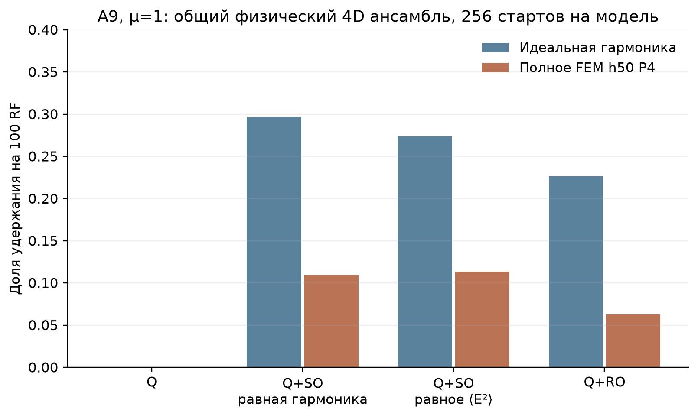

# V14. Сопоставление Q, SO и RO в точке A9

## Модель и физическая нормировка

Время `τ=Ωt`, координаты `x=X/R`, `y=Y/R`, `R=8 mm`, `f=100 kHz`, `M₀=3200.04652261404 Th`, `Q=+e`. Для A9 при `μ=1`: `α=0.00625`, `β=0.075`, `κ=−0.015`. Общий квадруполь во всех сравнениях одинаков:

`V_Q=(α+β cos τ) Re(z²)`, `z=x+iy`.

Вращающийся октуполь при относительной фазе `δ`: `V_RO=κ Re[z⁴ exp(−i(τ−δ))]`. Стоячий контроль: `V_SO=κ_SO Re(z⁴) cos(τ−δ)`. SO содержит **одну** пространственную RF-квадратуру; изменение `δ` у RO не превращает его в SO.

Использованы две отдельно помеченные нормировки: (i) `κ_SO=κ_RO`, одинаковая ведущая пространственная амплитуда; (ii) `κ_SO=√2 κ_RO`, одинаковое усреднённое по RF-периоду `|E₄|²` при каждом `r`. Действительно, `⟨|E₄|²⟩=16κ_RO²r⁶` для RO и `8κ_SO²r⁶` для SO. При второй нормировке октупольное напряжение на электродах больше в `√2` раза; питание Q остаётся тем же.

Реальные напряжения, полученные из сохранённых FEM-коэффициентов `c₂=d₂=0.7718255558274212`, `c₄=0.5413395699439091`: `U₂=81.42857 V`, `V_DC=6.78571 V`, `U₄(RO)=−23.21968 V`, `U₄(SO, equal RMS)=−32.83757 V`. Пиковые модули отдельных электродов: Q `88.2143 V`, RO и SO с равной гармоникой `111.4340 V`, SO с равной интенсивностью `121.0519 V`. Все четыре схемы ниже ограничения `250 V`; подробные 12-электродные строки в `electrode_voltage.csv`. Отрицательный знак κ означает относительную фазу `π`, а не смену знака массы или заряда.

## Парный физический 4D ансамбль, N=100 RF

Четыре независимых scrambled-Sobol реплики по 16 состояний, четыре одинаковые фазы инжекции `τ₀=0, π/2, π, 3π/2`: 256 одинаковых стартов на модель. Положения равномерны по площади диска `r₀≤7.5 mm`; скорости равномерны по площади скоростного диска при `E⊥≤5 eV`. Апертура `r<R`. Физические координаты и скорости Q/RO взяты из V13.3; SO рассчитан заново. Исходные Q/RO строки, хеши и параметры находятся в `../mass_filter_v13/v13_3_three_parameter_atlas/acceptance_4d_fem_h50_selected_N100/`. V14 скрипт проверяет совпадение всех 512 старых Q/RO ключей с новыми стартами до `10⁻¹³`.

| Поле | Q | SO, равная гармоника | SO, равная ⟨E²⟩ | RO |
|---|---:|---:|---:|---:|
| Идеальная ведущая гармоника | 0/256 | 76/256 = 29.69% | 70/256 = 27.34% | 58/256 = 22.66% |
| Полное h50 P4 FEM | 0/256 | 28/256 = 10.94% | 29/256 = 11.33% | 16/256 = 6.25% |

На полном FEM парная разность RO−Q `+6.25` процентного пункта; 95%-й t-интервал по четырём **парным репликам** `[+4.22,+8.28]` п.п. Для RO−SO при равной гармонике разность `−4.6875` п.п., интервал `[−6.718,−2.657]` п.п. При равной средней интенсивности разность `−5.0781` п.п., интервал `[−10.953,+0.797]` п.п., то есть знак ещё статистически не разрешён на четырёх репликах. Интервалы характеризуют вариацию независимых Sobol-скремблирований внутри **заданного** 4D домена, а не весь возможный инжекционный поток.

Это прямой отрицательный контроль гипотезы об уникальном преимуществе вращения в точке A9 на горизонте 100 RF. Оба октупольных поля обеспечивают конечновременное удержание при линейно неустойчивом центре; стоячий контроль с равной гармоникой здесь удерживает больше. Значительное падение абсолютных долей от идеальной модели к FEM показывает необходимость полного поля даже при одинаковых ведущих коэффициентах.

## Граница интерпретации

Результат относится к одному рабочему режиму, одному физическому 4D домену и конечному времени. Он не означает, что SO глобально лучше RO при иных массах, фазах, эмиттансах или оптимизации напряжений. `P_ret` — поперечное удержание, не приборная передача и не разрешение масс-фильтра. Исходные парные значения и интервалы: `fem_so_paired_summary.csv`, `fem_so_replicates.csv`, `ideal_pilot_paired_summary.csv`.
