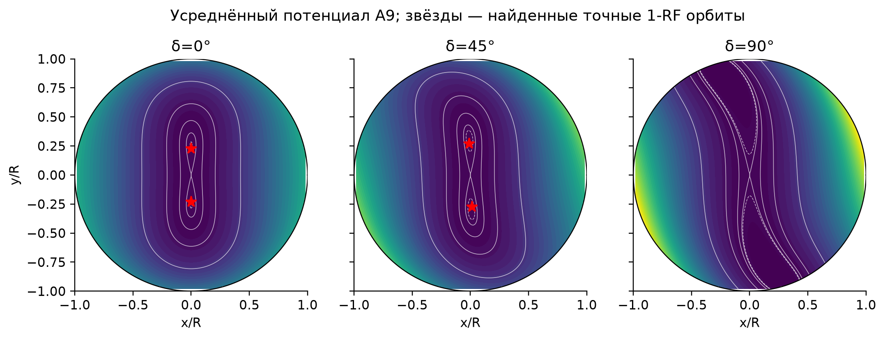

# V14. Внеосевые периодические орбиты A9 за линейной границей Флоке

## Линейный центр и механизм

При `α=0.00625`, `β=0.075`, `μ=1` линейные матрицы **идеального Q** имеют следы `tr Mₓ=1.0972973230`, `tr Mᵧ=2.0563081775` и детерминанты, близкие к единице. Центр строго неустойчив по y. Октупольная сила кубическая и не меняет эту линеаризацию для SO и RO. У **идеального** Q нет ненулевой 1-RF орбиты: отображение линейно, а `M−I` обратимо, поскольку ни один след не равен 2. Полный FEM квадрупольный базис содержит высшие гармоники и рассматривается отдельно ниже.

Независимый поиск стационарных точек ведущего RF-псевдопотенциала при `δ=0` дал два симметричных минимума по y: RO `y≈±0.258398`, SO при равной гармонике `±0.260874`, SO при равной средней `|E₄|²` `±0.219368`. Это **минимумы усреднённой модели**, а не доказательство орбит. Их использовали лишь как стартовые приближения для shooting в полном периодическом поле.

## Найденные 1-RF решения точной идеальной модели

При фазе инжекции `τ₀=0` найдены две связанные инверсией орбиты в каждой октупольной схеме. Для положительного y начальное состояние `z=(x,y,x′,y′)` и максимальный радиус внутри одного RF-периода:

| Модель | `z(0)` | `max r/R` | Модули четырёх мультипликаторов |
|---|---|---:|---|
| RO | `(0, 0.2284756482, 0.0011108947, 0)` | 0.310677 | четыре ≈1 |
| SO, равная гармоника | `(0, 0.2308798315, 0, 0)` | 0.314004 | четыре ≈1 |
| SO, равная ⟨E²⟩ | `(0, 0.1941460226, 0, 0)` | 0.263484 | четыре ≈1 |

Для RO мультипликаторы составляют `0.543581829±0.839356179i` и `0.941661515±0.336561423i`. Норма невязки замыкания `≈1.1×10⁻¹¹`, дефект симплектичности `≤1.5×10⁻¹⁵`. У SO при равной гармонике аналогичные пары `0.544442729±0.838798018i`, `0.942745874±0.333511943i`. Они не совпадают с ±1 и лежат на единичной окружности в численной точности. Значит, найденные орбиты **линейно эллиптические**; это не равносильно доказанной асимптотической устойчивости произвольного окружающего 4D объёма.

## Полное FEM h50/h35

Локальный shooting независимо выполнен на сохранённых полных P4 FEM базисах и геометриях h50 и h35. Одни и те же реальные `U₂`, `V_DC`, `U₄` заданы через FEM коэффициенты. Для положительной RO-орбиты:

| Поле | `y(0)` | `x′(0)` | `max r/R` | Невязка замыкания | Дефект симплектичности |
|---|---:|---:|---:|---:|---:|
| h50 | 0.2275805730 | 0.0010942528 | 0.309446 | `2.4×10⁻¹²` | `8.3×10⁻⁸` |
| h35 | 0.2275595584 | 0.0010939990 | 0.309419 | `1.2×10⁻¹²` | `1.5×10⁻⁷` |

Для SO с равной гармоникой `y(0)=0.2298649837` (h50) и `0.2298434433` (h35); для SO с равной средней интенсивностью `0.1937403963` и `0.1937220846`. Во всех шести FEM решениях максимальный модуль мультипликатора `1+O(10⁻⁸)` при дефекте численной симплектичности порядка `10⁻⁷`; матрица вычислена центральными разностями потока с шагами `10⁻⁶` и `5×10⁻⁷`, так что отклонения `10⁻⁸` не являются доказанной физической экспоненциальной неустойчивостью. Разница положения RO-центра h50−h35 всего `2.10×10⁻⁵ R`, то есть `0.168 μm`.

## Важный контроль: внеосевая орбита даже у Q на полном FEM

При запуске полного h50 квадрупольного поля из окрестности RO-орбиты часть траекторий осталась внутри апертуры 300 RF, несмотря на уход того же старта за `≈8.278 RF` в идеальном Q. Локальный shooting нашёл внеосевую 1-RF орбиту **самого полного Q поля** при `y(0)=0.5420515773 R` (h50), `0.5420339114 R` (h35), с `max r≈0.7343 R`. Невязка замыкания `≤8.7×10⁻¹¹`. Мультипликаторы близки к двум разным парам на единичной окружности (`≈0.6431±0.7658i`, `≈0.7770±0.6295i`); дефект симплектичности конечно-разностной h50 матрицы `4.3×10⁻⁵`, h35 `2.4×10⁻⁶`. Это кандидат на линейно эллиптическую FEM орбиту; точность h50 монодромии возле большого радиуса нуждается в дальнейшем уточнении.

Проверена конкретная причина. V13 FEM-проекция единичного Q базиса при `r=6 mm` даёт `c₂=0.7718255558282`, `c₁₀=0.0670918427126`, то есть `γ=c₁₀/c₂=0.08692617419`. В независимой идеальной модели `V=(α+β cosτ)[Re(z²)+γ Re(z¹⁰)]` shooting обнаружил орбиту при `y(0)=0.5410448524 R`, `max r=0.732898 R`, дефект симплектичности `2.0×10⁻¹⁰`. При `γ=0` тот же поиск сошёлся только к неустойчивому центру. Тем самым ведущая измеренная `m=10` гармоника **практически воспроизводит** расположение Q-FEM внеосевой орбиты. Этот контроль показывает, что существование конечновременных внеосевых движений на реальной 12-электродной геометрии не является само по себе отличительным свойством октупольного питания.

Устойчивые по линейной монодромии 1-RF орбиты SO и RO за неустойчивым центром являются **новым V14 численным результатом**. Они сохраняются при переходе от идеальной ведущей гармоники к полному FEM и от h50 к h35. Однако те же орбиты найдены у настоящего стоячего октуполя при обеих нормировках; полный FEM Q также содержит отдельную более высокоамплитудную орбиту. Следовательно, механизм внеосевых периодических движений **не уникален для вращения**.

Локальный shooting идеального поля повторён для периодов 2 и 4 RF из тех же классов стартовых приближений. Он сошёлся только к уже найденным 1-RF орбитам, рассматриваемым как решения более длинного периода; новых примитивных 2- или 4-RF решений **в этом локальном поиске** не получено. Поиск был ограничен псевдопотенциальными минимумами и первыми пережившими состояниями; отсутствие иных орбит из этого не следует. Файлы с полными состояниями, комплексными мультипликаторами и параметрами: `ideal_periodic_orbits.json`, `fem_periodic_orbits.json`, `fem_orbit_manifest.json`, `fem_q_orbit_search.json`, `q_m10_harmonic_control.json`.

