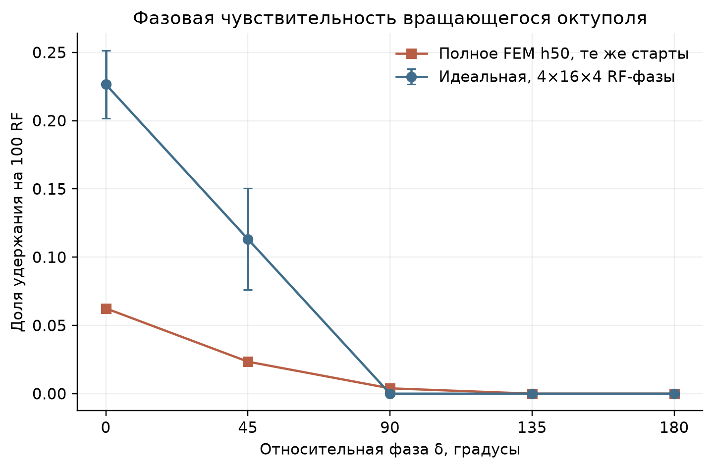
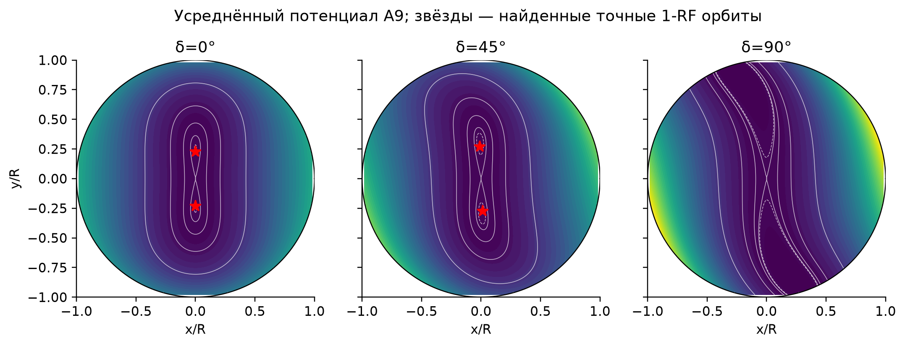

# V14. Относительная фаза вращающегося октуполя

Фаза `δ` сдвигает **октуполь** относительно RF-квадруполя; фаза инжекции `τ₀` сдвигает время старта иона при неизменной относительной конфигурации. В таблице `δ` меняется при общих четырёх инжекционных фазах, общих 256 физических 4D стартах, неизменных `α=0.00625`, `β=0.075`, `κ=−0.015`, `μ=1`. Доля относится к 100 RF и апертуре 8 mm.

| δ | Идеальное поле | Полное h50 P4 FEM | Пик электродов |
|---:|---:|---:|---:|
| 0° | 58/256 = 22.66% | 16/256 = 6.25% | 111.43 V |
| 45° | 29/256 = 11.33% | 6/256 = 2.34% | 106.00 V |
| 90° | 0/256 | 1/256 = 0.39% | 91.46 V |
| 135° | 0/256 | 0/256 | 106.00 V |
| 180° | 0/256 | 0/256 | 111.43 V |

На полном FEM парные разности `P(δ)−P(0)` по четырём независимым скремблированиям равны: при 45° `−3.906` п.п. (95%-й t-интервал `[−5.342,−2.471]` п.п.), при 90° `−5.859` п.п. (`[−7.103,−4.616]` п.п.). Для 135° и 180° разность `−6.25` п.п. (`[−8.280,−4.220]` п.п.). Интервалы вычислены по репликатным **парным** разностям, не по объединённым псевдослучайным точкам.

Аналитический усреднённый потенциал RO:

`V_eff=β²r²+αr² cos2θ+8κ²r⁶+4βκr⁴ cos(2θ+δ)`.

Перекрёстный RF-член при увеличении δ поворачивается относительно квадрупольного DC-седла. Локальные минимумы внутри апертуры смещаются: радиус `≈0.2584 R` при δ=0°, `≈0.3071 R` при 45°, `≈0.8774 R` при 90°; при 135° и 180° локальный поиск не обнаружил минимума внутри `r<0.95 R`. В точных уравнениях найденная эллиптическая 1-RF RO орбита имеет `max r≈0.311 R` при δ=0° и `≈0.368 R` при 45°. При 90°, 135°, 180° локальный shooting из продолженной орбиты и доступных псевдопотенциальных минимумов не сошёлся к допустимой внеосевой орбите. Точно такая же локальная картина 45°/90° получена на полном h50 и h35 P4 FEM: при 45° орбита найдена на обеих сетках с `max r≈0.3644 R`; при 90° — нет в пределах этого поиска.

**Интерпретация:** усреднённая модель качественно объясняет потерю при фазовом повороте смещением удерживающей структуры к границе апертуры. Она не доказывает исчезновение всех орбит: при 90° найден один удержанный FEM старт, а поиск периодов 2/4 и иных начальных приближений ещё ограничен. Пик напряжения при 90° меньше, чем при 0°; эффект не вызван превышением 250 V. Количественную передачу или асимптотическую устойчивость из этой таблицы выводить нельзя.

Исходные данные и воспроизведение: `phase_ideal_checkpoint.jsonl`, `phase_ideal_summary.csv`, `phase_fem_checkpoint.jsonl`, `phase_fem_summary.csv`, `phase_fem_paired_summary.csv`, `phase_ideal_orbits.json`, `fem_phase_orbit_search.json`. Старые FEM-строки для 0° и 90° повторно не интегрировались; их поля и старты сверены через сохранённые V13.3 исходники. Кривые соединяют только вычисленные пять фазовых точек.

