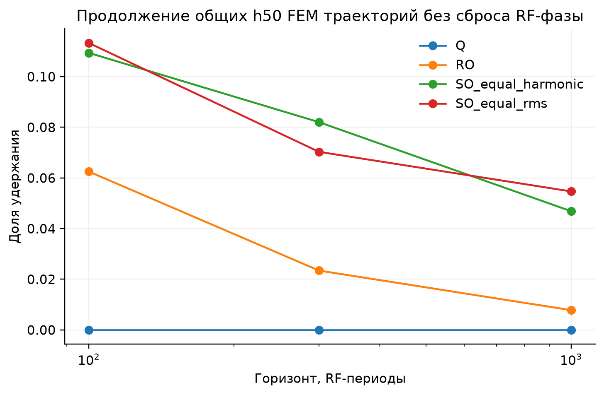
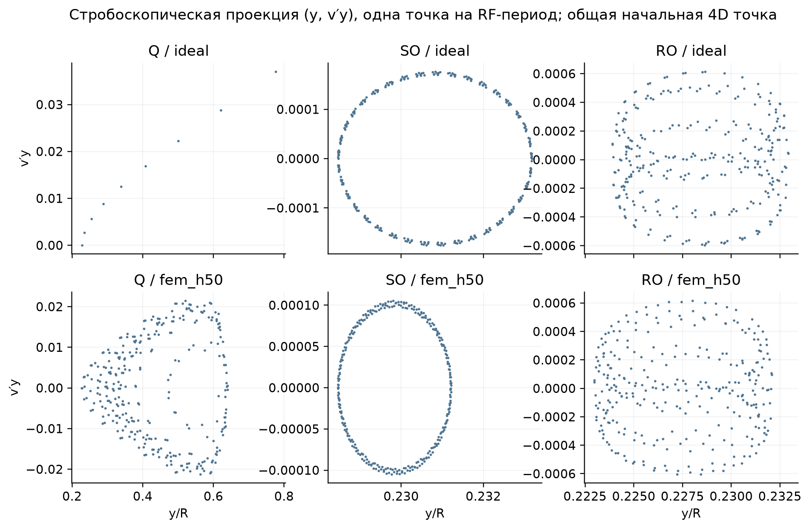

# V14. Фазовое пространство и длительность удержания A9

## Общий широкий физический ансамбль

Статусы 256 одинаковых 4D стартов на модель (четыре независимые Sobol-реплики ×16 состояний × четыре фазы инжекции) продолжены на полном h50 P4 FEM непрерывно: сегменты `0→100→300→1000 RF`, с абсолютным временем в правой части, без сброса RF-фазы. Начальная область: `r₀≤7.5 mm`, `E⊥≤5 eV`; апертура 8 mm. Ранний выход сохраняется как уже произошедший, а не переинтегрируется.

| Модель | 100 RF | 300 RF | 1000 RF |
|---|---:|---:|---:|
| Q | 0/256 | 0/256 | 0/256 |
| SO, равная гармоника | 28/256 = 10.94% | 21/256 = 8.20% | 12/256 = 4.69% |
| SO, равная ⟨E²⟩ | 29/256 = 11.33% | 18/256 = 7.03% | 14/256 = 5.47% |
| RO | 16/256 = 6.25% | 6/256 = 2.34% | 2/256 = 0.78% |

Среднее по четырём парным репликам `P_RO−P_SO` при равной ведущей гармонике: `−4.69` п.п. на 100 RF, 95% интервал `[−6.72,−2.66]`; `−5.86` п.п. на 300 RF, `[−8.99,−2.73]`; `−3.91` п.п. на 1000 RF, `[−9.82,+2.01]`. Последний интервал включает ноль: направление численно наблюдается, но величина на этом горизонте плохо разрешена четырьмя репликами. Для RO 14 из 16 переживших 100 RF стартов ушли до 1000 RF. Большинство исходного широкого ансамбля во всех моделях выходит уже примерно за 2 RF; медианы первого выхода среди потерянных: Q `1.793`, RO `1.842`, SO с равной гармоникой `1.873 RF` на горизонте 100.

Эти данные показывают смесь редких длительных движений и долгоживущих переходных траекторий. Не следует отождествлять `P(100)` с объёмом асимптотически устойчивых состояний.

## Стробоскопические 4D траектории

Для исходной RO идеальной 1-RF орбиты и её смещения `Δx=0.02R` записаны все четыре координаты `(x,y,x′,y′)` через один RF-период до 300 RF. На *идеальном* Q оба этих старта вышли за апертуру при `≈8.278 RF`; на идеальных SO и RO остались внутри. На *полном h50 FEM* все три модели удержали эти специально выбранные околопериодические старты 300 RF. У Q траектория занимает существенно более широкий диапазон `y≈0.2–0.65R`; отдельный shooting обнаружил на том же Q-FEM поле внеосевую 1-RF орбиту около `y=0.542R` (подробности в `PERIODIC_ORBITS_RU.md`). Это подчёркивает различие между малой мерой Q-подобной области в широком Sobol домене и существованием специального регулярного движения.

На 301 стробоскопической точке грубое FFT-разрешение `≈1/300` циклов на RF. Для околопериодических SO/RO траекторий доминирующая частота y близка к `0.053–0.056` циклов/RF. Для указанного Q-FEM старта спектральный максимум около `0.073` циклов/RF; амплитудная зависимость возможна, но по одной записи механизм не определён. Проекции `(y,y′)` на рисунке показывают геометрию наблюдаемого движения, **не являются полной двумерной поверхностью сечения 4D отображения** и сами по себе не доказывают инвариантные острова или хаос.

Для каждой из отдельно найденных h50 Q/SO/RO 1-RF орбит выбран один старт, смещённый по `x` на `+0.01R`. Все три такие **специально выбранные** траектории оставались внутри апертуры после непрерывного продолжения до `10 000 RF`. Максимальные радиусы в последнем сегменте: Q `0.73451R`, SO `0.31266R`, RO `0.31259R`. Записи разбиты на десять сегментов по 1000 RF с абсолютным временем и контрольными конечными состояниями (`near_orbit_long_checkpoint.jsonl`, `near_orbit_long_manifest.json`). Это демонстрирует долгую локальную околопериодическую динамику у всех трёх схем, но не доказывает асимптотическую устойчивость или величину 4D острова.

Полные состояния, первые времена выхода, сегменты продолжения и спектральные оценки: `stroboscopic_states.csv`, `stroboscopic_manifest.json`, `stroboscopic_spectra.csv`, `fem_long_checkpoint.jsonl`, `fem_long_summary.csv`.
