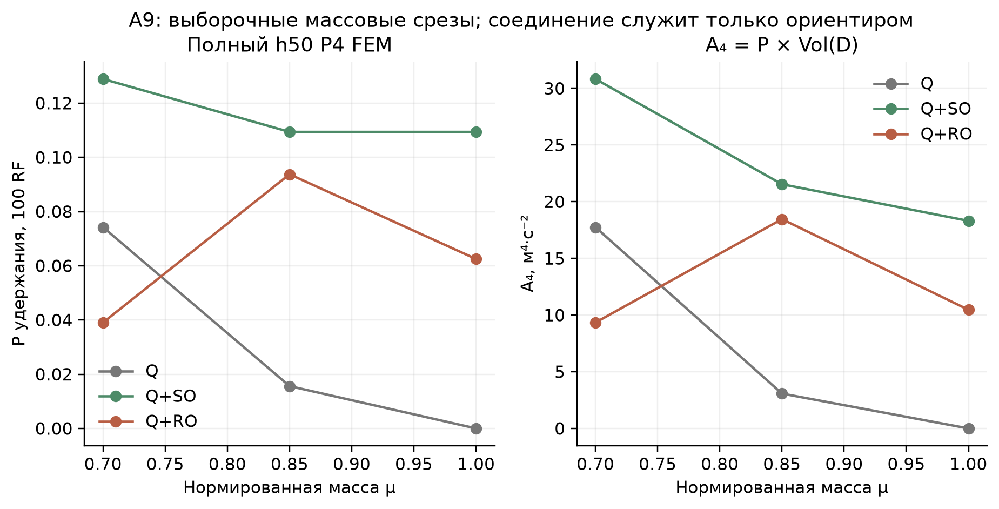

# V14 — Нелинейное удержание за границей Флоке: вращающийся и стоячий октуполь

*Итоговый отчёт V14, 17 ноября 2026 г.*

## Краткий вывод

В точке A9 (`α=0.00625`, `β=0.075`, `κ=−0.015`, `μ=1`, 100 kHz, `R=8 mm`) точная линеаризация центра Q имеет неустойчивое y-направление: `tr Mᵧ=2.05631`. В идеальном поле RO действительно создаёт внеосевые конечные движения. Но сравнение со стоячим октуполем и полным FEM показывает, что это **не уникальный эффект вращения**:

1. У Q+RO и Q+SO найдены внеосевые эллиптические 1-RF периодические орбиты за границей Флоке; они сходятся на h50 и h35 и остаются внутри апертуры.
2. В реальном полном Q FEM поле найдена ещё одна внеосевая 1-RF орбита при `y≈0.542R`. Её положение независимо воспроизводится идеальным гармоническим контролем с измеренной высшей `m=10` составляющей квадрупольного базиса.
3. При одинаковом широком физическом 4D ансамбле A9 полный h50 P4 FEM удержал на 100 RF `16/256=6.25%` RO и `28/256=10.94%` SO при равной ведущей октупольной гармонике. При равном `⟨E₄²⟩` SO удержал `29/256=11.33%`; RO−SO разность тогда не разрешена статистически.
4. При продолжении тех же полных FEM траекторий до 1000 RF осталось `2/256` RO и `12/256` SO с равной гармоникой. RO-ансамбль A9 в значительной степени состоит из долгоживущих переходных траекторий; отдельные орбитальные стартовые состояния всех трёх схем, напротив, пережили 10 000 RF.
5. Относительная фаза δ резко меняет массово усреднённое удержание и положение внеосевой структуры. Полный h50 показатель RO падает с `6.25%` при 0° до `0.39%` при 90° и нуля в данном ансамбле при 135°/180°. Усреднённая модель объясняет направление сдвига, но не заменяет точную динамику.

**Ответ на главный вопрос V14:** в исследованной точке вращение октуполя не продемонстрировало преимущество над сопоставимым стоячим октуполем. Оно помогает относительно идеального Q на 100 RF, однако стоячее поле удерживает больше стартов, а полный Q FEM содержит собственную высокоамплитудную орбиту, связанную с геометрическим `m=10` вкладом. Нелинейная внеосевая динамика подтверждена; её уникальная связь с вращением — нет.

## Физическая модель и сравнение питания

Для `z=x+iy` использованы:

`V_Q=(α+β cos(τ+τ₀)) Re(z²)`;

`V_RO=κ Re[z⁴ exp(−i(τ+τ₀−δ))]`;

`V_SO=κ_SO Re(z⁴) cos(τ+τ₀−δ)`.

Таким образом, RO содержит две вращающиеся пространственные квадратуры m=4, а SO — одну неподвижную косинусную гармонику с временной модуляцией. `δ` — фаза октуполя относительно квадруполя; `τ₀` — фаза инжекции обеих RF компонент. Они не взаимозаменяемы.

Сопоставлены (i) одинаковые ведущие гармоники `κ_SO=κ_RO` и (ii) одинаковая RF-средняя интенсивность октупольного электрического поля, для которой `κ_SO=√2κ_RO`, так как `⟨|E_RO|²⟩=16κ_RO²r⁶`, а `⟨|E_SO|²⟩=8κ_SO²r⁶`. Это разные нормировки, поэтому результаты не объединяются.

Для A9 физические амплитуды: `U₂=81.4286 V`, `V_DC=6.7857 V`, `U₄,RO=−23.2197 V`. Коэффициенты FEM: `c₂=d₂=0.77182556`, `c₄=0.54133957`. Пиковые модули электродов: Q `88.21 V`; RO и SO при равной гармонике `111.43 V`; SO при равной средней интенсивности `121.05 V`. Для всех фаз δ в исследованной сетке максимум не превышал `111.44 V` RO. Все конфигурации удовлетворяют лимиту `250 V`. Полная таблица 12 электродов: `electrode_voltage.csv`.

## Усреднённая динамика

В первом порядке псевдопотенциал равен `V_eff=V_DC(r)+(1/4)(|∇A|²+|∇B|²)`, если `V_RF=A(r) cosτ+B(r) sinτ`; здесь `V_DC(r)` означает пространственную функцию DC-потенциала, а не численное напряжение питания.

Для квадруполя:

`V_eff,Q=β²r²+αr² cos2θ`.

Для вращающегося октуполя:

`V_eff,RO=β²r²+αr² cos2θ+8κ²r⁶+4βκr⁴ cos(2θ+δ)`.

Для настоящего стоячего октуполя в выбранной ориентации:

`V_eff,SO=β²r²+αr² cos2θ+4κ_SO²r⁶+4βκ_SO cosδ r⁴ cos2θ`.

В A9 `β²=0.005625<α=0.00625`: центр — седло усреднённой модели, что согласуется с линейной неустойчивостью, но не задаёт точную границу Флоке. Эквивалентные параметры Матье `aₓ=0.05`, `q_M,x=−0.30`, `aᵧ=−0.05`, `q_M,y=+0.30` показывают, что ведущая высокочастотная аппроксимация здесь полезна качественно, но не является строгим малым-параметрическим пределом. За счёт квартального перекрёстного члена и положительного радиального члена шестой степени возникают две внеосевые ямы для SO/RO при δ=0. Минимумы находятся около `y/R=±0.2584` для RO и `±0.2609` для SO с равной гармоникой. Их использовали только как начальные приближения для shooting; сами по себе эти минимумы не считались орбитами.

При повороте δ минимум RO смещается: радиус около `0.258R` при 0°, `0.307R` при 45° и `0.877R` при 90°. В последнем случае он почти совпадает с физической апертурой, а при 135° локальный поиск не находит минимума внутри `0.95R`. Это согласуется с падением ансамблевого удержания, но высокочастотное усреднение около края апертуры количественно ограничено: там амплитуды движения и геометрические высшие гармоники уже заметны.

## Периодические орбиты при μ=1

Локальный shooting точных уравнений нашёл по две симметричные по инверсии 1-RF орбиты в идеальных RO, SO с равной гармоникой и SO с равной `⟨E²⟩`. Для положительной ветви RO начальное состояние примерно `(x,y,x′,y′)=(0,0.228476,0.001111,0)`, максимальный радиус за период `0.310677R`. SO при равной гармонике: `(0,0.230880,0,0)`, максимум `0.314004R`; при равной интенсивности: `(0,0.194146,0,0)`, максимум `0.263484R`.

У RO идеальной модели мультипликаторы `0.543582±0.839356i` и `0.941662±0.336561i`; невязка закрытия `1.1×10⁻¹¹`, дефект симплектичности `1.5×10⁻¹⁵`. SO орбиты также имеют две комплексно-сопряжённые пары на единичной окружности. Это численно эллиптические орбиты, не асимптотические аттракторы.

Такие RO/SO орбиты сохраняются в полном FEM: h50/h35 положения RO отличаются примерно на `2.1×10⁻⁵R`, `max r≈0.3094R`; SO с равной гармоникой также сошёлся на обеих сетках. Отдельно обнаружена высокоамплитудная орбита чистого полного Q FEM при `y≈0.54204R`, `max r≈0.7343R`. Измеренная нормированная проекция m=10 даёт `c₁₀/c₂=0.08692617`; в потенциале её относительный вклад дополнительно умножается на `ρ⁸` (например, около `0.87%` при `ρ=0.75`). Независимое поле `Re(z²)+0.08692617 Re(z¹⁰)` воспроизводит орбиту при `y≈0.54104R`. Это сильное указание на геометрическую причину Q орбиты, а не октупольный механизм, хотя совпадение не доказывает единственность причинного вклада m=10.

Для идеальной модели поиск с периодами 2 и 4 RF сошёлся только к уже найденным 1-RF орбитам в пределах выбранных стартов. Для RO при δ=45° найдена дополнительная точная орбита, согласованная на h50/h35 (`max r≈0.3644R`). При δ=90°/135°/180° локальный поиск не нашёл допустимой RO орбиты. Это не доказательство её отсутствия: поиск не был глобальным.

## Парное удержание и 4D аксептанс

Для каждого режима использованы те же 256 Sobol-стартов: четыре независимых скремблирования по 16 состояний, четыре инжекционные RF-фазы. `r₀≤7.5 mm`, равномерное по площади, поперечная энергия до 5 eV, равномерная по площади скоростного диска; апертура 8 mm. При μ=1 общий объём `Vol(D)=167.3891 m⁴s⁻²`, поэтому `A₄=P_ret Vol(D)`.

| Поле, A9, μ=1 | Q | Q+SO равная гармоника | Q+SO равная ⟨E²⟩ | Q+RO |
|---|---:|---:|---:|---:|
| Идеальное, 100 RF | 0/256 | 76/256 (29.69%) | 70/256 (27.34%) | 58/256 (22.66%) |
| h50 FEM, 100 RF | 0/256 | 28/256 (10.94%) | 29/256 (11.33%) | 16/256 (6.25%) |
| h50 FEM, 300 RF | 0/256 | 21/256 (8.20%) | 18/256 (7.03%) | 6/256 (2.34%) |
| h50 FEM, 1000 RF | 0/256 | 12/256 (4.69%) | 14/256 (5.47%) | 2/256 (0.78%) |

На 100 RF парная разность RO−SO (равная гармоника) `−4.6875` п.п., 95% t-интервал по четырём репликам `[−6.7175,−2.6575]` п.п. При равной интенсивности `−5.0781` п.п. с интервалом `[−10.953,+0.797]`, который включает ноль. На 1000 RF разность против SO с равной гармоникой `−3.906` п.п., но интервал `[−9.825,+2.012]` включает ноль из-за малого числа выживших. Не следует трактовать малый счёт `2/256` как точную асимптотическую оценку.

| μ | Q `P` | SO `P` | RO `P` | Парное RO−SO | `A₄` Q / SO / RO, м⁴s⁻² |
|---:|---:|---:|---:|---:|---:|
| 0.70 | 7.42% | 12.89% | 3.91% | `−8.98` п.п. `[−13.69,−4.28]` | 17.75 / 30.83 / 9.34 |
| 0.85 | 1.56% | 10.94% | 9.38% | `−1.56` п.п. `[−5.62,+2.50]` | 3.08 / 21.54 / 18.46 |
| 1.00 | 0% | 10.94% | 6.25% | `−4.69` п.п. `[−6.72,−2.66]` | 0 / 18.31 / 10.46 |

Интервалы разностей построены из четырёх общих парных реплик; Q/RO строки для `μ=0.70,0.85` взяты из проверенных V13.3 h50 расчётов, а SO интегрирован в V14 на совпадающих начальных состояниях. Массы менялись при неизменных физических напряжениях, поэтому `α,β,κ∝1/μ`; объём входного фазового домена зависит от массы (`Vol(D)∝1/μ`) при фиксированном пределе энергии 5 eV.

Оценки `A₄` ниже показывают номинальные 95%-е интервалы, полученные масштабированием интервалов удержания по объёму домена; они основаны на четырёх независимых scrambled-Sobol репликах (t-интервал, 3 степени свободы) и потому остаются грубыми. Нулевые исходы в конкретном ансамбле дают нулевую оценку, но **не доказывают**, что истинный фазовый объём точно равен нулю.

| μ | Модель | `A₄`, м⁴s⁻², оценка [95% интервал] |
|---:|---|---:|
| 0.70 | Q | 17.75 [4.56, 30.93] |
| 0.70 | Q+SO, равная гармоника | 30.83 [17.64, 44.01] |
| 0.70 | Q+RO | 9.34 [3.40, 15.29] |
| 0.85 | Q | 3.08 [0, 7.07] |
| 0.85 | Q+SO, равная гармоника | 21.54 [12.60, 30.48] |
| 0.85 | Q+RO | 18.46 [11.54, 25.39] |
| 1.00 | Q | 0 (0 из 256 стартов) |
| 1.00 | Q+SO, равная гармоника | 18.31 [14.91, 21.70] |
| 1.00 | Q+SO, равная `⟨E²⟩` | 18.96 [9.73, 28.19] |
| 1.00 | Q+RO | 10.46 [7.06, 13.86] |

На `μ=0.70` RO меньше SO по удержанию на `8.98` п.п. (95% интервал `[-13.69,-4.28]`) и по `A₄` на `21.48 м⁴s⁻²` (`[-32.74,-10.23]`). При `μ=0.85` RO и SO статистически не различены по этому ансамблю: `RO−SO=-1.56` п.п. (`[-5.62,+2.50]`), `ΔA₄=-3.08 м⁴s⁻²` (`[-11.07,+4.92]`). При `μ=1.00` RO ниже SO на `4.69` п.п. (`[-6.72,-2.66]`); разность `A₄≈−7.85 м⁴s⁻²` с масштабированным интервалом `[-11.25,-4.45]`. Это демонстрирует немонотонный массово-зависимый компромисс, но три разреженные массы не задают FWHM и не позволяют вычислить масс-разрешение.

`A₄` здесь — условный удерживаемый фазовый объём; он не равен току или реальной передаче прибора.

## Относительная фаза и пространство состояний

На полном FEM для RO `δ=0°,45°,90°,135°,180°` даёт соответственно `16,6,1,0,0` удержанных состояний из общих 256. Разность `P(90°)−P(0°)=−5.859` п.п. с 95%-м интервалом `[−7.103,−4.616]`. Идеальный пилот даёт более высокий абсолютный уровень (58/256 при 0°; 0/256 при 90° и выше в выбранной сетке), но то же направление. Напряжение при 90° ниже, чем при 0°; резкий спад не вызван выходом за лимит источника.

Стробоскопические `(x,y,x′,y′)` сохранены каждый RF до 300 RF. Для старта на RO-орбите и `Δx=0.02R` идеальный Q вышел примерно за 8.278 RF, идеальные SO/RO остались внутри; полное FEM Q/SO/RO удержало эти специально выбранные старты до 300 RF. На полном FEM в Q-проекции виден уход в район высокоамплитудной орбиты около `y≈0.54R`. Основные равновесные спектральные пики околопериодических SO/RO движений около `0.053–0.056` циклов на RF; запись из 300 точек даёт лишь разрешение порядка `1/300`. Проекции не используются как доказательство хаоса.

## Численная проверка и ограничения

В V14 выполнено: 8 тестов уравнений/градиентов/усреднения/сегментированной RF-фазы; DOP853 контроль 42 идеальных статусов из 42, максимальная разность времени выхода `4.81×10⁻⁴ RF`; h50/h35 FEM shooting и сеточное сравнение; 512 SO+FEM состояний при μ=1; 768 дополнительных фазовых RO FEM состояний; 512 SO FEM масс-контролей при μ=.70/.85; 2048 продолженных сегментных классификаций до 1000 RF; три околопериодические h50 старта до 10 000 RF. Исходные таблицы, checkpoint, seeds и скрипты приложены.

Не выполнены глобальный поиск всех орбит, полное продолжение периодических орбит по параметрам, проверка всех режимов до 100 000 RF, FTLE/MEGNO/SALI, полноценная классификация хаоса, трёхмерные краевые поля и осевой пролёт конечной длины. Для локально найденных орбит отсутствует глобальная оценка меры их бассейна. Сообщённые проценты — конечновременное поперечное удержание внутри апертуры, а не mass-filter `T(M/Q)` и не экспериментальное разрешение.

## Статус ответов на вопросы V14

| Вопрос | Статус | Что позволяют утверждать данные |
|---|---|---|
| Удерживает ли RO лучше SO при сопоставимой нормировке? | **Не подтверждено; на A9 равная гармоника показывает обратное** | На h50 `RO−SO=−4.69` п.п. за 100 RF, 95% интервал `[-6.72,-2.66]`; при равной средней `⟨E²⟩` интервал включает ноль. Это локальный вывод для заданного ансамбля и режима, не глобальное доказательство. |
| Есть ли конечновысокие периодические орбиты за границей Floquet? | **Подтверждено численно для найденных орбит** | Обнаружены эллиптические 1-RF орбиты Q+RO и Q+SO в идеальной модели, они сохраняются на h50/h35. Отдельная высокоамплитудная орбита есть и в полном Q FEM. Полнота поиска не установлена. |
| Объясняют ли они массовую долю долгоживущих стартов? | **Не установлено** | Отобранные старты рядом с орбитами живут 10 000 RF, но мера бассейна в общем 4D домене не оценена; большая часть исходных состояний выходит за первые несколько периодов. |
| Откуда сильная зависимость от относительной фазы δ? | **Фазовая чувствительность подтверждена; механизм установлен частично** | FEM-удержание при δ=0°/90° составляет 6.25%/0.39%; псевдопотенциальные минимумы сдвигаются к апертуре. Для количественного объяснения нужны точные орбиты и усреднение бассейнов при фазовом скане. |
| Сохраняются ли структуры на FEM и больших временах? | **Предварительно подтверждено для выбранных случаев** | h50/h35 воспроизводят периодические орбиты; три специально выбранных орбитальных старта выживают 10 000 RF на h50. Это не длительная проверка общего ансамбля и не доказательство асимптотической устойчивости. |
| Связано ли это с массозависимым A₄? | **Предварительный результат** | На трёх массах видно немонотонное изменение `A₄`, но профиль слишком разрежен для FWHM, разрешения или реальной передачи. |

## Научная новизна: строгая оценка

Нелинейное влияние добавленного октуполя на квадрупольные ловушки и масс-фильтры уже изучалось. Ding, Konenkov и Douglas рассматривали характеристики quadrupole mass filters с добавленной октупольной гармоникой 2–4% ([*Rapid Communications in Mass Spectrometry*, 2003](https://doi.org/10.1002/rcm.1235)); модели нелинейных частотных и амплитудных эффектов в Paul traps с октуполем также опубликованы ([Xiong et al., *Journal of the American Society for Mass Spectrometry*, 2015](https://doi.org/10.1007/s13361-015-1145-7)). Вращающаяся RF-ловушка с **вращающимся квадрупольным** полем изучалась теоретически ([Hasegawa & Bollinger, *Physical Review A* 72, 043403 (2005)](https://doi.org/10.1103/PhysRevA.72.043403)) и недавно экспериментально реализована ([Park et al., *Physical Review A* 114, L050801 (2026)](https://doi.org/10.1103/sxc6-199m)). Эти работы относятся к m=2 вращающемуся полю/иной конфигурации и сами по себе не являются сравнением настоящего вращающегося m=4 октуполя относительно стоячего m=4 на фоне неподвижной квадрупольной RF/DC-структуры.

Поэтому новизну нельзя основывать на самом факте `Q+octupole`. Кандидатный вклад V14 — контролируемое сравнение вращающейся и стоячей m=4 составляющих в 12-электродной P4 FEM геометрии, при двух явно раздельных нормировках, с проверкой периодических орбит и фазовой зависимости. Данные не дают основания заявлять уникальную стабилизацию вращением: SO демонстрирует не меньшие и на A9 часто большие удержание/аксептанс; полный Q FEM с реальной высшей гармоникой тоже имеет конечновысокую орбиту. Для самостоятельной статьи высокого уровня потребуются систематическое продолжение, оценки бассейнов орбит, анализ конечной длины/передачи и более широкая проверка параметров.

В статье можно осторожно утверждать: **(i)** в идеальной Q+RO и Q+SO моделях найдены эллиптические 1-RF орбиты вне строгой устойчивости центра; **(ii)** выбранные орбиты сохраняются в двух сетках полного P4 FEM; **(iii)** при одной физической точке и общем 4D ансамбле RO не превосходит SO, а чувствительность RO к δ велика; **(iv)** высшая m=10 гармоника Q-базиса воспроизводит найденную Q-FEM орбиту. Нельзя утверждать: доказанное асимптотическое удержание, RO-специфический остров, подтверждённый хаос, преимущество по приборной передаче или измеренное разрешение.

## Воспроизводимость и состав каталога

Код траекторий: `scripts/run_v14_ideal_pilot.py`, `scripts/analyze_v14_ideal.py`, `scripts/run_v14_fem_orbits.py`, `scripts/run_v14_fem_so.py`, `scripts/run_v14_fem_long.py`, `scripts/run_v14_fem_phase.py`, `scripts/run_v14_fem_mass_so.py`; модель и тесты: `src/three_phase_trap/v14_dynamics.py`, `tests/test_v14_dynamics.py`. Физические поля V13.3 сохранены неизменными. Манифесты, SHA-256 и проверка уникальности запусков собраны в `DATA_MANIFEST.json`.
