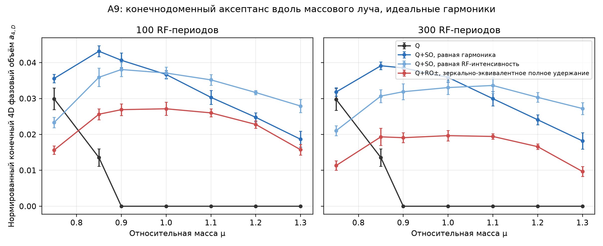
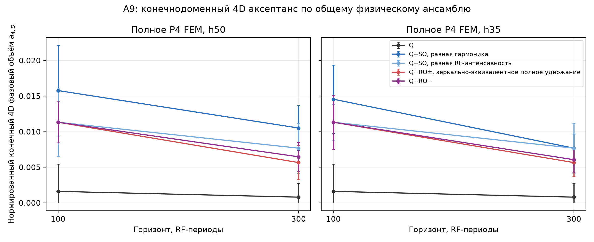
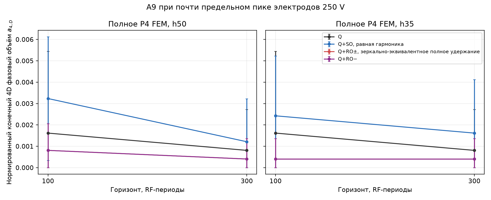
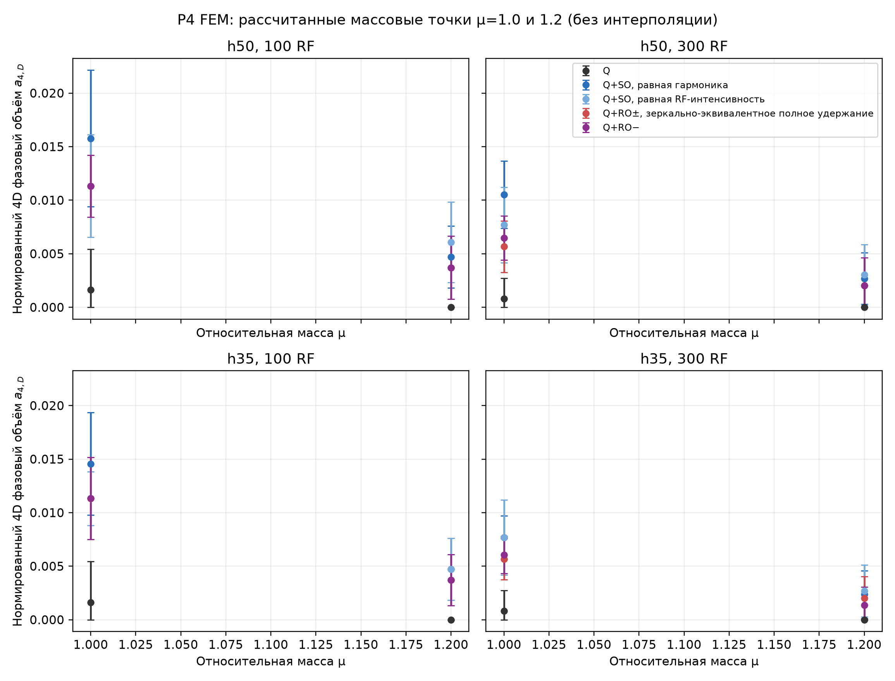

# V15. Конечнодоменный четырёхмерный аксептанс и масса

## Определение домена

Оценена величина

\[
A_{4,D}(N)=\int_D I_N(x_0,y_0,v_{x0},v_{y0})\,d^2r_0\,d^2v_0,
\qquad a_{4,D}=\frac{A_{4,D}}{R^4\Omega^2},
\]

для общего домена `D`: `r0≤7.5 mm`, равномерно по площади; `E_perp≤5 eV`, равномерно по площади диска скоростей. Его фазовый объём при `mu=1` равен `167.3891393 m^4/s^2`, а нормированный объём — `0.1035160261`. Поэтому `a4,D=P_ret×0.103516` при `mu=1`. Для массового луча порог физической энергии фиксирован, так что объём D и нормированный множитель изменяются как `1/mu`.

Это условный конечновременный фазовый объём именно в указанном D; он не является током или передачей реального источника.

## A9, идеальные гармоники при `mu=1`

| Горизонт | Q | Q+SO, равная гармоника | Q+SO, равная RF-интенсивность | Q+RO± |
|---:|---:|---:|---:|---:|
| 100 RF | 0.00000 | 0.03670 | 0.03710 | 0.02719 |
| 300 RF | 0.00000 | 0.03589 | 0.03296 | 0.01996 |
| 1000 RF | 0.00000 | 0.03498 | 0.03083 | 0.01284 |

Единицы `a4,D` безразмерны; 95% интервалы по восьми Sobol-репликам приведены в исходной [таблице](finite_domain_acceptance.csv). Рост разницы с горизонтом отражает потери в поперечной модели, а не реальное время пролёта.

## A9, полное P4 FEM при `mu=1`

| Сетка / горизонт | Q | SO, равная гармоника | SO, равная RF-интенсивность | RO+ |
|---|---:|---:|---:|---:|
| h50 / 100 RF | 0.00162 | 0.01577 | 0.01132 | 0.01132 |
| h35 / 100 RF | 0.00162 | 0.01456 | 0.01132 | 0.01132 |
| h50 / 300 RF | 0.00081 | 0.01051 | 0.00768 | 0.00566 |
| h35 / 300 RF | 0.00081 | 0.00768 | 0.00768 | 0.00566 |

Оценки получают умножением FEM `P_ret` на тот же доменный объём. При 300 RF RO меньше SO с равной ведущей гармоникой на обеих сетках; различие RO против SO при равной средней RF-интенсивности не разрешено. RO выше Q. Эти проценты относятся к тому же равномерному домену и не могут без модели источника трактоваться как отношение токов.

## Связь с массовой характеристикой

Идеальный массовый луч показан по семи заданным массам в [MASS_DEPENDENCE_RU.md](MASS_DEPENDENCE_RU.md). `P_ret(mu)` имеет широкие плато, а не узкий ограниченный пик; FWHM и условное разрешение не определяются. При вычислении `a4,D(mu)` дополнительно меняется объём скоростной части домена `~1/mu`, поэтому для физической интерпретации нужно смотреть и на вероятность удержания, и на A4.

Дополнительная FEM точка на массовом луче `mu=1.2` рассчитана на исправленном matched h50/h35 наборе. При этой массе `a4,D`:

| Сетка / горизонт | Q | SO, равная гармоника | SO, равная RF-интенсивность | RO+ |
|---|---:|---:|---:|---:|
| h50 / 100 RF | 0 | 0.00472 [0.00183,0.00761] | 0.00607 [0.00230,0.00983] | 0.00371 [0.00077,0.00664] |
| h35 / 100 RF | 0 | 0.00472 [0.00183,0.00761] | 0.00472 [0.00183,0.00761] | 0.00371 [0.00132,0.00610] |
| h50 / 300 RF | 0 | 0.00270 [0.00029,0.00511] | 0.00303 [0.00022,0.00584] | 0.00202 [0,0.00465] |
| h35 / 300 RF | 0 | 0.00236 [0.00013,0.00459] | 0.00270 [0.00029,0.00511] | 0.00202 [0.00002,0.00402] |

При `mu=1.2` RO выше Q в парной разности на 100 RF на обеих сетках, однако уступает SO по точечным оценкам и не даёт разрешённого преимущества над SO при обоих вариантах сравнения. На 300 RF RO−SO и RO−Q интервалы в основном включают ноль. Это одна дополнительная массовая точка, не FEM-профиль.

Для A9 физический фазовый объём при `mu=1.2` уменьшен в `1/1.2` относительно `mu=1`, поскольку физический предел поперечной энергии остаётся фиксированным. Полученные `A4` и `a4,D` — оценки фазового объёма на этой общей области; они не являются током.

## 4D мера при почти предельном пике электродов

Для дополнительного matched-start FEM батча при `max |V_j|=249.823 V` нормированный объём `a₄,D` вычислен тем же доменом и из тех же долей удержания. Это конечновременная мера ансамбля, а не независимая оценка распределения источника.

| Сетка / горизонт | Q | Q+SO, равная ведущая гармоника | Q+RO± |
|---|---:|---:|---:|
| h50 / 100 RF | 0.00162 [0,0.00544] | 0.00323 [0.00034,0.00613] | 0.00081 [0,0.00206] |
| h35 / 100 RF | 0.00162 [0,0.00544] | 0.00243 [0,0.00523] | 0.00040 [0,0.00136] |
| h50 / 300 RF | 0.00081 [0,0.00272] | 0.00121 [0,0.00323] | 0.00040 [0,0.00136] |
| h35 / 300 RF | 0.00081 [0,0.00272] | 0.00162 [0,0.00412] | 0.00040 [0,0.00136] |

Точечные оценки RO ниже SO на обеих сетках и горизонтах, но статистические интервалы широки из-за малой доли выживших; это не доказательство строгого порядка во всём фазовом объёме. В согласии с парной оценкой удержания, этот аппаратный контроль не выявляет роста аксептанса от вращения.

Нет конечной длины, осевого движения или краевых полей — приборная функция `T(M/Q)` не моделировалась.
