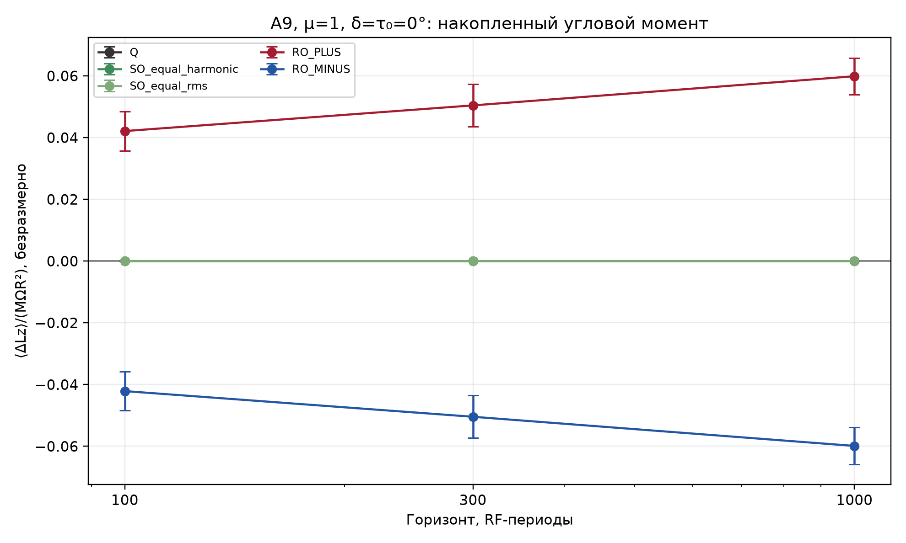
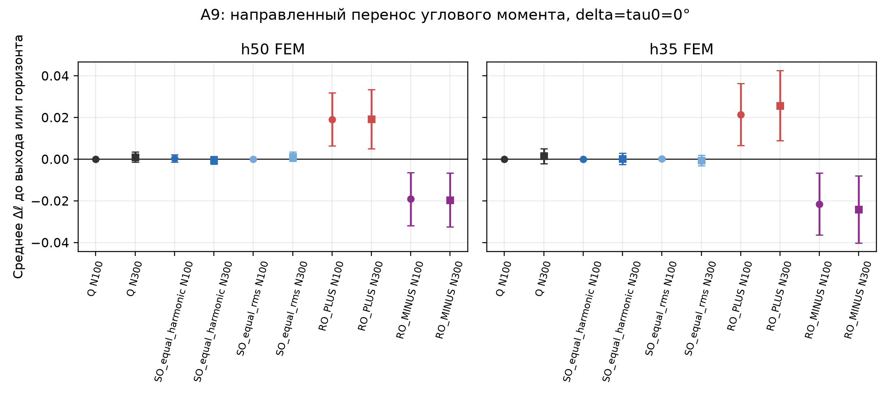

# V15. Перенос углового момента

В безразмерных переменных `ell=x y′−y x′=Lz/(M Ω R²)`, `ell′=x Fy−y Fx`. Интегратор сохраняет интеграл момента силы до выхода или горизонта; проверяется невязка `Delta ell−∫(xFy−yFx)dτ`.

## Идеальная модель A9, `mu=1`

На 8×128 зеркальных пар в каждой точке фаз и горизонта при `delta=tau0=0°` среднее по всем стартам:

| Горизонт | Q/SO | RO+ `mean Delta ell` | RO− `mean Delta ell` |
|---:|---:|---:|---:|
| 100 RF | 0 по зеркалу | +0.04212 [0.03579,0.04846] | −0.04212 [−0.04846,−0.03579] |
| 300 RF | 0 по зеркалу | +0.05044 [0.04354,0.05733] | −0.05044 [−0.05733,−0.04354] |
| 1000 RF | 0 по зеркалу | +0.05988 [0.05393,0.06584] | −0.05988 [−0.06584,−0.05393] |

Баланс момента для 122 880 записей замкнулся с максимумом `1.04×10⁻⁷`. Среднее приращение у выживших RO+ на 100/300/1000 RF близко к нулю; у вышедшей подвыборки приращение заметно больше. Поэтому суммарная направленная отдача не является свидетельством раскрутки захваченного ансамбля.

## Полная FEM A9

На увеличенном FEM ансамбле использованы 8×16 пар, обе сетки h50/h35, DOP853. RO подтверждает направленный момент на полном P4 поле:

| Сетка | Горизонт | RO+ `mean Delta ell` (95% ДИ) | RO− `mean Delta ell` (95% ДИ) |
|---|---:|---:|---:|
| h50 | 100 RF | +0.01908 [0.00634,0.03183] | −0.01913 [−0.03187,−0.00638] |
| h35 | 100 RF | +0.02148 [0.00659,0.03638] | −0.02148 [−0.03638,−0.00658] |
| h50 | 300 RF | +0.01919 [0.00499,0.03338] | −0.01960 [−0.03254,−0.00666] |
| h35 | 300 RF | +0.02574 [0.00888,0.04261] | −0.02409 [−0.04017,−0.00801] |

Максимальная невязка интегрального момента по FEM-ансамблю — `1.15×10⁻¹¹`. Отдельный `Delta ell` у оставшихся удержанными траекторий мал и/или различается между сетками; основная часть ансамблевого переноса приходится на траектории, уходящие за апертуру. Следовательно, FEM подтверждает направленную передачу момента от бегущего поля, но не долгоживущую вращательно-захваченную популяцию и не хиральное удержание.

## Фазы и масштаб

В идеальной модели RO+ на 100 RF: `mean Delta ell=+0.04212` при `(delta,tau0)=(0°,0°)`, `+0.01932` при `(0°,90°)`, `+0.00080` при `(90°,0°)` и `−0.00818` при `(90°,90°)`. Таким образом, внешний момент задаётся и направлением вращения, и фазовой конфигурацией. При `Omega=2π·100 kHz`, `R=8 mm`, `Omega R²=40.21 m²/s`, идеальный A9 результат на 1000 RF соответствует около `2.41 m²/s` среднего специфического приращения момента по всей исходной популяции.

Периодически меняющийся потенциал может давать усреднённые скоростезависимые магнитоподобные члены; общий теоретический механизм описан Cox и Levi (2020, [Nonlinearity](https://doi.org/10.1088/1361-6544/ab7d29)). Это не физическое магнитное поле и не основание заявлять новизну само по себе. В V15 вычисленное полное неусреднённое движение подтверждает моментный баланс; количественная точность усреднения для A9 отдельно не установлена.

## Проверка массовой точки `mu=1.2`

Исправленный FEM массовый контроль не повторил значимый ансамблевый момент A9. Для RO+ средний `Delta ell` по всей популяции на h50: `−0.00236 [−0.01138,0.00667]` на 100 RF и `−0.00250 [−0.01262,0.00762]` на 300 RF; на h35: `+0.00064 [−0.00791,0.00919]` и `+0.00003 [−0.00910,0.00916]`. Все интервалы включают ноль. Это указывает, что величина и знак ансамблевого переноса зависят от массы/режима; на одной дополнительной точке при μ=1.2 перенос не разрешён статистически.

## Перенос момента при почти предельном электродном пике

В независимом FEM контроле амплитуда RO/SO равной гармоники увеличена до `κ=−0.1044` (`max |V_j|=249.823 V`). На 100 RF среднее безразмерное приращение `Δℓ` по всей исходной популяции для RO+ равно `+0.18776 [0.16649,0.20903]` на h50 и `+0.18919 [0.16847,0.20991]` на h35; для RO− получен противоположный знак. На 300 RF значения RO+ остаются `+0.18805 [0.16676,0.20935]` и `+0.18923 [0.16853,0.20993]`. Баланс момента закрывается с максимумом `1.68×10⁻¹⁰`. При этом доля удержания RO мала, `Δχ` включает ноль, а медианное время первого выхода RO около `0.79 RF`. Значит, более сильный torque — достоверный эффект, но преимущественно до быстрого выхода частиц; он не свидетельствует о захвате ионов с согласованным знаком `Lz`.
