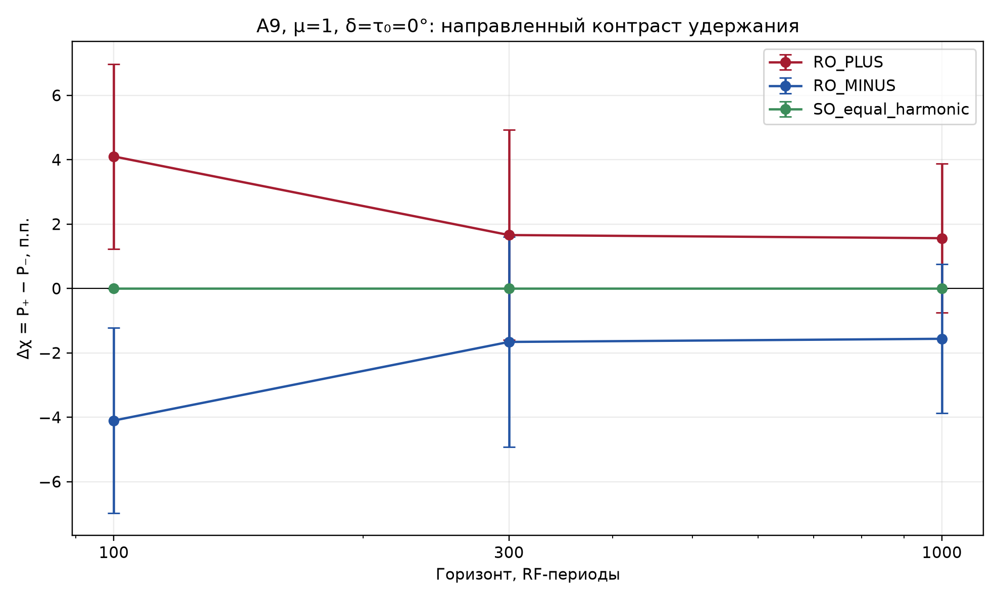
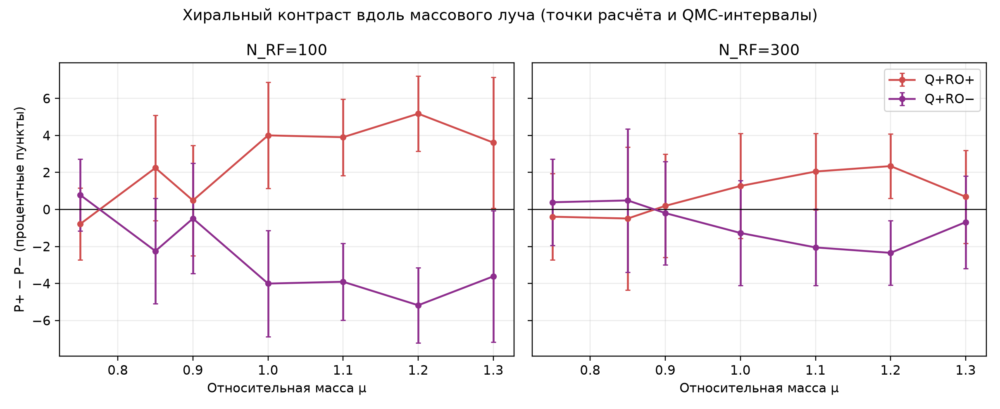

# V15. Направленное удержание и хиральная селективность

## Определение и протокол

`P+` и `P−` — доли удержания к заданному горизонту для стартов с положительным и отрицательным начальным `Lz`. Основная метрика `Delta_chi=P+−P−`. Стартовые пары совпадают по радиусу, физической поперечной энергии, радиальной скорости, модулю тангенциальной скорости и RF-фазе; меняется только зеркально обращённый знак `Lz`.

Подтверждающий физический домен: `r0≤7.5 mm`, равномерно по площади, `E_perp≤5 eV`, равномерно по площади диска скоростей; `M0=3200.0465226 Th`, `Q=+e`, `R=8 mm`, `f=100 kHz`. A9: `alpha=0.00625`, `beta=0.075`, `kappa=−0.015`. Пиковые напряжения всех вариантов ниже 250 V. Неопределённость — 95% t-интервал по средним восьми независимых Sobol-скремблирований.

## Идеальная модель A9 при `mu=1`

На основном ансамбле (8×128 зеркальных пар на конфигурацию/фазу) при `delta=tau0=0°` RO+ дал `Delta_chi=+4.10 п.п. [1.23,6.98]` на 100 RF. На 300 RF разность упала до `+1.66 [−1.60,4.92]`, на 1000 RF — `+1.56 [−0.75,3.88]`; оба интервала включают ноль. RO− меняет знак контраста, Q и SO дают ноль на каждой зеркальной паре.

## Независимая массовая проверка

При просмотре массового луча (`mu=0.75…1.30`, только идеальное поле, `delta=tau0=0°`) найден кандидат около `mu=1.2`. Для него выполнено новое независимое подтверждение на seeds, не использованных в массовом скане: 8×128 зеркальных пар, пять конфигураций, RK4 256 шагов на период, непрерывное продолжение до 300 RF.

| Горизонт | `P+` RO+ | `P−` RO+ | `Delta_chi` RO+ |
|---:|---:|---:|---:|
| 100 RF | 28.52% [26.39,30.64] | 23.93% [21.98,25.87] | **+4.59 п.п. [0.90,8.28]** |
| 300 RF | 19.53% [17.56,21.51] | 17.48% [15.51,19.45] | +2.05 п.п. [−1.72,5.83] |

Это независимое воспроизведение кратковременного 100-периодного контраста в идеальной модели. Оно не подтверждает долговременную селекцию: на 300 RF интервал включает ноль. Значение при `mu=1.2` было выбрано после просмотра семи масс, поэтому профиль требует отдельной поправки на множественный поиск и проверки в полной FEM-геометрии.

## Полное FEM при A9, `mu=1`

Для полного h50/h35 P4 FEM использованы 8×16 зеркальных пар (256 пар на сетку/модель), DOP853, `rtol=3×10⁻⁹`, `atol=3×10⁻¹¹`, `max_step=2π/64`; длинный участок продолжался с сохранением абсолютной фазы.

| FEM-сетка | Горизонт | `Delta_chi` RO+ | 95% ДИ |
|---|---:|---:|---:|
| h50 | 100 RF | 0.00 п.п. | [−4.84,+4.84] |
| h50 | 300 RF | −1.56 п.п. | [−6.19,+3.07] |
| h35 | 100 RF | 0.00 п.п. | [−5.59,+5.59] |
| h35 | 300 RF | 0.00 п.п. | [−3.95,+3.95] |

На A9 выбранная ideal-модельная хиральность **не воспроизведена как разрешённый эффект удержания на полном FEM**. Единичные зеркальные несовпадения на горизонте 300 RF происходят у чувствительных длинных траекторий; усреднённый результат обеих сеток остаётся неразрешённым. Контраст по фазе для широкого FEM-ансамбля сильно меняется, но этот скан мал и является лишь качественной проверкой.

## Независимая массовая точка `mu=1.2` на полном FEM

После просмотра идеального массового луча выполнен отдельный matched h50/h35 набор для `M=3840.055827 Th`, с 8 независимыми scramble ×16 зеркальных пар, 100/300 RF, `delta=tau0=0°`. Результаты RO+:

| Сетка | Горизонт | `Delta_chi` | 95% ДИ |
|---|---:|---:|---:|
| h50 | 100 RF | +0.78 п.п. | [−2.57,+4.13] |
| h35 | 100 RF | −0.78 п.п. | [−5.96,+4.40] |
| h50 | 300 RF | 0.00 п.п. | [−2.79,+2.79] |
| h35 | 300 RF | +1.56 п.п. | [−0.86,+3.98] |

Все интервалы включают ноль. При `mu=1.2` средний FEM `Delta ell` по всему ансамблю также включает ноль; направленная передача момента по отдельным стартам не формирует разрешённого хирального удержания. RO+−RO− парное полное удержание не отличается статистически на 300 RF, несмотря на единичные численно чувствительные FEM зеркальные расхождения. Таким образом, независимый идеальный контраст `+4.59 п.п.` на 100 RF не подтверждён на полном FEM.

## Вывод

Идеальный RO создаёт кратковременный `Delta_chi` в A9 и при `mu=1.2`; стоячее поле не может дать такого контраста на зеркально-парных стартах по симметрии. Однако на 300 RF контраст включает ноль, а независимые FEM наборы при `mu=1` и `mu=1.2` не воспроизводят его как разрешённый эффект. Поэтому физическая хиральная селективность реальной геометрии **не установлена**. Это не масса-фильтрационная передача и не разрешение прибора конечной длины.

Данные: `confirmation_a9_uniform4d/summary_by_phase_model_horizon.csv`, `mass_ray_a9/retention_summary.csv`, `mass_chirality_mu1p2_confirmation/summary.csv`, `fem_confirmation_a9_refined/summary_by_phase_model_horizon.csv`; индивидуальные checkpoint-файлы оставлены локально.

## Контроль у аппаратного предела

В отдельном h50/h35 FEM батче `κ=−0.1044` (`η=−1.392`) выбран так, чтобы пик электродов был `249.823 V`; использованы `δ=τ₀=0°`, восемь независимых scramble ×16 зеркальных пар. На обоих горизонтах и обеих сетках `Δχ` RO+ и парные RO+−RO− различия не разрешены от нуля; суммы удержания RO+ и RO− совпадают на парном ансамбле. Таким образом, сильное увеличение вращающейся амплитуды до почти аппаратного лимита не превратило перенос момента в надёжную хиральную селекцию. Точные значения и интервалы сохранены в `fem_equal_peak_a9/summary_by_phase_model_horizon.csv`.
