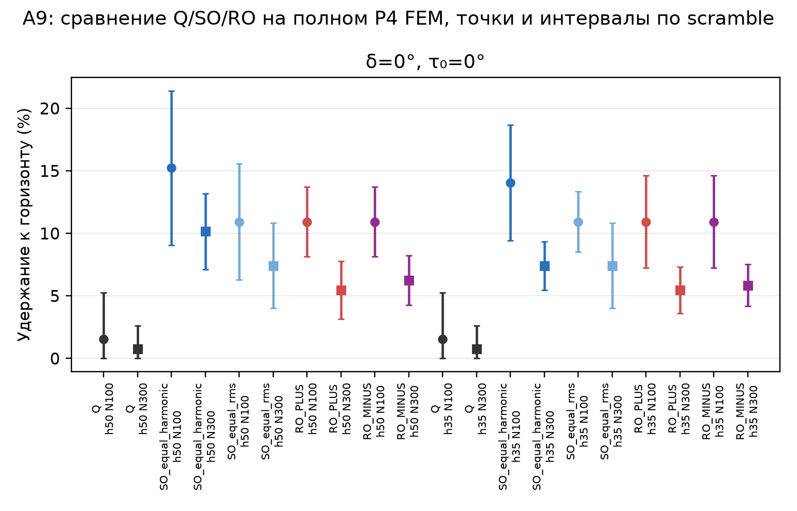
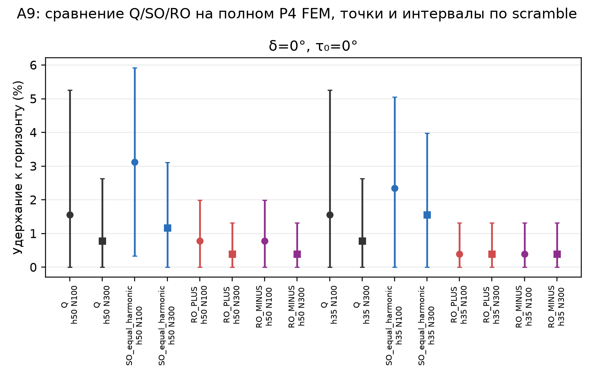

# Проверка V15 на полном P4 FEM-поле

## Использованные поля и проверка базисов

Новые FEM-решения для V15 не строились. Повторно использованы сохранённые единичные P4 базисы `m=2` и `m=4` на общей 12-электродной геометрии: `c2=d2=0.7718255558274`, `c4=0.5413395699439`, `R=8 mm`. Интегрируется полное поле соответствующих базисов с сохранёнными высшими пространственными гармониками, не одна ведущая гармоника. Для вращения комбинируются согласованные cosine/sine квадратуры; SO использует одну неподвижную пространственную квадратуру. Полное совместное решение на всей геометрии не пересчитывалось: V13.1 показала корректную линейную суперпозицию независимо решённых модальных задач и прямую проверку P4 градиента.

Независимая V13.1 проверка m=2/m=4 суперпозиции на 600 внутренних точках, четырёх RF-фазах и пяти октупольных амплитудах дала нулевой алгебраический остаток суперпозиции; прямой P4 градиент совпал с конечными разностями с максимальной относительной ошибкой `2.75e-10`. Зеркальная чётность FEM градиентов V15 проверена на 300 точках: максимальная относительная ошибка `2.51e-7` для h50 и `3.38e-7` для h35.

## A9 на h50 и h35: парное сравнение

Проведены полные P4 траектории для Q, Q+SO с равной ведущей гармоникой, Q+SO с равной средней RF-интенсивностью октупольного поля, Q+RO+ и Q+RO−. На каждой сетке использовано 8 независимых Sobol scramble ×16 зеркальных пар, всего 256 стартов на схему, на горизонтах 100 и 300 RF, при `delta=tau0=0°`. Решатель DOP853: `rtol=3e-9`, `atol=3e-11`, `max_step=2π/64`. 300 RF получены непрерывным продолжением 100 RF выживших.

| Схема | h50, 100 RF | h35, 100 RF | h50, 300 RF | h35, 300 RF |
|---|---:|---:|---:|---:|
| Q | 1.56% [0, 5.26] | 1.56% [0, 5.26] | 0.78% [0, 2.63] | 0.78% [0, 2.63] |
| Q+SO, равная гармоника | 15.23% [9.08, 21.39] | 14.06% [9.43, 18.69] | 10.16% [7.11, 13.20] | 7.42% [5.48, 9.37] |
| Q+SO, равная RF-интенсивность | 10.94% [6.31, 15.57] | 10.94% [8.52, 13.36] | 7.42% [4.02, 10.82] | 7.42% [4.02, 10.82] |
| Q+RO+ | 10.94% [8.14, 13.73] | 10.94% [7.24, 14.63] | 5.47% [3.15, 7.79] | 5.47% [3.62, 7.32] |

Интервалы 95% рассчитаны по восьми независимым scrambled репликам. При равной ведущей гармонике RO−SO на 100 RF не разрешён: h50 `−4.30 п.п. [−10.53, 1.94]`, h35 `−3.13 [−7.96, 1.71]`. На 300 RF разность отрицательная на обеих сетках: h50 `−4.69 [−8.64, −0.74]`, h35 `−1.95 [−3.31, −0.60]` п.п. При равной RF-средней интенсивности RO−SO не разрешён: на 300 RF обе сетки дают `−1.95 п.п.` с 95% ДИ, включающими ноль. Таким образом, на этом A9 протоколе Q+RO лучше Q, но не лучше стоячего октуполя; различие относительно SO зависит от выбранной нормировки и времени.

FEM-хиральный контраст RO+ по зеркально парным стартам не разрешён от нуля ни на одной сетке. На 100 RF точечная оценка равна нулю; 95% интервалы: h50 ±4.84 п.п., h35 ±5.59 п.п. На 300 RF h50 `−1.56 [−6.19, 3.07]`, h35 `0 [−3.95, 3.95]` п.п. RO+ и RO− дают равное суммарное удержание в пределах этих ошибок.

## Баланс углового момента на FEM

Безразмерный момент `ell=x vy−y vx`; интеграл момента силы проверялся для каждой траектории. Максимальная невязка V15 FEM refined batch `|Δell−∫(x ay−y ax)dτ|=1.15e-11`. Средний `Δell` RO+ в полной стартовой популяции положителен на 100 RF: h50 `+0.01908 [0.00634,0.03183]`, h35 `+0.02149 [0.00659,0.03638]`; RO− даёт противоположный знак. На 300 RF средний направленный перенос сохраняет знак и разрешён от нуля на обеих сетках, но среднее среди выживших близко к нулю и сеточно чувствительно. Следовательно, на FEM подтверждён направленный механический момент бегущего поля, но это не означает удержание частиц нужной хиральности: вклад в среднее по стартовой популяции в основном дают траектории, выходящие через апертуру.

## Массовый контроль при μ=1.2: исправление процесса и статус

Первый запуск с manifest `fem_mass_mu1p2_confirmation/manifest.json` обнаружил ошибку Windows `spawn`: `MU=1.2`, присвоенное родительскому процессу, не передавалось дочерним workers. В уже записанных строках поэтому стояли `mu=1.0`, `alpha=0.00625`, `beta=0.075`, что противоречило manifest (`mu=1.2`, `alpha=0.0052083`, `beta=0.0625`). Эти данные **помечены как недействительные и не используются для физических выводов**; исходный checkpoint сохранён без изменений как аудит сбоя.

Исправление передаёт `mu` через initializer каждому worker. Spawn-pilot `fem_mass_mu1p2_spawncheck/` содержит 320 валидных строк. Полноценный исправленный набор `fem_mass_mu1p2_confirmation_fixed/` завершён: 5120 строк, 10 групп mesh×model, 5120 уникальных ключей, все строки `mu=1.2`, `alpha=0.00520833`, `beta=0.0625`, нет unresolved и напряжений выше 250 V; максимум невязки момента `9.05e-12`.

| Сетка / горизонт | Q | SO, равная гармоника | SO, равная RF-интенсивность | RO+ |
|---|---:|---:|---:|---:|
| h50 / 100 RF | 0% | 5.47% [2.12,8.82] | 7.03% [2.67,11.39] | 4.30% [0.89,7.70] |
| h35 / 100 RF | 0% | 5.47% [2.12,8.82] | 5.47% [2.12,8.82] | 4.30% [1.53,7.07] |
| h50 / 300 RF | 0% | 3.13% [0.33,5.92] | 3.52% [0.26,6.77] | 2.34% [0,5.39] |
| h35 / 300 RF | 0% | 2.73% [0.15,5.32] | 3.13% [0.33,5.92] | 2.34% [0.03,4.66] |

При `mu=1.2` FEM не подтверждает идеальный короткий хиральный контраст: `Delta_chi` RO+ включает ноль на 100 и 300 RF на обеих сетках. RO−−RO+ полное удержание также не разрешено от нуля. RO+−SO включает ноль при обеих нормировках и горизонтах, тогда как RO+−Q положителен на 100 RF обеих сеток и слабый/пограничный на 300 RF. Это одна масса, не массовая FEM кривая.

## Контроль при почти предельном электродном напряжении

Чтобы проверить, не скрывает ли обычная A9 амплитуда преимущество RO из-за неиспользованного voltage headroom, выполнен отдельный полный P4 FEM батч на тех же физических стартах и квадрупольных `U2,VDC`. Октупольная амплитуда Q+SO и Q+RO± увеличена в `6.96` раза от A9: `κ=−0.1044`, `η=−1.392`. По точному синтезу на двенадцати электродах максимум мгновенного пика в запущенном протоколе `249.823 V`; точный расчётный масштаб до `250 V` равен `6.9676123`, так что траектории не выходят за ограничение. SO равной RF-интенсивности исключён: при `√2` амплитуде он превышает лимит. Q сохранён с исходными A9 напряжениями, то есть сравнение показывает, что даёт добавление доступного октупольного drive поверх общего Q.

Использованы h50 и h35, восемь независимых scrambled-Sobol реплик по 16 зеркальных пар (256 стартов на модель и сетку), `δ=τ₀=0°`, общий физический домен `r₀≤7.5 mm`, `E⊥≤5 eV`, DOP853 (`rtol=3×10⁻⁹`, `atol=3×10⁻¹¹`, `max_step=2π/64`), непрерывное продолжение 100→300 RF. В `4096` строках нет unresolved исходов; ключи уникальны; максимум невязки баланса момента `1.68×10⁻¹⁰`.

| Сетка / горизонт | Q | SO, равная ведущая гармоника | RO+ | RO+−SO, п.п. (парно, 95% ДИ) | RO+−Q, п.п. (парно, 95% ДИ) |
|---|---:|---:|---:|---:|---:|
| h50 / 100 RF | 1.56% [0,5.26] | 3.13% [0.33,5.92] | 0.78% [0,1.99] | −2.34 [−5.39,0.70] | −0.78 [−4.91,3.35] |
| h35 / 100 RF | 1.56% [0,5.26] | 2.34% [0,5.05] | 0.39% [0,1.31] | −1.95 [−4.35,0.44] | −1.17 [−5.11,2.76] |
| h50 / 300 RF | 0.78% [0,2.63] | 1.17% [0,3.12] | 0.39% [0,1.31] | −0.78 [−1.99,0.43] | −0.39 [−2.57,1.79] |
| h35 / 300 RF | 0.78% [0,2.63] | 1.56% [0,3.98] | 0.39% [0,1.31] | −1.17 [−3.12,0.77] | −0.39 [−2.57,1.79] |

Ни одно парное различие RO−SO или RO−Q не разрешено от нуля; все точечные оценки RO не выше SO. RO+ и RO− имеют одинаковое суммарное удержание на парном наборе. Для SO при h50 на 300 RF обнаружены 2 несовпадающие зеркальные классификации из 256; на h35 несовпадений нет. Это редкие чувствительные trajectory-классификации, а не физический контраст: парные интервалы включают ноль, FEM полевая паритетность проверена отдельно. При этом знак переноса момента противоположен направлению вращения и устойчив к сетке: для RO+ среднее безразмерное `Δℓ` популяции на 100 RF равно `+0.188` (h50, 95% ДИ `[0.166,0.209]`) и `+0.189` (h35, `[0.168,0.210]`); RO− даёт противоположный знак. Это подтверждает механический torque бегущего поля, но не хиральное удержание: хиральные контрасты включают ноль, а медианное время выхода RO составляет около `0.79 RF` в этом близком к апертуре ансамбле. Следовательно, дополнительный момент в данном режиме сопровождается быстрым уходом, а не ростом фазового объёма.

Данные, конфигурация и результаты парных сравнений: `fem_equal_peak_a9/manifest.json`, `summary_by_phase_model_horizon.csv`, `paired_retention_differences.csv`, `validation.json`. Итоги напряжений: `equal_peak_voltage_summary.json` и `electrode_voltages_A9_equal_peak.csv`.

## Электродные напряжения и границы вывода

При A9: `U2=81.4286 V`, `VDC=6.7857 V`, `U4=−23.2197 V` для Q+RO и SO равной гармоники; SO с равной средней RF-интенсивностью имеет амплитуду октупольной гармоники `√2` выше. Максимум мгновенного напряжения среди 12 электродов остаётся ниже `121.1 V`, заметно ниже лимита `250 V`. Все FEM сравнения здесь относятся к бесконечной поперечной динамике при фиксированной начальной энергии; это не измерение передачи ионного фильтра конечной длины.

Набор h50/h35 подтверждает главные качественные выводы V15 для A9: RO переносит направленный момент, RO не имеет разрешённого ансамблевого хирального контраста, и RO не превосходит SO по удержанию. Он не подтверждает никакого нового резонанса, стабильной вращательно-захваченной популяции или массовой селективности.
