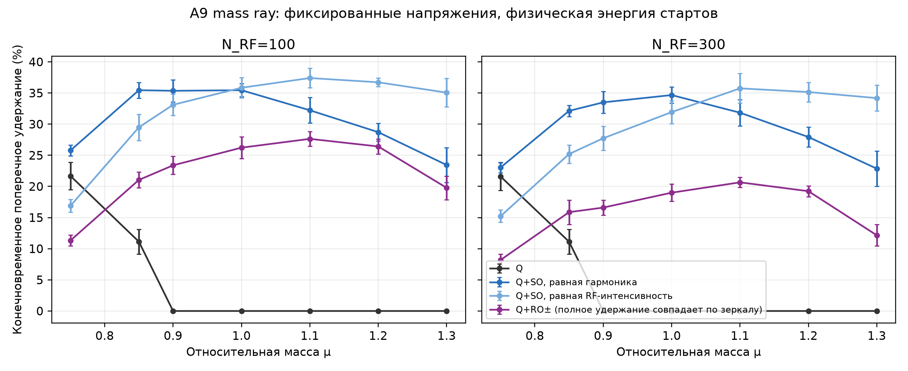
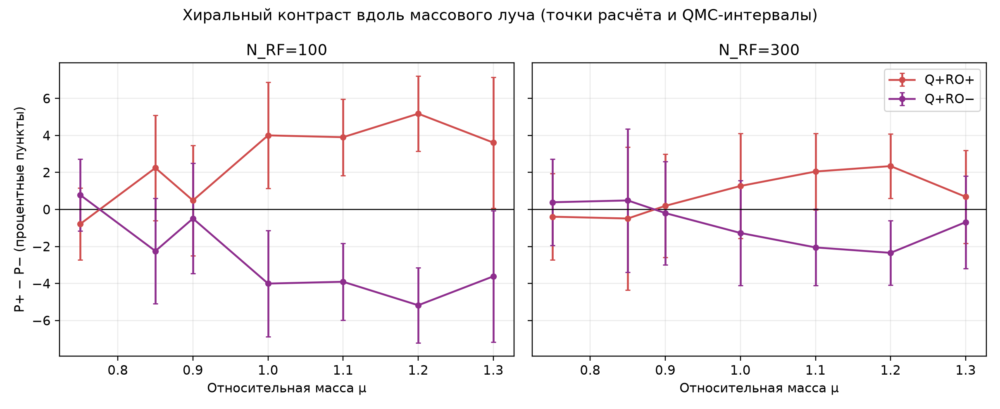

# V15. Массовая зависимость удержания и направленного контраста

## Протокол массового луча

Параметры A9 при опорной массе `M0=3200.0465226 Th`: `alpha0=0.00625`, `beta0=0.075`, `kappa0=−0.015`, `Q=+e`, `R=8 mm`, `f=100 kHz`. При неизменных физических напряжениях `(alpha,beta,kappa)=(alpha0,beta0,kappa0)/mu`, а отношение `mu=(M/Q)/(M0/Q0)`. Начальная область физическая: `r0≤7.5 mm`, `E_perp≤5 eV`; при сканировании сохранялась физическая энергия, поэтому безразмерная начальная скорость изменялась как `mu^-1/2`.

Идеальный RK4 скан: `mu={0.75,0.85,0.90,1.00,1.10,1.20,1.30}`, 8 независимых scrambled-Sobol реплик ×128 зеркальных пар (2048 стартов на схему и массу), 256 шагов на RF, начальная фаза `tau0=0°`, относительная фаза `delta=0°`, горизонты 100 и 300 RF с непрерывным продолжением. Всего 143 360 уникальных trajectory-horizon записей; unresolved и напряжений выше 250 V не было. ДИ рассчитаны по восьми средним независимых scramble; это конечновременное поперечное удержание, не передача прибора.

## Полные профили удержания (идеальные гармоники)

Числа ниже — доли удержания, проценты; интервалы по каждой точке и парные разности доступны в CSV. RO+ и RO− имеют идентичное полное удержание на зеркально-симметричном ансамбле.

| `mu` | Q, 100 RF | SO равная гармоника | SO равная RF-интенсивность | RO± |
|---:|---:|---:|---:|---:|
| 0.75 | 21.68 | 25.78 | 16.89 | 11.33 |
| 0.85 | 11.13 | 35.45 | 29.49 | 21.04 |
| 0.90 | 0.00 | 35.35 | 33.11 | 23.39 |
| 1.00 | 0.00 | 35.45 | 35.84 | 26.22 |
| 1.10 | 0.00 | 32.23 | 37.40 | 27.64 |
| 1.20 | 0.00 | 28.71 | 36.72 | 26.42 |
| 1.30 | 0.00 | 23.44 | 35.06 | 19.78 |

| `mu` | Q, 300 RF | SO равная гармоника | SO равная RF-интенсивность | RO± |
|---:|---:|---:|---:|---:|
| 0.75 | 21.58 | 23.05 | 15.23 | 8.20 |
| 0.85 | 11.13 | 32.13 | 25.20 | 15.87 |
| 0.90 | 0.00 | 33.50 | 27.73 | 16.60 |
| 1.00 | 0.00 | 34.67 | 31.93 | 18.99 |
| 1.10 | 0.00 | 31.84 | 35.74 | 20.65 |
| 1.20 | 0.00 | 27.93 | 35.16 | 19.24 |
| 1.30 | 0.00 | 22.85 | 34.18 | 12.16 |

Для `mu=0.75` RO ниже Q на 100 RF на `−10.35 п.п. [−12.55,−8.16]`; при `mu=0.85` RO выше Q на `+9.91 [7.77,12.05]`, а при `mu=1.00` на `+26.22 [24.46,27.98]`. Однако на всей сетке RO остаётся ниже SO при равной ведущей гармонике и при равной средней RF-интенсивности. Например, при `mu=1.20` RO−SO (равная гармоника) = `−2.29 п.п. [−3.93,−0.66]` на 100 RF и `−8.69 [−10.93,−6.45]` на 300 RF. Это реальная в идеальной модели нелинейная массовая зависимость RO относительно Q, но не преимущество над SO.

## Массовая зависимость `Delta_chi`

При RO+ `delta=tau0=0°` идеальный массовый луч даёт кратковременный положительный контраст на части масс:

| `mu` | `Delta_chi`, 100 RF (п.п.) | `Delta_chi`, 300 RF (п.п.) |
|---:|---:|---:|
| 0.75 | −0.78 [−2.73,1.16] | −0.39 [−2.73,1.95] |
| 0.85 | +2.25 [−0.60,5.09] | −0.49 [−4.36,3.38] |
| 0.90 | +0.49 [−2.49,3.47] | +0.20 [−2.59,2.98] |
| 1.00 | +4.00 [1.14,6.87] | +1.27 [−1.57,4.10] |
| 1.10 | +3.91 [1.84,5.97] | +2.05 [−0.01,4.11] |
| 1.20 | +5.18 [3.14,7.21] | +2.34 [0.60,4.09] |
| 1.30 | +3.61 [0.07,7.16] | +0.68 [−1.82,3.19] |

Так как `mu=1.20` было выбрано после просмотра семиточечного профиля, для него проведён новый идеальный расчёт на восьми новых Sobol seeds (8×128 пар). Он независимо воспроизвёл `Delta_chi(100)=+4.59 п.п. [0.90,8.28]`; на 300 RF получил `+2.05 [−1.72,5.83]`, уже не отличимый от нуля. Это поддерживает кратковременный идеальный эффект, не устойчивую долговременную селективность. Массовый поиск не корректировался на множественное сравнение, поэтому одиночные интервалы по семи точкам не являются глобальной статистической гарантией.

## FEM и ограничения

Полное h50/h35 P4 FEM при `mu=1.20` (фиксированные физические напряжения, `M=3840.055827 Th`, `alpha=0.00520833`, `beta=0.0625`, `kappa_RO=−0.0125`) завершено с 8×16 зеркальными парами на модель и сетку, 100/300 RF. Напряжения остаются такими же как при `mu=1` и ниже 121.1 V. Наблюдаемое `Delta_chi` RO+ на 100 RF: h50 `+0.78 п.п. [−2.57,4.13]`, h35 `−0.78 [−5.96,4.40]`; на 300 RF h50 `0.00 [−2.79,2.79]`, h35 `+1.56 [−0.86,3.98]`. Все интервалы включают ноль. Поэтому идеальный `mu=1.2` контраст не воспроизведён на полном FEM в пределах этой выборки.

При `mu=1.20` FEM RO выше Q на 100 RF на обеих сетках: `+4.30 п.п. [0.89,7.70]` (h50) и `[1.53,7.07]` (h35). На 300 RF разность h50 `+2.34 [−0.70,5.39]` не разрешена, h35 `+2.34 [0.03,4.66]` едва выше нуля. RO−SO равной ведущей гармоники не разрешён: на 100 RF обе сетки `−1.17 [−4.27,1.93]`; на 300 RF h50 `−0.78 [−3.10,1.53]`, h35 `−0.39 [−1.31,0.53]`. RO−SO равной интенсивности также включает ноль. Результат не указывает на специфическую селективность RO относительно SO.

В скане ни у RO, ни у SO нет узкой полосы передачи, ограниченной с обеих сторон с разрешённой FWHM. Поэтому `R_m` не рассчитывается. Данные не содержат осевого пролёта, входного распределения реального прибора и краевых полей, следовательно `T(M/Q)` и приборное mass resolution не получены.

Данные и протоколы: `mass_ray_a9/manifest.json`, `retention_summary.csv`, `paired_retention_differences.csv`, `validation.json`; независимый идеальный повтор `mass_chirality_mu1p2_confirmation/`; corrected FEM-повтор `fem_mass_mu1p2_confirmation_fixed/`. Первый ошибочный запуск оставлен отдельно и помечен `INVALID_RUN_DIAGNOSTIC.json`.
