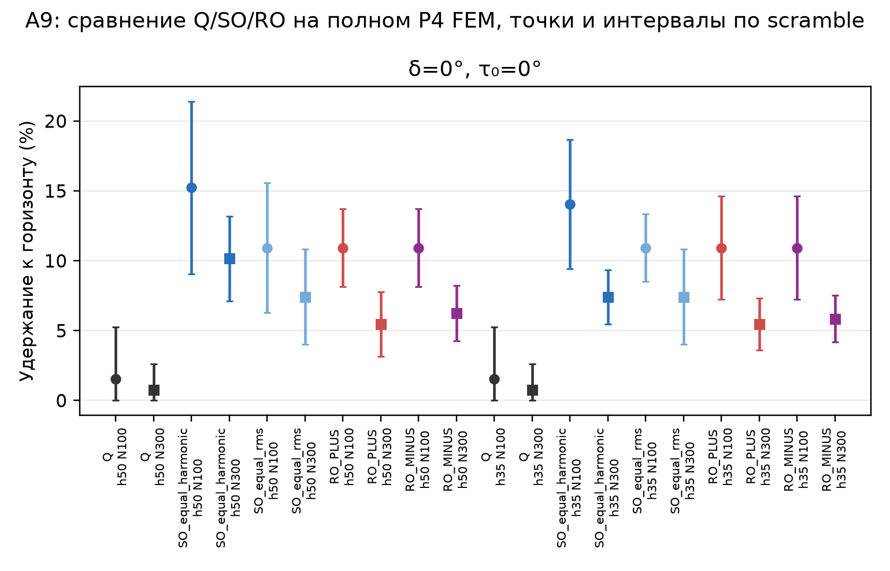
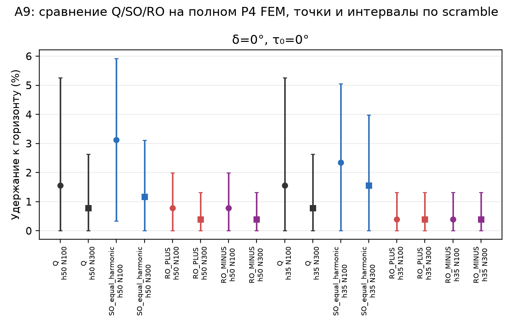

# V15. Q, Q+SO и Q+RO: сопоставимые режимы

## Режим и нормировки

A9: `alpha=0.00625`, `beta=0.075`, `kappa=−0.015`, `mu=1`, `M0=3200.0465226 Th`, `Q=+e`, `R=8 mm`, `f=100 kHz`. Реальные модальные коэффициенты: `c2=d2=0.7718255558274`, `c4=0.5413395699439`. Физические напряжения: `U2=81.4286 V`, `VDC=6.7857 V`, `U4=−23.2197 V` для равной ведущей октупольной гармоники; `SO` при равной RF-средней интенсивности использует `sqrt(2)` по амплитуде октуполя.

В основном A9 сравнении максимумы составляют 88.214 V для Q, 111.434 V для SO/RO равной ведущей гармоники и 121.052 V для SO равной RF-интенсивности. В отдельном cap-контроле Q оставлен на базовом A9 уровне, тогда как октупольные SO и RO сравниваются при одинаковом пике 249.823 V; это прямой аппаратный контроль вращения при общем квадруполе, но не глобальная оптимизация чистого Q. RO− — это инверсия направления вращения синусной квадратуры, не смена знака `kappa`.

## Идеальная гармоническая модель, A9

Общий равномерный 4D домен, 8 независимых Sobol-реплик ×128 зеркальных пар, `delta=tau0=0°`. Интервалы — 95% t-интервалы по репликам.

| `N_RF` | Q | Q+SO, равная гармоника | Q+SO, равная RF-интенсивность | Q+RO± |
|---:|---:|---:|---:|---:|
| 100 | 0.00% | 35.45% [34.41,36.49] | 35.84% [34.22,37.46] | 26.27% [24.47,28.06] |
| 300 | 0.00% | 34.67% [33.36,35.97] | 31.84% [29.93,33.74] | 19.29% [17.96,20.62] |
| 1000 | 0.00% | 33.79% [32.05,35.53] | 29.79% [27.68,31.89] | 12.40% [11.22,13.58] |

В этой идеальной модели RO уступает SO на обеих нормировках; разность RO−SO при равной ведущей гармонике достигает `−21.39 п.п. [−23.77,−19.01]` к 1000 RF. Результат относится к A9, заданному физическому ансамблю и фазам.

## Полное P4 FEM, A9

На h50 и h35 использованы существующие сохранённые поля, 8 скремблирований ×16 зеркальных пар, DOP853 и общее начальное состояние между моделями.

| Сетка / горизонт | Q | Q+SO, равная гармоника | Q+SO, равная RF-интенсивность | Q+RO+ | RO+−Q (парно) | RO+−SO гармоника (парно) | RO+−SO RMS (парно) |
|---|---:|---:|---:|---:|---:|---:|---:|
| h50 / 100 | 1.56% [0,5.26] | 15.23% [9.08,21.39] | 10.94% [6.31,15.57] | 10.94% [8.14,13.73] | +9.38 [3.62,15.13] | −4.30 [−10.53,1.94] | 0.00 [−5.76,5.76] |
| h35 / 100 | 1.56% [0,5.26] | 14.06% [9.43,18.69] | 10.94% [8.52,13.36] | 10.94% [7.24,14.63] | +9.38 [3.13,15.62] | −3.13 [−7.96,1.71] | 0.00 [−4.84,4.84] |
| h50 / 300 | 0.78% [0,2.63] | 10.16% [7.11,13.20] | 7.42% [4.02,10.82] | 5.47% [3.15,7.79] | +4.69 [1.89,7.48] | −4.69 [−8.64,−0.74] | −1.95 [−5.63,1.73] |
| h35 / 300 | 0.78% [0,2.63] | 7.42% [5.48,9.37] | 7.42% [4.02,10.82] | 5.47% [3.62,7.32] | +4.69 [2.27,7.11] | −1.95 [−3.31,−0.60] | −1.95 [−5.63,1.73] |

Парные разности приведены в процентных пунктах с 95% ДИ по восьми независимым scramble-репликам. Результат по A9 FEM: RO повышает конечновременное удержание относительно Q, но не даёт увеличения относительно SO. При равной ведущей гармонике RO на 300 RF ниже SO на обеих сетках; размер разности зависит от сетки. При равной RF-средней интенсивности сравнение RO/SO статистически не разрешено. На 100 RF RO/SO также не разделяются.

## Массовый луч

Для идеальных гармоник, при фиксированных напряжениях, `P_RO` ниже обеих SO-нормировок на всех семи точках `mu=0.75…1.30`. Относительно Q знак меняется: RO теряет около 10.35 п.п. при `mu=0.75`, но прибавляет 9.91 п.п. при `mu=0.85` и 26.22 п.п. при `mu=1.0` на 100 RF. Это массовая зависимость конечновременного поперечного удержания, не приборная передача.

Ни ideal-скан, ни исходный A9 FEM не показывают превосходства RO над SO при равной гармонике и равной RF-интенсивности. Дополнительно выполнено насыщенное сравнение при почти одинаковом пределе `max_j,t |V_j|=250 V`; подробности ниже.

### Одинаковый предельный пик электродного напряжения

Квадрупольные `U2,VDC` зафиксированы на A9; чистый Q поэтому сохраняет пик `88.214 V` и не является отдельно оптимизированным фильтром. Амплитуды октуполя RO и SO равной ведущей гармоники увеличены одинаково в `6.96` раза (`κ=−0.1044`, `η=−1.392`). Для каждого RO± и SO расчётный максимум по 12 электродам составляет `249.823 V` (99.93% лимита). Точный аналитический масштаб до 250 V равен `6.9676123` (`U4=−161.7857 V`, `κ=−0.1045142`); траекторный запуск оставлен чуть ниже предела. SO равной RF-интенсивности потребовал бы `√2` большей амплитуды и потому исключён из сравнения с тем же аппаратным ограничением. Полный FEM h50/h35, восемь независимых scramble ×16 зеркальных пар, общие старты, `δ=τ0=0°`, горизонты 100/300 RF.

| Сетка / горизонт | Q | Q+SO, пик 249.82 V | Q+RO+, пик 249.82 V | RO+−SO (парно), п.п. | RO+−Q (парно), п.п. |
|---|---:|---:|---:|---:|---:|
| h50 / 100 | 1.56% [0,5.26] | 3.13% [0.33,5.92] | 0.78% [0,1.99] | −2.34 [−5.39,0.70] | −0.78 [−4.91,3.35] |
| h35 / 100 | 1.56% [0,5.26] | 2.34% [0,5.05] | 0.39% [0,1.31] | −1.95 [−4.35,0.44] | −1.17 [−5.11,2.76] |
| h50 / 300 | 0.78% [0,2.63] | 1.17% [0,3.12] | 0.39% [0,1.31] | −0.78 [−1.99,0.43] | −0.39 [−2.57,1.79] |
| h35 / 300 | 0.78% [0,2.63] | 1.56% [0,3.98] | 0.39% [0,1.31] | −1.17 [−3.12,0.77] | −0.39 [−2.57,1.79] |

Все парные интервалы RO−SO и RO−Q включают ноль; точечные оценки RO ниже SO на обеих сетках и горизонтах. RO+ и RO− дают одинаковые полные доли удержания на парном ансамбле. Таким образом, ограничение напряжения не выявляет скрытого выигрыша RO. При этом это специально выбранная точка A9 и большой `|η|`, а не глобальная оптимизация аппаратных режимов.

Полная таблица, определения и доверительные интервалы: [MASS_DEPENDENCE_RU.md](MASS_DEPENDENCE_RU.md), [mass-ray CSV](mass_ray_a9/paired_retention_differences.csv), [FEM paired CSV](fem_confirmation_a9_refined/paired_retention_differences.csv), [equal-peak paired CSV](fem_equal_peak_a9/paired_retention_differences.csv).
