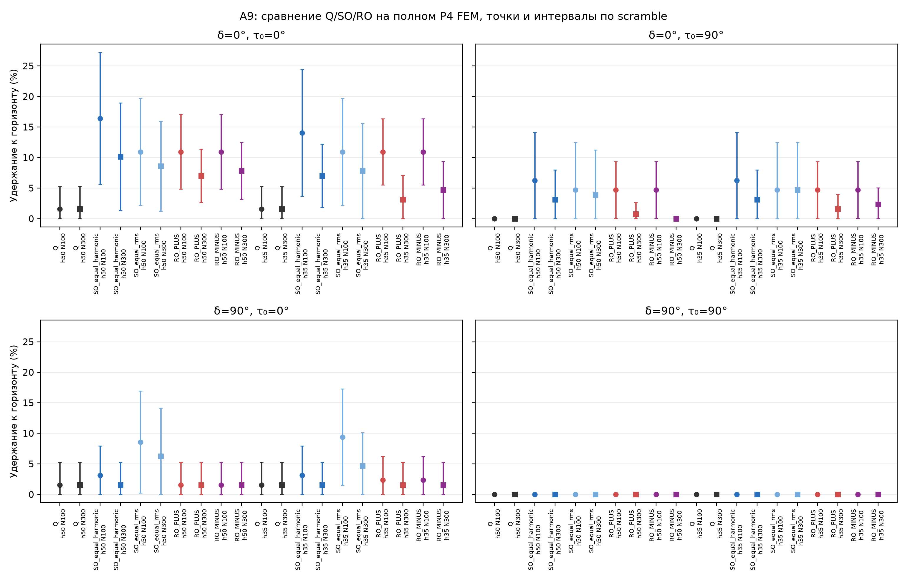

# Относительная фаза и RF-фаза инжекции

## Определения

`τ₀` — начальная общая фаза квадрупольного RF-возбуждения и носителя октуполя; `δ` — относительная фаза октуполя. Для SO используется `cos(τ+τ₀−δ)`, для RO± — `Re[z⁴ exp(∓i(τ+τ₀−δ))]`. Обращение направления RO нельзя заменить `κ→−κ` или сдвигом `δ→δ+π`.

## Идеальная модель

Для A9 при `δ=0°`, Q+RO удерживает на 100 RF `26.27% [24.47,28.06]` при `τ₀=0°`, но только `0.68% [0.30,1.06]` при `τ₀=90°`. При `δ=90°` RO удерживает `0.68% [0.30,1.06]` при `τ₀=0°` и `0.29% [0.00,0.58]` при `τ₀=90°`. Следовательно, эффект вращающегося поля сильно зависит от отношения двух фаз.

При `δ=τ₀=0°` хиральный контраст RO+ `Δχ` равен `+4.10 п.п. [1.23,6.98]` на 100 RF, но уже не разрешён на 300 RF (`+1.66 [−1.60,4.92]`) и 1000 RF (`+1.56 [−0.75,3.88]`). При `δ=0°, τ₀=90°` контраст не разрешён от нуля даже на 100 RF. Средний перенос момента также меняет знак при изменении фаз: на 100 RF `⟨Δell⟩=+0.04212` для `(δ,τ₀)=(0°,0°)`, `+0.01932` для `(0°,90°)`, `+0.00080` для `(90°,0°)` и `−0.00818` для `(90°,90°)`; соответствующие интервалы указаны в `ideal_angular_momentum_summary.csv`.

## Полный FEM, четыре фазовых сочетания

Для `δ,τ₀={0°,90°}` проведён более дешёвый h50/h35 P4 FEM экран: 8 scramble ×8 зеркальных пар, 128 стартов на конфигурацию и фазовое сочетание. При `δ=τ₀=0°` RO удерживает 10.94% на 100 RF на обеих сетках; SO с равной гармоникой — 16.41% (h50) и 14.06% (h35). При `δ=0°,τ₀=90°` RO удерживает 4.69% на обеих сетках на 100 RF, SO — 6.25%. При `δ=90°,τ₀=0°` RO даёт лишь 1.56% на h50 и 2.34% на h35, SO — 3.13% на обеих сетках. При `δ=τ₀=90°` на этом малом ансамбле все режимы дали нулевое удержание. 95% интервалы достаточно широки; это скрининг фазовой чувствительности, а не точная карта.

На refined h50/h35 наборе `δ=τ₀=0°` (256 стартов/модель): RO равно 10.94% [8.14,13.73] на h50 и 10.94% [7.24,14.63] на h35 к 100 RF; к 300 RF — 5.47% [3.15,7.79] и 5.47% [3.62,7.32]. SO с равной гармоникой удерживает больше RO на 300 RF на обеих сетках. При равной средней RF-интенсивности RO−SO остаётся статистически неразрешённым.

## Интерпретация

Сильная фазовая модуляция присутствует уже в идеальной модели и сохраняется качественно на полном FEM. Это подтверждает, что в V14/V15 фазу нельзя считать несущественной. Однако данные не различают вклады усреднённой направленной динамики и конечной RF-микродинамики. Для механистического объяснения потребуются фазово-усреднённые орбиты/частоты, более плотный скан `δ` и сопоставимое сравнение хирального контраста на FEM. Здесь это не выполнено, поэтому объяснение сильной фазовой зависимости остаётся открытым.
