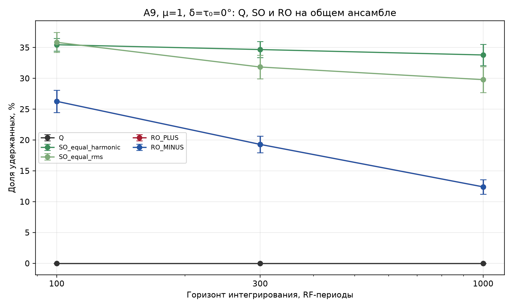
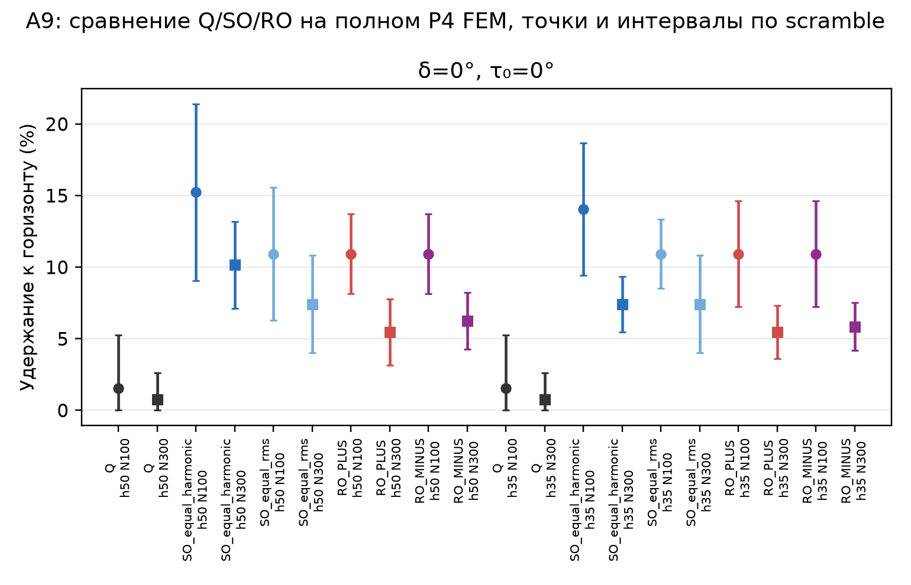
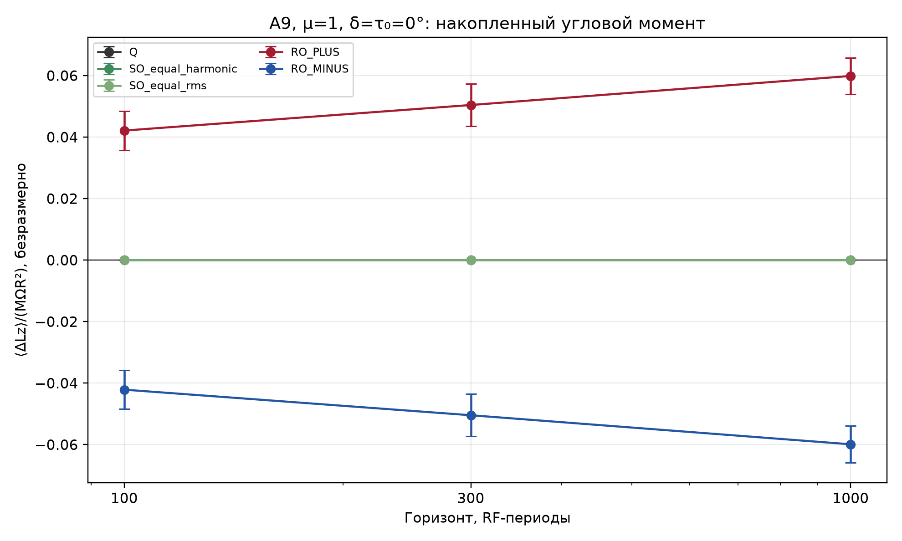
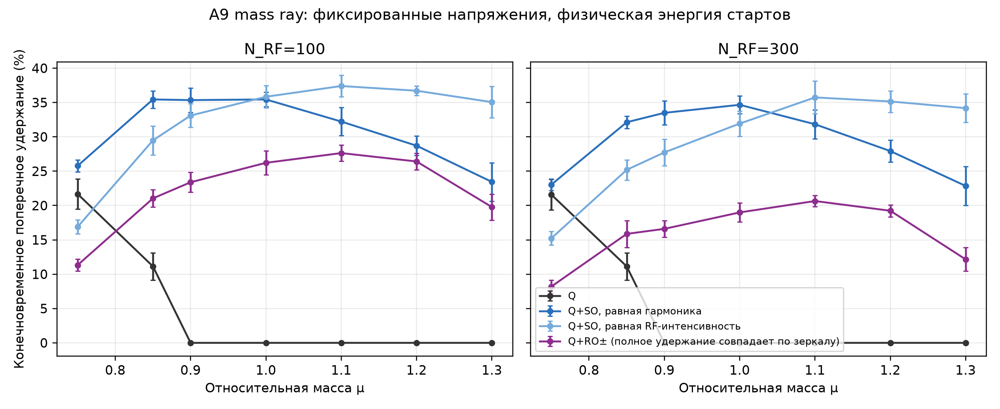
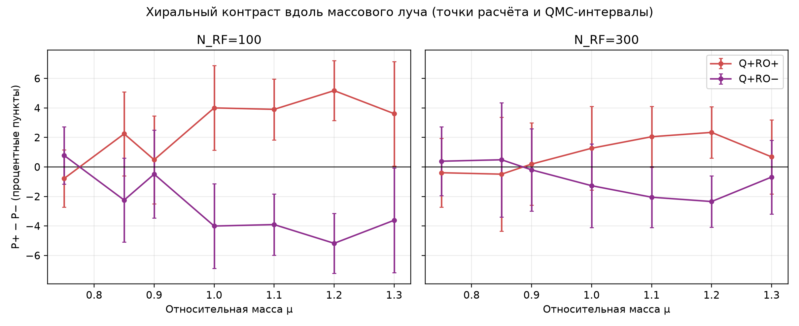
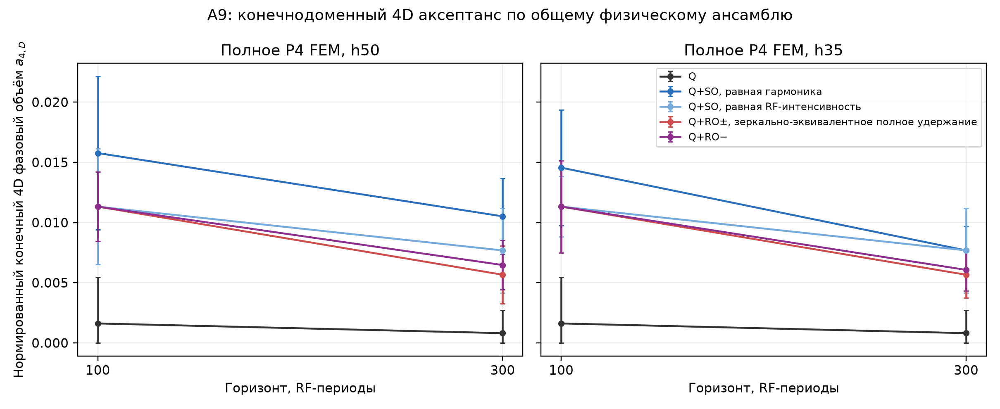
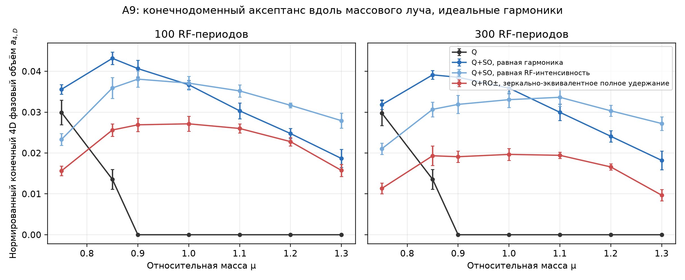
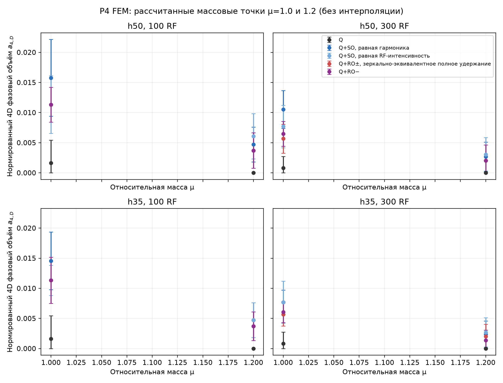
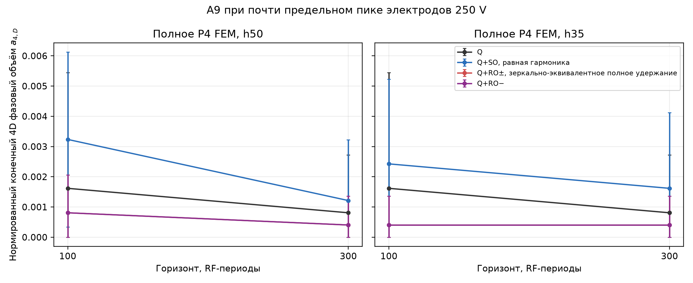

# V15. Вращающийся октуполь в квадрупольной RF/DC-ловушке: направленное удержание, момент и массовая зависимость

## Аннотация

Проведено численно-контролируемое исследование того, создаёт ли вращающийся RF-октуполь специфическое нелинейное поведение в присутствии общего стоячего RF/DC-квадруполя. Сопоставлены четыре конфигурации: Q, Q+SO, Q+RO+ и Q+RO−. Для SO отдельно рассмотрены равная ведущая октупольная гармоника и равная RF-средняя интенсивность октупольного поля. Начальные состояния сформированы зеркальными парами на одном 4D фазовом домене, чтобы отделить направленную селективность по знаку начального углового момента от локальной угловой асимметрии.

**Главный вывод:** направление вращения создаёт воспроизводимый перенос углового момента в идеальной модели и на полном P4 FEM-поле. В A9, однако, ансамблевый хиральный контраст удержания на FEM не разрешён от нуля; RO не удерживает лучше SO при сопоставимых нормировках. Отдельный полный FEM контроль при почти предельном `250 V` пике также не обнаружил преимущества RO: его точечное удержание и 4D мера ниже SO на обеих сетках, хотя парные интервалы широки. Идеальный массовый луч показывает широкую нелинейную зависимость, но не узкий ограниченный пик; условное разрешение не определяется. Полученная 4D мера — объём удерживаемых стартов в заданном домене, а не ток или передача конечнодлинного фильтра. Поэтому специфическое влияние вращения на механический момент подтверждено, а практически полезный уникальный механизм хирального или масс-селективного удержания — нет.

## 1. Что проверялось и что не является новым результатом V15

V14 ранее обнаружила внеосевые периодические орбиты, фазовую чувствительность RO и широкое конечновременное удержание, включая случаи за линейной границей Флоке. Эти орбиты и результаты не пересчитывались и не заявляются как новые открытия V15. Здесь проверялась другая гипотеза: различается ли удержание стартов с `Lz(0)>0` и `Lz(0)<0`, и сопровождается ли направленный момент полезной популяционной селекцией.

Основной режим A9: `α=0.00625`, `β=0.075`, `κ=−0.015`, `η=−0.20`, `μ=1`, `Q=+e`, `M₀=3200.0465226 Th`, `f=100 kHz`, `R=8 mm`. Физические электроды: `U₂=81.42857 V`, `VDC=6.78571 V`, `U₄=−23.21968 V` для Q+RO и SO равной ведущей гармоники. Для SO равной RF-средней интенсивности `|U₄|` увеличен в `√2` раза. Максимальное мгновенное напряжение среди двенадцати электродов составляет 88.21 V для Q, 111.43 V для равной гармоники и 121.05 V для SO равной интенсивности; всё ниже 250 V.

Точная модель, определения фаз, начальный домен и синтез электродных напряжений описаны в [безразмерной модели](DIMENSIONLESS_MODEL_RU.md) и таблице [электродных напряжений](electrode_voltages_A9.csv).

## 2. Ансамбли и достоверность сравнения

Главный идеальный ансамбль использует общий домен `r₀≤7.5 mm`, равномерно по площади, и `E⊥≤5 eV`, равномерно по площади диска скоростей. Каждая scrambled-Sobol реплика построена зеркальными парами: одинаковы радиус, энергия, радиальная скорость и модуль тангенциальной скорости, отличается знак `Lz`. Это исключает подмену хиральной селективности особенностями угла запуска. Использованы восемь независимых scramble ×128 зеркальных пар, фазы инжекции `τ₀={0°,90°}`, относительные фазы `δ={0°,90°}`, схемы Q/SO/RO± и горизонты 100, 300, 1000 RF. Итого 122 880 строк траекторий по горизонтам.

Вероятности и парные разности сопровождаются 95% t-интервалами по независимым значениям scramble, а не по точкам одной QMC-последовательности. Идеальные траектории интегрированы RK4 с 128 шагами на RF-период; выжившие непрерывно продолжены на 300 и 1000 периодов. FEM использует сохранённые полные P4 базисы m=2 и m=4 на сетках h50 и h35, DOP853 (`rtol=3×10⁻⁹`, `atol=3×10⁻¹¹`, `max_step=2π/64`) и непрерывное продолжение 100→300 RF.

## 3. Симметрии и хиральное удержание

Отражение `S:(x,y,vx,vy)→(x,−y,vx,−vy)` меняет знак `Lz`. Оно сохраняет Q и SO, но переводит RO+ в RO−. Поэтому Q/SO на точной зеркальной паре имеют `Δχ=P+−P−=0`, а RO+ и RO− должны иметь одинаковое полное удержание и противоположный направленный контраст. Это следствие симметрии, а не эмпирическое открытие.

### Идеальная модель A9, `δ=τ₀=0°`

| Горизонт | Q | Q+SO, равная гармоника | Q+SO, равная RF-интенсивность | Q+RO+ и Q+RO− |
|---:|---:|---:|---:|---:|
| 100 RF | 0.00% | 35.45% [34.41,36.49] | 35.84% [34.22,37.46] | 26.27% [24.47,28.06] |
| 300 RF | 0.00% | 34.67% [33.36,35.97] | 31.84% [29.93,33.74] | 19.29% [17.96,20.62] |
| 1000 RF | 0.00% | 33.79% [32.05,35.53] | 29.79% [27.68,31.89] | 12.40% [11.22,13.58] |

Хиральный контраст RO+ равен `+4.10 п.п. [1.23,6.98]` на 100 RF, но на 300 RF уже `+1.66 [−1.60,4.92]`, а на 1000 RF `+1.56 [−0.75,3.88]`. Последние два интервала включают ноль. RO− имеет противоположный знак контраста. Это короткий идеальный фазово-зависимый сдвиг удержания, но не подтверждённая долговременная селекция.

### Начальный поиск по другим физическим точкам

Перед крупным подтверждением выполнен компактный идеальный screening в четырёх кандидатных точках из V13.3: A9, `gain_negative`, `gain_positive` и `floquet_stable`. Каждая точка: четыре независимых scramble ×16 зеркальных пар, 100 RF, `δ=τ₀=0°`. Это отборочный набор (64 пары/точку), не финальная статистика; он показывает, что A9 — не единственная проверенная точка.

| Точка | Q | SO равная гармоника | SO равная интенсивность | RO± |
|---|---:|---:|---:|---:|
| A9 | 0.0% | 39.1% [26.5,51.6] | 35.9% [19.0,52.9] | 21.9% [13.8,30.0] |
| `gain_negative` | 0.0% | 32.8% [23.3,42.3] | 29.7% [20.2,39.2] | 14.1% [7.6,20.5] |
| `gain_positive` | 0.0% | 25.0% [10.9,39.1] | 26.6% [17.0,36.1] | 18.8% [6.6,30.9] |
| `floquet_stable` | 54.7% [49.7,59.7] | 34.4% [28.6,40.1] | 25.0% [6.8,43.2] | 8.6% [0.1,17.1] |

На этих предварительных точках RO тоже не превзошёл SO; в `floquet_stable` RO удержал меньше Q. Из-за малого ансамбля и выбора точек по прежним расчётам этот screening не доказывает общего отсутствия оптимальных RO-режимов. Он лишь не даёт оснований расширять дорогие FEM расчёты на эти точки в рамках V15.

### Полный FEM A9

В refined парном наборе использовано 8 scramble ×16 пар =256 стартов на схему и сетку, `δ=τ₀=0°`. Удержание к 100/300 RF:

| Схема | h50, 100 RF | h35, 100 RF | h50, 300 RF | h35, 300 RF |
|---|---:|---:|---:|---:|
| Q | 1.56% [0,5.26] | 1.56% [0,5.26] | 0.78% [0,2.63] | 0.78% [0,2.63] |
| Q+SO, равная гармоника | 15.23% [9.08,21.39] | 14.06% [9.43,18.69] | 10.16% [7.11,13.20] | 7.42% [5.48,9.37] |
| Q+SO, равная интенсивность | 10.94% [6.31,15.57] | 10.94% [8.52,13.36] | 7.42% [4.02,10.82] | 7.42% [4.02,10.82] |
| Q+RO± | 10.94% [8.14,13.73] | 10.94% [7.24,14.63] | 5.47% [3.15,7.79] | 5.47% [3.62,7.32] |

Парный контраст RO−Q положителен: на 100 RF `+9.38 п.п.` на обеих сетках; на 300 RF `+4.69 п.п.` на обеих сетках, интервалы не включают ноль. Но RO против SO равной гармоники на 100 RF не разрешён; на 300 RF разность отрицательная на обеих сетках: h50 `−4.69 [−8.64,−0.74]`, h35 `−1.95 [−3.31,−0.60]` п.п. При нормировке SO на равную среднюю RF-интенсивность RO−SO не разрешён от нуля на 100 и 300 RF. Итак, RO улучшает удержание относительно Q в этом режиме, но не относительно SO; величина RO−SO при одинаковой ведущей гармонике зависит от сетки.

На FEM A9 `Δχ` RO не разрешён от нуля ни на h50, ни на h35: на 100 RF оценки равны нулю с 95% интервалами ±4.84 и ±5.59 п.п.; на 300 RF h50 `−1.56 [−6.19,3.07]`, h35 `0 [−3.95,3.95]`. Следовательно, главный идеальный хиральный контраст не прошёл FEM-подтверждение в пределах доступной статистики.

## 4. Направленный перенос углового момента

Безразмерный угловой момент `ell=Lz/(MΩR²)=x vy−y vx`; момент силы `x ay−y ax`. В идеальном A9 для RO+ при `(δ,τ₀)=(0°,0°)` среднее `Δell` по всей стартовой популяции равно:

| Горизонт | RO+ | RO− | RO+ среди выживших |
|---:|---:|---:|---:|
| 100 RF | +0.04212 [0.03579,0.04846] | −0.04212 [−0.04846,−0.03579] | +0.00015 [−0.00232,0.00262] |
| 300 RF | +0.05044 [0.04354,0.05733] | −0.05044 [−0.05733,−0.04354] | −0.00179 [−0.00438,0.00080] |
| 1000 RF | +0.05988 [0.05393,0.06584] | −0.05988 [−0.06584,−0.05393] | +0.00107 [−0.00102,0.00316] |

В среднем момент у выжившей подвыборки близок к нулю; основной вклад даёт популяция, которая выходит за апертуру. На полном FEM к 100 RF `⟨Δell⟩` RO+ равен `+0.01908 [0.00634,0.03183]` (h50) и `+0.02149 [0.00659,0.03638]` (h35). На 300 RF знак сохраняется и интервал остаётся положительным на обеих сетках; RO− даёт противоположный знак. FEM баланс `Δell−∫torque` закрывается с максимальной невязкой `1.15×10⁻¹¹`.

Таким образом, направленная передача момента от бегущего поля подтверждена. Но среднее по общей популяции нельзя интерпретировать как захват удерживаемых ионов с заданным вращением: выжившие в среднем не демонстрируют разрешённого ненулевого остаточного момента.

## 5. Фазовая зависимость

Идеальная модель резко зависит от `τ₀` и `δ`. При `δ=0°` RO удерживает 26.27% на 100 RF для `τ₀=0°`, но 0.68% для `τ₀=90°`. При `δ=90°` значения составляют 0.68% и 0.29%. Меняется и знак среднего `Δell`: на 100 RF RO+ даёт `+0.04212`, `+0.01932`, `+0.00080` и `−0.00818` для `(δ,τ₀)=(0,0),(0,90),(90,0),(90,90)°` соответственно.

На полном FEM малый фазовый экран качественно сохраняет сильную зависимость, хотя интервалы широки. При `(δ,τ₀)=(0°,0°)` RO удерживает 10.94% на 100 RF на обеих сетках; при `(0°,90°)` — 4.69%; при `(90°,0°)` — 1.56% на h50 и 2.34% на h35; при `(90°,90°)` — ноль в этой ограниченной выборке. Это скрининг 128 стартов на комбинацию, не точная фазовая карта. Механизм зависимости — усреднённая направленная динамика либо неусреднённая RF-микродинамика — этим расчётом не разделён.

Подробные значения, включая SO-контроли и интервалы, приведены в [анализе фаз](PHASE_DEPENDENCE_RU.md).

## 6. Массовая зависимость и условная селективность

При фиксированных физических напряжениях `α,β,κ∝1/μ`, начальная безразмерная скорость масштабируется как `μ⁻¹/²` при фиксированной физической поперечной энергии. Проведён идеальный массовый луч `μ={0.75,0.85,0.90,1.00,1.10,1.20,1.30}`; для каждой массы использованы 8 scramble ×128 пар и Q/SO/RO+ при `δ=τ₀=0°`, 100/300 RF. Всего 143 360 trajectory-horizon строк; unresolved исходов нет.

На 100 RF полное удержание, %:

| μ | Q | SO равная гармоника | SO равная интенсивность | RO± |
|---:|---:|---:|---:|---:|
| 0.75 | 21.68 | 25.78 | 16.89 | 11.33 |
| 0.85 | 11.13 | 35.45 | 29.49 | 21.04 |
| 0.90 | 0.00 | 35.35 | 33.11 | 23.39 |
| 1.00 | 0.00 | 35.45 | 35.84 | 26.22 |
| 1.10 | 0.00 | 32.23 | 37.40 | 27.64 |
| 1.20 | 0.00 | 28.71 | 36.72 | 26.42 |
| 1.30 | 0.00 | 23.44 | 35.06 | 19.78 |

RO ниже обеих SO нормировок на всех семи точках. Он ниже чистого Q при `μ=0.75`, выше Q при `μ≥0.85`, а для `μ=1` парная разность RO−Q составляет `+26.22 п.п. [24.46,27.98]`. Это демонстрирует массозависимую нелинейную реакцию модели, но не преимущество RO над SO.

Для `μ=1.20` выполнен независимый идеальный повтор на 8 новых Sobol seeds: `Δχ(100 RF)=+4.59 п.п. [0.90,8.28]`; на 300 RF `+2.05 [−1.72,5.83]`. Поскольку точка выбрана после обзора основного массового луча, этот интервал является подтверждением внутри выбранной точки, но не поправкой на множественный поиск по всему пространству. Долговременный контраст не разрешён.

**Масс-разрешение не рассчитано.** Профиль не содержит узкого локального максимума, ограниченного с обеих сторон и достаточно плотно разрешённого; FWHM и условное `R_m` были бы фиктивными. Это конечновременное поперечное удержание, а не передача через прибор конечной длины.

## 7. Четырёхмерный аксептанс

В домене `D: r₀≤7.5 mm`, `E⊥≤5 eV` объём при `μ=1` равен `167.3891393 m⁴/s²`, или безразмерно `0.1035160261 R⁴Ω²`. Условная мера определяется как `A₄,D=P_ret·Vol(D)`; при фиксированном физическом пороге энергии `Vol(D)∝1/μ`. Это оценка размера сохраняющейся области входного фазового объёма, не экспериментальный ток.

На идеальном A9 при `μ=1` безразмерный `a₄,D`:

| Горизонт | Q | SO, равная гармоника | SO, равная интенсивность | RO± |
|---:|---:|---:|---:|---:|
| 100 RF | 0.00000 | 0.03670 | 0.03710 | 0.02719 |
| 300 RF | 0.00000 | 0.03589 | 0.03296 | 0.01996 |
| 1000 RF | 0.00000 | 0.03498 | 0.03083 | 0.01284 |

Для FEM при 100 RF `a₄,D` Q равен `0.00162`; SO равной гармоники — `0.01577` (h50) и `0.01456` (h35); SO равной интенсивности и RO — `0.01132` на обеих сетках. На 300 RF Q равно `0.00081`; SO равной гармоники — `0.01051` (h50) и `0.00768` (h35); SO равной интенсивности — `0.00768`; RO — `0.00566` на обеих сетках. Итак, A9 RO даёт больший конечновременный 4D фазовый объём, чем Q, но меньший, чем SO равной гармоники; сравнение с SO равной RF-интенсивности не разрешено статистически на удержании.

Так как `A₄` включает объём скоростной части домена, который меняется как `1/μ` при фиксированном физическом `E⊥`, интерпретация требует смотреть и на `P_ret`, и на `A₄`. Ни один показатель нельзя приравнивать к току без заданного распределения источника.

## 8. Полный FEM при μ=1.2: аудит и подтверждение

Первый запуск `fem_mass_mu1p2_confirmation` оказался внутренне противоречивым: родительский процесс записал manifest для `μ=1.2`, но дочерние Windows `spawn` workers использовали глобальное значение `μ=1`. Этот запуск остановлен, сохранён для аудита и полностью исключён из количественного анализа. Ошибка исправлена передачей `μ` в initializer каждого worker. Отдельный spawn-pilot на 320 строках подтвердил `μ=1.2`, `α=0.00520833`, `β=0.0625`, уникальные ключи, отсутствие unresolved исходов и баланс момента до `7.16×10⁻¹²`.

Исправленный batch `fem_mass_mu1p2_confirmation_fixed` завершён: h50/h35, 8 scramble ×16 зеркальных пар, Q/SO/RO±, 100/300 RF, 5120 строк. Проверка manifest прошла: только `μ=1.2`, `α=0.0052083333`, `β=0.0625`, `κ_RO=−0.0125`, 5120 уникальных ключей, 10 mesh×model групп, нет unresolved, максимум напряжения `121.052 V`, максимальная невязка момента `9.05×10⁻¹²`.

| Сетка / горизонт | Q | SO, равная гармоника | SO, равная интенсивность | RO+ | RO− |
|---|---:|---:|---:|---:|---:|
| h50 / 100 RF | 0% | 5.47% [2.12,8.82] | 7.03% [2.67,11.39] | 4.30% [0.89,7.70] | 4.30% [0.89,7.70] |
| h35 / 100 RF | 0% | 5.47% [2.12,8.82] | 5.47% [2.12,8.82] | 4.30% [1.53,7.07] | 4.30% [1.53,7.07] |
| h50 / 300 RF | 0% | 3.13% [0.33,5.92] | 3.52% [0.26,6.77] | 2.34% [0,5.39] | 2.34% [0,5.39] |
| h35 / 300 RF | 0% | 2.73% [0.15,5.32] | 3.13% [0.33,5.92] | 2.34% [0.03,4.66] | 1.56% [0,3.54] |

При μ=1.2 RO+−SO равной ведущей гармоники составляет `−1.17 п.п. [−4.27,1.93]` на 100 RF на обеих сетках, `−0.78 [−3.10,1.53]` на 300 RF h50 и `−0.39 [−1.31,0.53]` на h35. RO+−SO равной средней RF-интенсивности включает ноль на всех сравнениях. RO+−Q на 100 RF положителен (`+4.30 п.п.`) на обеих сетках; к 300 RF оценка `+2.34` включает ноль на h50 и едва исключает его на h35. RO+ и RO− должны иметь одинаковое ансамблевое удержание по зеркальной симметрии, но в h35 на 300 RF различаются на 0.78 п.п.; парный интервал разности `+0.78 [−0.43,1.99]` включает ноль. Это численно пограничное расхождение не трактуется как физический эффект. Результат — точечное массовое подтверждение, не FEM mass profile.

Хиральный контраст RO+ на μ=1.2 не разрешён от нуля: на 100 RF h50 `+0.78 [−2.57,4.13]`, h35 `−0.78 [−5.96,4.40]`; на 300 RF h50 `0.00 [−2.79,2.79]`, h35 `+1.56 [−0.86,3.98]` п.п. Идеальный независимый эффект μ=1.2 поэтому не воспроизводится как разрешённый FEM контраст. На полном FEM средний `Δell` по всему ансамблю также включает ноль при обоих горизонтах; torque identity закрывается, но направленная селекция по удержанию не подтверждена. Для той же массы нормированный `a₄,D` RO+ составляет `0.00371` [0.00077,0.00664] (h50, 100 RF), `0.00371` [0.00132,0.00610] (h35, 100), и около `0.00202` к 300 RF; SO-оценки выше, но интервалы широки. Полная таблица — [четырёхмерный аксептанс](ACCEPTANCE_AND_MASS_RU.md).

## 9. Проверка при одинаковом аппаратном пике 250 V

Отдельно проверено, меняется ли вывод при использовании почти всего доступного напряжения. Квадрупольные `U₂,VDC` оставлены на A9 (чистый Q остаётся на пике `88.214 V`, без отдельной оптимизации); амплитуды SO и RO увеличены в `6.96` раза, так что `κ=−0.1044`, `η=−1.392`. Максимальный рассчитанный мгновенный пик по двенадцати электродам — `249.823 V`; точный масштаб до 250 V равен `6.9676123`. SO равной RF-интенсивности потребовал бы `√2` большей октупольной амплитуды и потому не помещается в тот же предел. Сравнение проведено на полном h50/h35 P4 FEM, восьми независимых scramble ×16 пар, общих стартах, `δ=τ₀=0°`, 100 и 300 RF.

| Сетка / горизонт | Q | SO (равный пик) | RO+ | RO+−SO, п.п. (парно, 95% ДИ) |
|---|---:|---:|---:|---:|
| h50 / 100 RF | 1.56% [0,5.26] | 3.13% [0.33,5.92] | 0.78% [0,1.99] | −2.34 [−5.39,0.70] |
| h35 / 100 RF | 1.56% [0,5.26] | 2.34% [0,5.05] | 0.39% [0,1.31] | −1.95 [−4.35,0.44] |
| h50 / 300 RF | 0.78% [0,2.63] | 1.17% [0,3.12] | 0.39% [0,1.31] | −0.78 [−1.99,0.43] |
| h35 / 300 RF | 0.78% [0,2.63] | 1.56% [0,3.98] | 0.39% [0,1.31] | −1.17 [−3.12,0.77] |

Парные интервалы включают ноль, поэтому эксперимент не устанавливает статистического RO−SO различия в этой точке; точечные оценки RO ниже SO на обеих сетках и горизонтах. Парные разности RO−Q также включают ноль. Стартовый ансамбль оказался жёстким для этой сильной нелинейности: медиана первого выхода RO — около `0.79 RF`, поэтому длительно удерживаемая популяция здесь не возникла. При этом момент силы переносит `ℓ` в направлении вращения: `Δℓ≈+0.188…+0.189` к 100 RF для RO+ с 95% ДИ, не содержащими ноль; RO− меняет знак. Это физический torque, но не полезная направленная селекция. Условный 4D `a₄,D` также ниже по точечной оценке для RO, чем для SO, а неопределённость широка.

Эта проверка закрывает ограниченный аппаратный контроль RO против SO для выбранной A9 точки, но не является глобальным поиском оптимальных амплитуд/напряжений и не сравнивает с отдельно оптимизированным чистым Q.

## 10. Ограничения численной интерпретации

Идеальный RK4 h128/h256 дал 76 индивидуальных расхождений из 20 480 парных классификаций (0.37%). DOP853 refinement 74 спорных траекторий совпал с h256 для всех на 100 RF, но лишь для 54/74 на 300 RF, хотя агрегатные числа совпали. В индивидуальной судьбе некоторых граничных состояний есть численная/событийная чувствительность.

На FEM h50/h35 ошибки чётности пространственных градиентов малы (`2.51×10⁻⁷`, `3.38×10⁻⁷` в относительной норме на 300 точках). Однако редкие зеркальные траектории при 300 RF расходятся по времени выхода на десятки периодов и дают несколько различных индивидуальных статусов. Такие классификации нельзя объявлять точной траекторной симметрией, а по одной лишь чувствительности времени выхода нельзя объявлять хаос. Ансамблевые интервалы и сравнение сеток остаются главным основанием выводов.

Полевая линейная суперпозиция использует сохранённые FEM базисы без нового решения общей геометрии. Массовый профиль FEM покрывает только отдельные точки, не полную кривую. Нет продольной скорости, конечной длины, входных/выходных краевых полей, поэтому `T(M/Q)` прибора не вычислялась.

## 11. Реестр выполненных расчётов

| Расчёт | Размер и условия | Статус результата |
|---|---|---|
| Идеальный A9 Q/SO/RO± | 122 880 строк; 8×128 пар; `δ,τ₀=0°,90°`; 100/300/1000 RF | Завершён; основная оценка хиральности, момента и удержания |
| Сходимость идеального шага | 20 480 парных классификаций h128/h256; 74 DOP853 уточнения | Завершена; агрегаты стабильнее отдельных граничных судеб |
| Полный FEM фазовый экран A9 | 10 240 строк; h50/h35; 8×8 пар; четыре пары фаз; 100/300 RF | Завершён; фазовый эффект ориентировочен из-за малого ансамбля |
| Полный FEM refined A9 | 5120 строк; h50/h35; 8×16 пар; `δ=τ₀=0°`; 100/300 RF | Завершён; основной FEM контроль, максимум torque residual `1.15e-11` |
| Идеальный массовый луч | 143 360 строк; 7 масс; 5 конфигураций; 100/300 RF | Завершён; узкого ограниченного пика не обнаружено |
| Независимый идеальный повтор μ=1.2 | 20 480 строк; 8 новых Sobol seeds; 100/300 RF | Завершён; короткий `Δχ` подтверждён, 300 RF неразрешён |
| Полный FEM μ=1.2 | h50/h35; 8×16 пар; Q/SO/RO±; 100/300 RF | Завершён и прошёл валидацию; краткий хиральный идеальный эффект не подтверждён |
| Полный FEM при равном пиковом ограничении | 4096 строк; h50/h35; Q/SO/RO±; 8×16 пар; октупольный drive 6.96×; 100/300 RF | Завершён; при 249.823 V RO не превзошёл Q или SO, парные интервалы широки; torque перенесён, хиральное удержание не разрешено |
| 4D мера `A₄,D` | Пересчитана из удержания на общем домене; идеал, FEM и массовый луч | Завершена; не является передачей конечнодлинного прибора |
| Новые спектры, периодические орбиты, длинные массовые хиральные карты | Не выполнялись в V15 | Оставлены будущей программой; V14 — лишь регрессионный контроль |

## 12. Итог по главным вопросам

| Вопрос | Ответ | Статус |
|---|---|---|
| Есть ли отличие RO от SO? | Да, бегущая гармоника передаёт направленный момент и нарушает зеркальную симметрию. | Подтверждено идеалом и A9 FEM |
| Даёт ли RO хирально-селективное удержание? | Идеальный эффект виден при 100 RF в отдельных фазах; на 300/1000 RF и полном FEM A9 контраст включает ноль. | Кратковременный идеальный эффект; полезное селективное удержание не установлено |
| Удерживает ли RO лучше SO? | На A9 полном FEM RO не лучше SO; при одинаковом предельном пике 249.823 V точечная оценка RO ниже SO на обеих сетках и горизонтах, парные интервалы включают ноль. | Преимущество не подтверждено в проверенных нормировках |
| Обнаружена ли масс-селективность RO? | На 7-точечном массовом луче получена широкая нелинейная зависимость, но нет узкого двусторонне ограниченного пика. | Узкий пик/условное разрешение не установлены |
| Найден ли новый резонанс/устойчивый остров? | V15 не проводила нового поиска; орбиты V14 — старый контроль. | Не установлено в V15 |
| Достаточно ли новизны для Q1? | Направленный момент ожидаем из симметрии бегущего поля и общей теории усреднения; практическая селективность не показана. | Заявление о приоритете/Q1 пока не обосновано |

## 13. Научная новизна и рекомендуемая следующая проверка

Добавление октупольного поля к quadrupole mass filter и нелинейная массовая динамика исследовались ранее; вращающиеся RF-ловушки и общая передача момента также известны ([Ding et al. 2003](https://doi.org/10.1002/rcm.1235), [Xiong et al. 2015](https://doi.org/10.1007/s13361-015-1145-7), [Hasegawa & Bollinger 2005](https://doi.org/10.1103/PhysRevA.72.043403), [Cox & Levi 2020](https://doi.org/10.1088/1361-6544/ab7d29)). Поэтому отличительный тезис возможной статьи должен быть уже: количественная зависимость фазово-популяционного момента и выживания от взаимодействия бегущего m=4 с отдельным стоячим RF/DC m=2 в реальной 12-электродной геометрии. V15 пока не доказывает, что это превращается в устойчивую хиральную или масс-селективную функцию.

Для будущей работы сначала нужен независимый массово-хиральный профиль в физически перспективных режимах с более высокой базовой долей выживания и несколькими фазами; увеличение амплитуды RO до аппаратного предела в A9 не помогло. Если контраст `Δχ` снова исчезает к 300 RF и не связывается с устойчивой выжившей популяцией, рациональнее сосредоточить ресурсы на массовой селективности и конечной передаче с заданной осевой инжекцией и краевыми полями. Большие поиски резонансов/хаоса до этого не оправданы.

## Данные и воспроизводимость

Итоговые таблицы: `confirmation_a9_uniform4d/summary_by_phase_model_horizon.csv`, `fem_confirmation_a9_refined/summary_by_phase_model_horizon.csv`, `fem_confirmation_a9_refined/paired_retention_differences.csv`, `mass_ray_a9/retention_summary.csv`, `mass_ray_a9/paired_retention_differences.csv`, `finite_domain_acceptance.csv`. Manifests фиксируют seeds, hashes FEM-полей, физические амплитуды и интеграторы. Все индивидуальные checkpoints оставлены локально; крупные сырые массивы не требуются для публикационного summary, но остаются доступными для возобновления/аудита.
