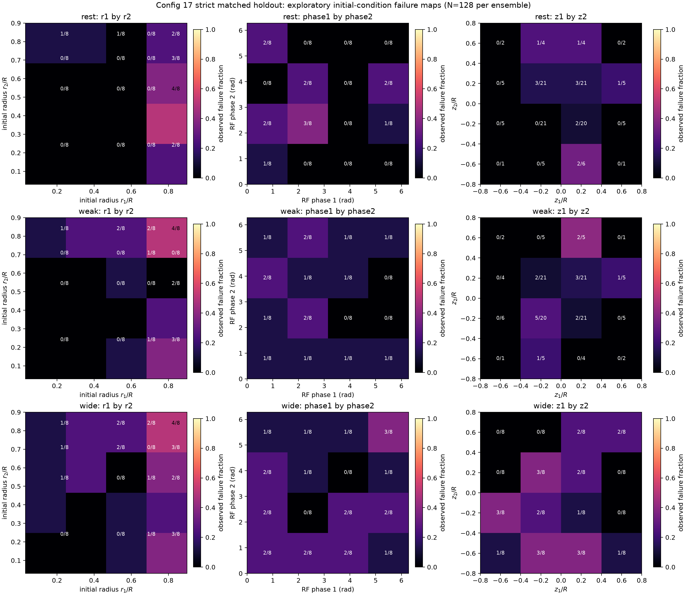

# V17C.10 P2 — строгая парная проверка config 17

Дата анализа: 19 ноября 2026 г.

## Вопрос

Проверить, переносится ли преимущество короткого training-лидера config 17 на независимые строгие старты candidate 52, используя те же начальные состояния, RF-фазы, горизонт и классификатор. Config 17 выбран только по P0-скринингу N=16 и короткому горизонту; строгий результат ниже — отдельная оценка на 128 matched starts в каждом ансамбле.

## Протокол и проверки

- 128 frozen стартов в каждом ансамбле `rest`, `weak`, `wide` — всего 384 пары с candidate 52.
- Строгий горизонт 15 000 периодов, 64 шага на период, переходный участок 200 периодов.
- Та же RK4-реализация, тот же безгидродинамический режим, те же конечные радиусы `a₁/R=0.00020`, `a₂/R=0.00189` и тот же критерий `CR_screen`.
- До и после запуска проверены SHA-256 исходных стартовых наборов, точные начальные состояния и RF-фазы config 17 и candidate 52, metadata и повторное воспроизведение strict CR-меток по сохранённым оборотам.

Все семь групп проверок прошли; полный результат находится в `candidate17_holdout/paired_validation_summary.json`. Все 384 запуска config 17 сохранены отдельно от исходного holdout candidate 52.

## Сопоставление

| Ансамбль | Candidate 52 strict CR | Config 17 strict CR | Разница 17−52 | Парные переходы 52→17: только 52 / только 17 |
|---|---:|---:|---:|---:|
| rest | 112/128 (87.50%) | 115/128 (89.84%) | +2.34 п.п. | 1 / 4 |
| weak | 113/128 (88.28%) | 112/128 (87.50%) | −0.78 п.п. | 3 / 2 |
| wide | 104/128 (81.25%) | 105/128 (82.03%) | +0.78 п.п. | 3 / 4 |

Config 17 дал три дополнительных строгих исхода суммарно на этих 384 matched starts: `rest` +3, `weak` −1, `wide` +1. Минимальная доля по ансамблям выросла только с 81.25% до 82.03%. Не следует складывать разные распределения `rest/weak/wide` в одну универсальную вероятность. Ни один ансамбль не достиг 95%.

В training-скрининге config 17 набрал `14/16`, `15/16`, `15/16`; на строгом holdout широкая группа показала 105/128 (82.03%), а слабая — 112/128 (87.50%). Малый короткий screening поэтому не даёт надёжной оценки строгого бассейна. Парные переходы дают мало discordant случаев: net +3, −1 и +1 соответственно. Здесь не приводятся калиброванные интервалы или p-значения; вывод ограничен этими matched randomized Sobol-выборками.

## Остаточные механизмы отказа config 17

Из 52 неуспехов 50 классифицированы как контакт конечной частицы со стенкой, ещё два — `axis_ambiguous` в ансамбле `wide`. Все 50 wall-исходов повторно проиграны по исходным RK4-ступеням: все достигли радиальной внешней стенки, ни один не достиг осевой границы. 46 контактов произошли в первом RF-периоде, остальные четыре — во втором; все раньше двух периодов. Медианное время контакта — 0.2188 периода, 90-й процентиль — 0.7297 периода. В одном из 50 событий обе частицы пересекли радиальную границу на одной RK4-проверке.

Как и у candidate 52, условные доли отказа выше среди стартов с большим начальным `r_max=max(r₁,r₂)`: 51/245 (20.8%) при `r_max≥0.70R`, 41/147 (27.9%) при `≥0.80R`, 33/79 (41.8%) при `≥0.85R`. Пороги вложены друг в друга и приведены как описательная диагностика, не как причинная зависимость или доверительная оценка.

Две траектории `wide` не засчитаны из-за близкого прохода первой частицы к оси (`r_min=0.01626R` и `0.00532R`, порог классификатора `0.02R`); обе завершили 15 000 периодов с противоположными знаками оборотов. Одна из них была строгим CR у candidate 52, но стала неоднозначной у config 17.

## Карты и файлы

- `candidate17_holdout/cfg17_*.jsonl` — все 384 запуска с начальными и финальными состояниями.
- `candidate17_holdout/cfg17_*.meta.json` — параметры, frozen-start hash и настройки интегратора.
- `candidate17_holdout/paired_validation_summary.json` — валидация matched-сравнения и переходы категорий.
- `candidate17_holdout/failure_analysis_config17.json` — RK4-повторы wall-событий, время первого контакта, детали осевых исходов и бины начальных условий.
- `candidate17_holdout/failure_map_config17_*.csv` и `failure_maps_config17.png` — исходные размеры ячеек и описательные карты отказов.
- `run_config17_matched_holdout.py`, `validate_config17_matched_holdout.py`, `analyze_config17_failures.py` — запуск, аудит и анализ.

## Решение и следующий шаг

Config 17 проходит независимую строгую проверку, но выигрыш над candidate 52 небольшой и не одинаков во всех ансамблях; подтверждённым оптимумом он не является. Оба кандидата по-прежнему теряют старты преимущественно при раннем радиальном уходе, особенно из внешней части начального распределения. Следующий поиск следует направить на снижение этой потери и оценивать по ансамблям отдельно, сохраняя строгий holdout для окончательного сравнения.

Воспроизведение запуска: из корня checkout выполнить `.venv/Scripts/python.exe research/v17c/v17c_10/run_config17_matched_holdout.py --threads 4`. Валидация и анализ запускаются командами `python research/v17c/v17c_10/validate_config17_matched_holdout.py` и `python research/v17c/v17c_10/analyze_config17_failures.py`.
