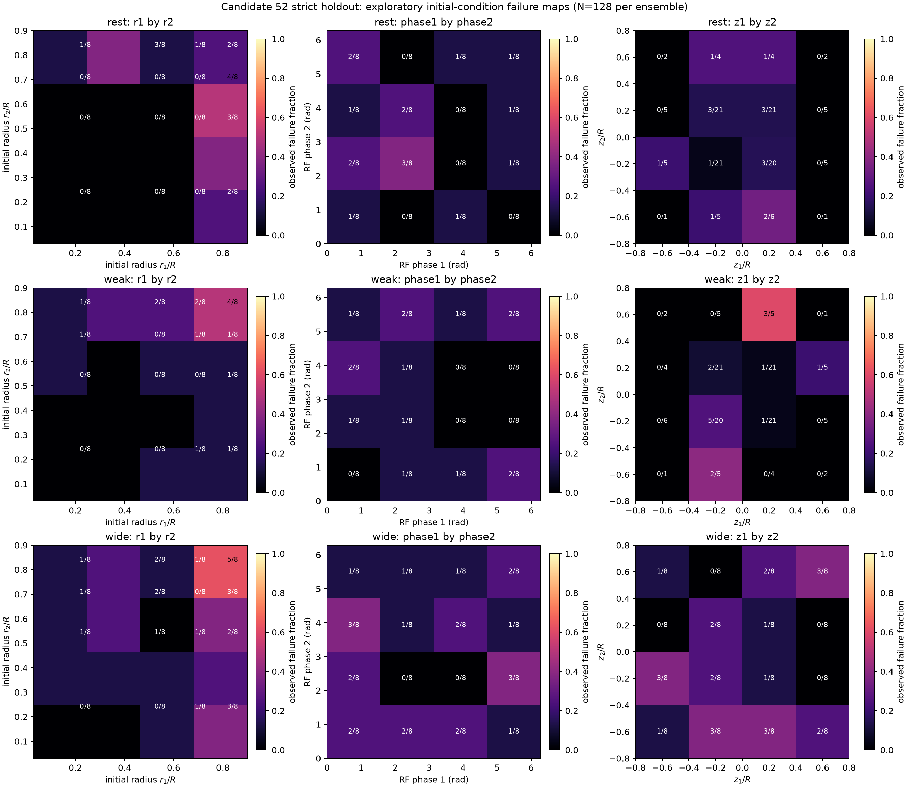

# V17C.10 P1 — причины отказов и карты candidate 52

Дата анализа: 19 ноября 2026 г.

Этап: P1, разбор исходного строгого holdout candidate 52.

## Данные и проверка

Использованы три ранее рассчитанные независимые scrambled Sobol-выборки `rest`, `weak`, `wide`: по 128 стартов на ансамбль, 15 000 RF-периодов, 64 шага на период, переходный участок 200 периодов. Параметры — candidate 52; `q₂/q₁=3.5274259874597194`; размеры частиц `a₁/R=0.00020`, `a₂/R=0.00189`; гидродинамическое взаимодействие выключено.

Проверка до анализа подтвердила SHA-256 всех шести JSONL/meta-файлов по paired-holdout manifest, SHA-256 трёх frozen start-файлов, 128 уникальных индексов и точное совпадение начальных состояний и RF-фаз с frozen starts. Все три набора метаданных совпали с конфигурацией holdout.

## Итоги строгого классификатора

| Ансамбль | Строгий CR | Радиальный контакт со стенкой | Неоднозначность оси | Всего |
|---|---:|---:|---:|---:|
| rest | 112/128 (87.50%) | 16 | 0 | 128 |
| weak | 113/128 (88.28%) | 15 | 0 | 128 |
| wide | 104/128 (81.25%) | 23 | 1 | 128 |

Всего за три разных ансамбля: 329 строгих CR, 54 отказа из-за контакта со стенкой и 1 осево-неоднозначный исход. Совокупную долю 329/384 не следует трактовать как одну универсальную вероятность: `rest`, `weak` и `wide` имеют разные распределения стартов.

## Что было причиной отказов

Все 54 строки `finite_particle_wall_contact` повторно проиграны по исходному RK4-интегратору с тем же candidate52-вектором, гармониками поля, `qratio`, размерами частиц и проверками на промежуточных RK4-ступенях. Во всех случаях первый зарегистрированный контакт — радиальный, с внешней границей `r+a>R`; осевых контактов, столкновений частиц и одновременных касаний двух частиц не обнаружено. Первой границы достигала частица 1 в 29 случаях, частица 2 — в 25.

Повторный прогон позволяет точнее восстановить время, чем сохранённый `completed_periods`, который округляет число завершённых периодов вниз. 48 из 54 радиальных контактов произошли в первом RF-периоде, остальные 6 — во втором; все — раньше двух периодов. Медианное время события — 0.2305 периода, 90-й процентиль — 1.0344 периода, максимум — 1.9063 периода. Следовательно, наблюдаемые wall-отказы — ранняя потеря частицы до формирования долгоживущей вращательной динамики.

Единственный исход `axis_ambiguous` был в ансамбле `wide` (индекс 88). Он прошёл полный горизонт 15 000 периодов, но минимальный радиус первой частицы составил `0.00569 R`, ниже порога классификатора `0.02 R`; поэтому исход не зачтён как строгий CR. В сохранённых суммарных категориях нет одностороннего вращения, медленного/локализованного исхода, потери удержания, столкновения или неразрешённой сингулярности.

## Начальные условия и карты

В каждом ансамбле наблюдаемая доля отказов растёт при условии на более внешний начальный радиус `r_max=max(r₁,r₂)`:

| Условие на начальный радиус | Число стартов | Отказы | Наблюдаемая доля |
|---|---:|---:|---:|
| `r_max ≥ 0.70 R` | 245 | 52 | 21.2% |
| `r_max ≥ 0.80 R` | 147 | 42 | 28.6% |
| `r_max ≥ 0.85 R` | 79 | 31 | 39.2% |

Пороги вложены друг в друга, а не образуют независимые сравниваемые группы. Тренд повторяется отдельно в каждом ансамбле, но эти значения остаются описательными долями одной выборки; они не являются калиброванными доверительными оценками и не доказывают причинность. Условные карты по радиусам и RF-фазам используют по четыре бина на каждую ось; многие ячейки содержат около восьми стартов. Карты z тоже разрежены, особенно для разных диапазонов `rest/weak` и `wide`. Поэтому их следует использовать для выбора следующей выборки, а не для точного восстановления границы бассейна.

## Вывод и следующий шаг

Главный механизм отказа в этом holdout — быстрый радиальный выход через внешнюю стенку, особенно для стартов с большим начальным радиусом. Для расширения бассейна следует сначала отбирать новые условия на раннее радиальное удержание, затем проверять их строгим горизонтом и неизменным набором matched starts. Отдельно следует сохранять исходы около оси, поскольку строгая классификация корректно исключает траектории, которые пересекают её порог.

Следующий шаг по плану — независимая строгая проверка training-лидера config 17 на этих же frozen starts и holdout-протоколе candidate 52. Короткий P0-скрининг config 17 не является подтверждением улучшения.

## Артефакты и воспроизведение

- `analyze_candidate52_failures.py` проверяет источники, строит карты и повторно проигрывает 54 стеночных исхода.
- `failure_analysis_candidate52.json` содержит проверки, количественные сводки, исходы RK4-повторов, бины и доли отказов.
- `failure_map_<ensemble>_<map>.csv` содержит исходные числа стартов/отказов и наблюдаемые доли для каждой ячейки.
- `failure_maps_candidate52.png` — сводный рисунок 3×3.
- Код использует зафиксированный harmonics/config-файл V17C.5 и параметры candidate 52 из проверенных paired-holdout метаданных. Сам файл гармоник указан в JSON по SHA-256.

Команда из корня checkout: `python research/v17c/v17c_10/analyze_candidate52_failures.py`.
