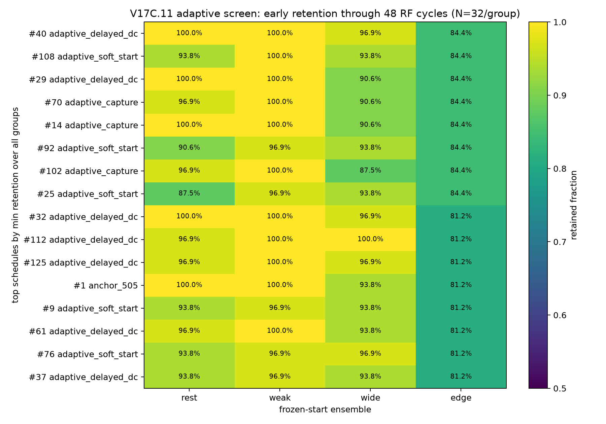

# V17C.11 — адаптивный экран огибающих включения

## Что проверено

Для неизменной конечной конфигурации local15 исследованы 128 общих расписаний: постоянное поле, опубликованные лидеры #505 и #353 и 125 новых вариантов Sobol. Новые варианты меняли начальные уровни RF/DC, длительности и задержки двух RF-компонент и DC, форму рампы и двухстадийное усиленное удержание. В каждом запуске обе частицы испытывали одно и то же расписание; фазы несущих непрерывны. Все расписания завершили переход к local15 не позднее 24.55 периода f1.

На замороженных независимых стартах `N=32` в каждой из четырёх групп выполнено 16 384 уникальных интегрирования. Использованы RK4/96 и горизонт 48 периодов f1. Четыре группы имеют отдельные Sobol seed’ы; контрольные суммы координат и фаз приведены в `adaptive_loading/training_starts.json`. Перезапускаемые записи — `adaptive_loading/adaptive_runs.jsonl`.

Скрин измеряет раннее удержание до конца 48-го периода. Он **не измеряет** долгосрочную вероятность встречного вращения: за этот интервал траектории не набирают требуемые 10 оборотов после загрузки.

## Раннее удержание

| Расписание | Rest | Weak | Wide | Edge | min(rest, weak, wide) | min(все 4) |
|---|---:|---:|---:|---:|---:|---:|
| Постоянный local15 | 27/32 (84.38%) | 26/32 (81.25%) | 30/32 (93.75%) | 21/32 (65.63%) | 81.25% | 65.63% |
| #505 | 32/32 (100%) | 32/32 (100%) | 30/32 (93.75%) | 26/32 (81.25%) | 93.75% | 81.25% |
| #353 | 31/32 (96.88%) | 32/32 (100%) | 31/32 (96.88%) | 25/32 (78.13%) | 96.88% | 78.13% |
| #40, новый delayed-DC вариант | 32/32 (100%) | 32/32 (100%) | 31/32 (96.88%) | 27/32 (84.38%) | **96.88%** | **84.38%** |

У #40 среди 128 испытаний было пять потерь, и все пять — конечный контакт частиц со стенкой: 0/32 rest, 0/32 weak, 1/32 wide, 5/32 edge. У #505 было восемь таких контактов: 0, 0, 2, 6 по группам. Непосредственный прирост #40 над #505 на этих же стартах составляет один удержанный wide-start и один edge-start. Размер выборки мал: эти проценты являются только обучающим экраном и не имеют нужной точности для заявления о 95% успехе.

Протокол #40 продолжался 1.70136 периода. Относительные коэффициенты `(gA,gB,gDC)` менялись независимо по полукосинусной форме с непрерывными RF-фазами. Начальные уровни: `(0.0864515, 0.5316324, 0.1364382)`. Длительности: `(TA,TB,TDC)=(1.4939667, 0.5143618, 0.8419602)` периода; задержка DC `0.8594030` периода, задержка второй RF-компоненты нулевая. После этого все коэффициенты точно равны local15. Полный 19-элементный вектор сохранён в `best_loading_protocol.json`.

На рисунке показаны 16 лидеров по минимальной ранней удержанности среди групп. Полная таблица, категории исходов и ранжирование сохранены в CSV/JSON. Все зарегистрированные неудачи лидеров в этом раннем окне были стеночными контактами; этот факт согласуется с гипотезой о раннем риске загрузки, но ещё не доказывает, что оптимизация включения повышает долгосрочный `P_CR`.

## Следующий обязательный этап

Продолжить поиск расширенной выборкой Sobol до 1 024 протоколов с той же общей терминальной конфигурацией, четырьмя группами и общими frozen starts для парных сравнений. Затем отобрать несколько расписаний по раннему удержанию и проверить их на новых стартах с долгим интегрированием и строгим классификатором `CR_screen`. Короткий экран не считать научным подтверждением встречного вращения.
