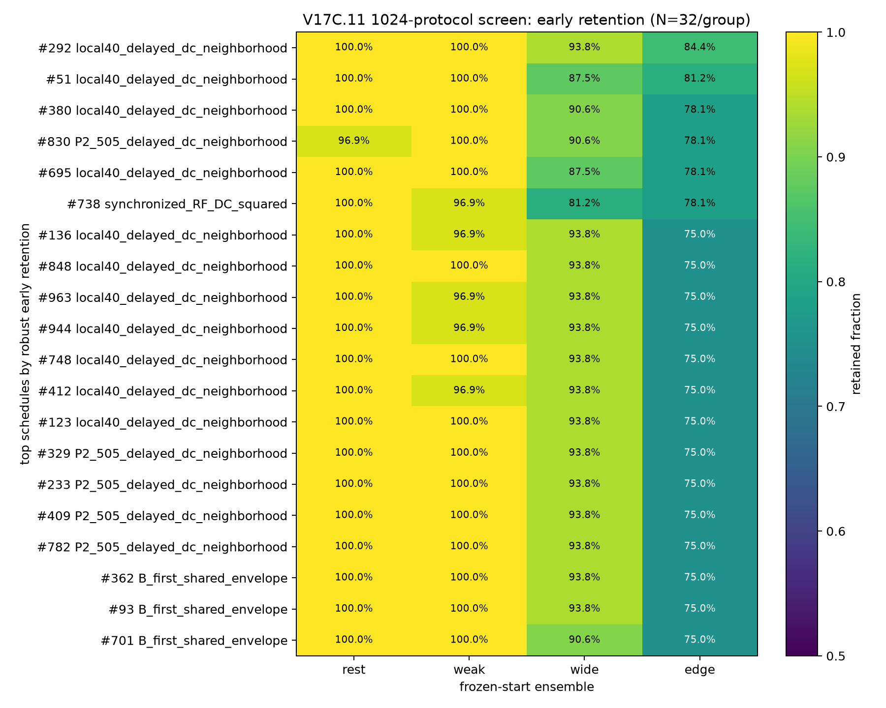

# V17C.11 — расширенный Sobol-скрининг протоколов загрузки

## План и полнота

Запущены 1 024 различных протокола включения конечного RF–DC-поля local15. В выборке есть четыре контрольных расписания (постоянный local15, #505, #353 и предыдущий ранний лидер #40), 510 вариантов около #40, 184 варианта около #505, 123 схемы с `gDC=gA·gB`, 131 двухстадийный capture и 72 варианта с включением компоненты B первой.

Для каждого расписания испытаны одинаковые замороженные старты четырёх ансамблей, `N=32` на группу: всего `1 024×4×32=131 072` уникальных траекторий. Seed’ы нового набора: `20261171–20261174`; контрольные суммы — `adaptive_loading_v2/training_starts.json`. Интегратор RK4/96, горизонт 48 периодов `f1`, четыре worker’а; время — 1 665 s. Все огибающие полностью достигли local15 до конца горизонта, максимальная длительность перехода — 29.68 периода. Ни один массовый прогон не сохранял длинную временную серию.

Рейтинг ниже относится исключительно к **раннему удержанию**. Протоколы отбирались на этих же стартах, поэтому этот этап — обучающий screen, не независимый holdout и не оценка долгосрочного `P_CR`.

## Контрольные расписания и лидер

| Протокол | Rest | Weak | Wide | Edge | `J` раннего удержания | `J_robust` раннего удержания |
|---|---:|---:|---:|---:|---:|---:|
| Постоянный local15 | 28/32 (87.50%) | 25/32 (78.13%) | 27/32 (84.38%) | 20/32 (62.50%) | 78.13% | 62.50% |
| #505 | 32/32 (100%) | 32/32 (100%) | 29/32 (90.63%) | 23/32 (71.88%) | 90.63% | 71.88% |
| #353 | 32/32 (100%) | 31/32 (96.88%) | 29/32 (90.63%) | 22/32 (68.75%) | 90.63% | 68.75% |
| #40, скрин P6 | 32/32 (100%) | 31/32 (96.88%) | 28/32 (87.50%) | 23/32 (71.88%) | 87.50% | 71.88% |
| **#292, лидер P7** | **32/32 (100%)** | **32/32 (100%)** | **30/32 (93.75%)** | **27/32 (84.38%)** | **93.75%** | **84.38%** |

На новых стартах #292 удержал на 4 edge-старта больше, чем каждый из #505 и #40, и на 2 wide-старта больше. Все 7 физических потерь #292 были контактами конечных частиц со стенкой: 2 wide и 5 edge. Ещё один удержанный запуск был классифицирован как осево-неоднозначный; он считается удержанным только в этой короткой метрике и не является успехом встречного вращения.

При `N=32` 95% интервал Уилсона для edge-удержания `27/32` составляет примерно `68.3–93.1%`; статистики недостаточно даже для утверждения о 95% раннем удержании. Для 32/32 нижняя граница составляет около 89.3%.

## Выбранное расписание #292

Общие множители RF-A, RF-B и DC огибаются независимо; форма — степенная `s^4`. Все величины нормированы на конечные параметры local15. Длительности и задержки заданы в периодах `f1`; после 1.84451 периода поле точно постоянно и равно local15.

- `gA(0)=0.0372658`, рампа A: `1.1924145` периода;
- `gB(0)=0.2141599`, рампа B: `0.2180914` периода;
- `gDC(0)=0.0540496`, рампа DC: `0.2869588` периода после задержки `1.5575518` периода;
- задержки RF-A и RF-B равны нулю;
- RF-фазы не сбрасываются, частоты не меняются, обе частицы получают одну огибающую.

Полный 19-компонентный вектор сохранён в `best_loading_protocol.json`; исходные массивы и расписания находятся в `adaptive_loading_v2/`.

## Вывод и следующий шаг

Двух независимых обучающих наборов достаточно, чтобы выделить полезный класс управления: небольшие начальные уровни RF и отложенное включение DC заметно уменьшают ранние wall-loss. На втором наборе расписание #292 улучшило edge-удержание на 12.5 процентного пункта относительно контрольного #505, но его edge-уровень `84.4%` далёк от целевого 95–99%, а успехом встречного вращения не измерялся.

Следом нужно испытать #292 на новых holdout-starts с долгим 15 000-периодным интегрированием, независимыми моделями/разрешениями для представителей и строгим `CR_screen` классификатором. До этого #292 остаётся кандидатом на проверку, не подтверждённым протоколом.
