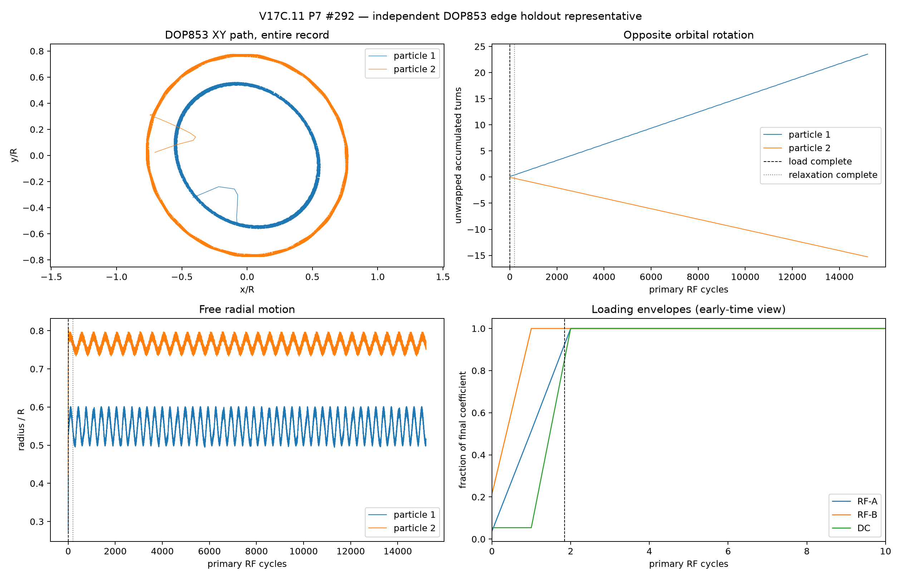

# V17C.11 — независимая DOP853, сходимость и энергетический баланс

## DOP853 на независимых holdout-стартах

На сохранённых edge-успешных стартах независимо интегрированы #505, #353 и #292. Реализация DOP853 отдельно вычисляет полярные компоненты RF-градиента, полную 3D кулоновскую силу, DC и линейное сопротивление. Точность `rtol=2×10⁻¹⁰`, `atol=2×10⁻¹²`, максимальный шаг `2π/48`; шаг вывода — один период основной RF для хранения и развёртки угла. Огибающие и обе несущие фазы непрерывны.

| Протокол | RK4/96 | DOP853 | `max |Δ final state|` | Категория DOP853 |
|---|---:|---:|---:|---|
| #505 | `+154.24537/−100.17631 Hz` | `+154.24791/−100.17431 Hz` | 0.00147 | CR_screen |
| #353 | `+154.28556/−100.20592 Hz` | `+154.28847/−100.20418 Hz` | 0.00127 | CR_screen |
| #292 | `+154.20732/−100.20083 Hz` | `+154.20999/−100.19903 Hz` | 0.00126 | CR_screen |

Каждый интегратор воспроизвёл строгую встречную классификацию. Расхождение частот не превышает 0.003 Hz; углы развернуты независимо по DOP853-выборкам. Сохранены исходные фазы, итоговые состояния и стробоскопические ряды в `dop853_*.npz`.

## Проверка шага RK4 для #292

Один и тот же edge-start #292 повторён с 64 и 128 шагами на RF-период; сравнение идёт с уже выполненной RK4/96 holdout-траекторией, которая не пересчитывалась.

| Шагов/период | Категория | Частоты (Hz) | Макс. разность частот против /96 | Макс. разность конечного состояния против /96 |
|---:|---|---:|---:|---:|
| 64 | CR_screen | `+154.17797/−100.21908` | 0.02936 Hz | 0.01280 |
| 96 | CR_screen | `+154.20732/−100.20083` | — | — |
| 128 | CR_screen | `+154.20974/−100.19926` | 0.00242 Hz | 0.00110 |

Знаки, строгая категория и минимум десяти оборотов сохраняются. При увеличении разрешения с 96 до 128 частоты сходятся к DOP853; 64 шага сохраняет категорию, но даёт более заметное фазовое расхождение.

## Энергия и угловой момент

Для трёх DOP853-траекторий отдельно проверены полный интервал управления и поздний автономный интервал. Баланс учитывает RF-A, RF-B, DC, кулоновский обмен и сопротивление частиц; системный Hamiltonian содержит кинетическую энергию, RF/DC потенциалы и кулоновскую энергию. Явная работа RF/DC вычислена из полной производной потенциала по времени, включая производные огибающих. После окончания рамп DC-поле не совершает систематической работы.

Максимальные абсолютные остатки среди трёх проверок:

- системный энергетический баланс на всём интервале включения и движения: `8.09×10⁻⁸`;
- системный энергетический баланс после релаксации: `7.97×10⁻⁸`;
- индивидуальный кинетический баланс частицы: `2.29×10⁻⁸`;
- системный баланс `Lz` по сумме моментов сил: `2.83×10⁻⁸`.

Для #292 полные явные вклады изменения RF-потенциала составили RF-A `+73.3514`, RF-B `+136.9629`, вклад изменения DC `+0.01837`, а работа сопротивления `−210.4991` (нормированные единицы). После загрузки явные вклады RF-A и RF-B равны `+72.3786` и `+135.3747`, а drag — `−207.7214`; явная работа изменения DC после окончания рампы равна нулю. Эти величины — члены системного баланса потенциальной и кинетической энергии, а не мгновенная мощность поля на отдельной частице. Постоянный DC локализует систему, но не служит постоянным источником вращательной энергии; RF-поле компенсирует потери на сопротивление.

Кулоновская работа каждой частицы в этом представителе порядка `10⁻⁴`, тогда как RF/drag — десятки и сотни нормированных единиц; Coulomb сохраняется в модели и перераспределяет угловой момент, но этот пример не указывает на доминирующий коллективный энергетический механизм.

Числа подробно записаны в `strict_loading_holdout/dop853_representatives.json`, JSONL и `step_convergence_P7_292.json`; код независимой реализации — `verify_loading_holdout_dop853.py`.
