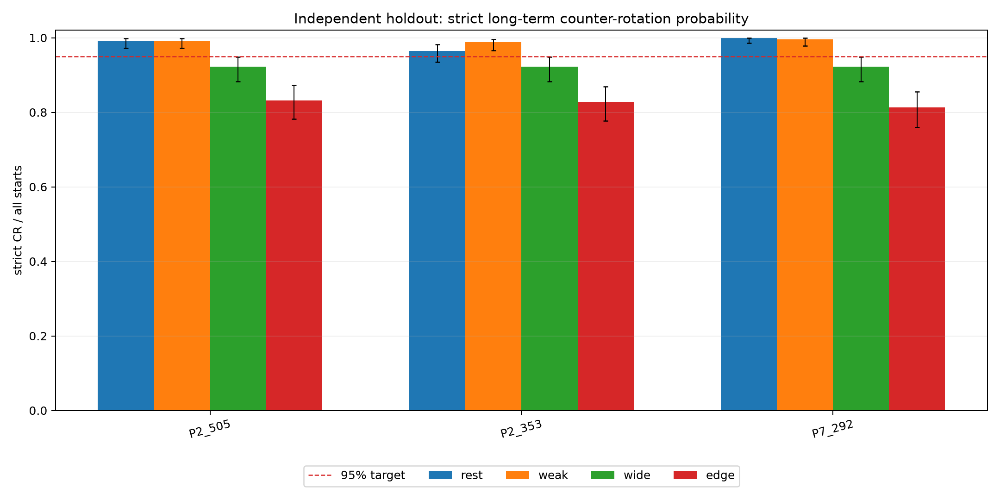

# V17C.11 — итог исследования загрузки для самопроизвольного встречного вращения

## Результат

Завершена независимая проверка трёх заранее выбранных временных протоколов включения к фиксированной конечной конфигурации local15. Лучший по робастной точечной оценке — **P2 #505**: строгий встречный режим зарегистрирован в `957/1024 = 93.46%` стартов суммарно, при `J_robust=min(rest,weak,wide,edge)=83.20%`. Результаты по группам: rest `254/256`, weak `254/256`, wide `236/256`, edge `213/256`.

Протокол повысил эмпирическую успешность rest/weak, но не обеспечил целевые 95–99% на широких независимых начальных распределениях. Edge остаётся ограничивающим ансамблем: там `40/256` стеночных контактов и `3/256` осево-неоднозначных траектории. Все контакты со стенкой в holdout происходили в течение первых двух RF-периодов.

## Конфигурация и лучший протокол

Конечная конфигурация не оптимизировалась заново. local15 имеет вектор параметров `[A,B,nu,beta,s=m1/m2,C_eff,lambda1,lambda2]`:

```text
[0.03716194907442204, 0.16269381993434680, 3.11180294528603560,
 0.017273303124515367, 0.10944955727644175, 9.463121589050818e-6,
 0.20975541409005094, 0.12617311138613094]
```

`q2/q1=3.1179673275`, `m2/m1=9.1366290087`; радиусы частиц `0.00020R` и `0.00189R`. RF-частоты `100 kHz` и `311.1802945 kHz`. Точная геометрия, MFS спектр и физический смысл параметров сохранены в `local15_parameters.json`.

Для #505: `gA` линейно растёт от 0.10 до 1 за 3 периода основной частоты; `gB` — от 0.10 до 1 за 0.25 периода; DC остаётся на уровне 0.35 до задержки 2.2228266522 периода, затем линейно доходит до 1 за 0.25 периода. Через 3 периода (30 μs) все коэффициенты постоянны и равны local15. Несущие фазы и частоты не сбрасываются. Полная запись: `best_loading_protocol.json`.

## Сравнение кандидатов

| Протокол | Rest | Weak | Wide | Edge | `J_robust` | Итог |
|---|---:|---:|---:|---:|---:|---|
| #505 | 254/256 | 254/256 | 236/256 | 213/256 | **83.20%** | лидер по робастной точечной оценке |
| #353 | 247/256 | 253/256 | 236/256 | 212/256 | 82.81% | близкий конкурент, рампа длиннее |
| #292 | 256/256 | 255/256 | 236/256 | 208/256 | 81.25% | высокий rest/weak, слабее edge |



Все 2,860 строгих успехов этих трёх протоколов имели направление `(+,-)`; `(-,+)` не наблюдалось. Для #505 средние частоты успешных trajectories — около `+154.22–154.23 Hz` и `−100.19 Hz`; средние полные обороты после загрузки — `+23.13` и `−15.03`. Независимые DOP853-проверки представителей всех трёх протоколов сохранили знак и категорию.

## Контроль качества

Все 3,072 N=256 строки, frozen starts, seed и SHA-256 проверены; успешные записи удовлетворяют строгим критериям по трём поздним окнам и минимуму десяти оборотов. Для представительных режимов независимый DOP853 расходится с RK4/96 по частоте менее чем на `0.003 Hz`; проверка шага RK4/64–96–128 и системного энергетического и углового балансов описана в `NUMERICAL_VALIDATION_RU.md` и `DOP853_ENERGY_VALIDATION_RU.md`.

Поскольку каждая группа использовала один randomized Sobol scramble, Wilson intervals и парные McNemar значения рассматриваются как номинальные ориентиры, а не как полная калибровка вероятностной неопределённости для IID выборки. Детали — `STATISTICAL_VALIDATION_RU.md` и `ROBUSTNESS_RU.md`.

## Ограничения и завершение

Модель использует конечные размеры сфер и проверку контактов, полную трёхмерную кулоновскую силу и линейное феноменологическое сопротивление. Межчастичная гидродинамика, шумы реального источника, ошибки электроники, полная физическая масштабировка и аппаратные ограничения не проверялись в V17C.11. В частности, holdout не доказывает переносимость протокола на другую ловушку или допуски управления.

По указанию пользователя после завершения N=256 новые серии и увеличение N остановлены. V17C.11 закрыт; следующий этап — исследовать пару встречновращающихся кулоновских кристаллов по три частицы каждый. Данные, код, отчёты и график сравнения опубликованы в `research/v17c-loading`.


Граница постановки: N=256 holdout содержит три заранее отобранных рамповых протокола; он не содержит парного #local15_constant контроля. Базовые числа V17C.10 получены на другом seed-set и не являются парным контролем для этого holdout.
