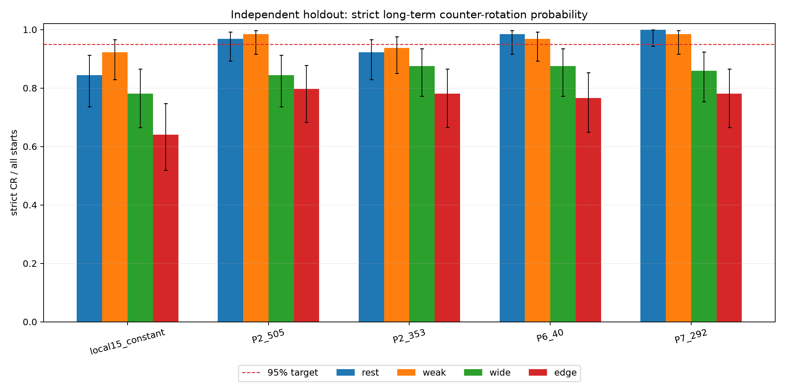

# V17C.11 — независимая строгая проверка протокола загрузки

## Постановка

Пять фиксированных расписаний — local15 без управления, #505, #353, ранний лидер #40 и P7-лидер #292 — проверены на одном и том же новом scrambled-Sobol holdout. В каждой группе `N=64`, всего 1 280 уникальных траекторий. Seed’ы `20261201–20261204`, массивы и контрольные суммы сохранены в `strict_loading_holdout/holdout_starts.*`.

Интегрировались полные уравнения RF–DC, 3D Coulomb и линейного сопротивления конечных частиц. Для каждого расписания первые `ceil(T_load)+200` периодов исключены из счёта; после завершения огибающей и 200 периодов релаксации записаны ещё 15 000 периодов с RK4/96. Успехом считался только `CR_screen`: удержание, более десяти полных оборотов обеих частиц, противоположные средние знаки и постоянство направления в трёх поздних окнах. Все остальные исходы, включая стеночный контакт и осевую неоднозначность, остались неуспехом в знаменателе.

Все 1 280 ключей уникальны, все запуски достигли контрольного горизонта либо завершились физическим wall-contact событием. Полные начальные и конечные состояния, частоты, развёрнутые обороты, минимальные радиусы и разделение частиц находятся в `strict_loading_holdout/holdout_runs.jsonl`.

## Безусловный строгий `P_CR`

| Протокол | Rest | Weak | Wide | Edge | `J=min(rest,weak,wide)` | `J_robust=min(all)` |
|---|---:|---:|---:|---:|---:|---:|
| Постоянный local15 | 54/64 (84.38%) | 59/64 (92.19%) | 50/64 (78.13%) | 41/64 (64.06%) | 78.13% | 64.06% |
| #505 | 62/64 (96.88%) | 63/64 (98.44%) | 54/64 (84.38%) | 51/64 (79.69%) | 84.38% | **79.69%** |
| #353 | 59/64 (92.19%) | 60/64 (93.75%) | **56/64 (87.50%)** | 50/64 (78.13%) | **87.50%** | 78.13% |
| #40 | 63/64 (98.44%) | 62/64 (96.88%) | **56/64 (87.50%)** | 49/64 (76.56%) | **87.50%** | 76.56% |
| **#292** | **64/64 (100%)** | **63/64 (98.44%)** | 55/64 (85.94%) | 50/64 (78.13%) | 85.94% | 78.13% |

Целевой уровень 95% не достигнут ни в wide, ни в edge. #353 и #40 имеют наибольший стандартный `J` — 87.50%; #505 имеет лучший минимакс по всем четырём группам — 79.69%. Новый кандидат #292 увеличил число успехов rest, но его общий `J` ниже #353/#40, а `J_robust` ниже #505.

Особенно важно, что улучшение раннего edge-удержания #292 (`27/32` на обучающем экране против `23/32` у #505/#40) не перенеслось в строгий долгосрочный edge-`P_CR`: на holdout #292 дал `50/64`, #353 — `50/64`, #505 — `51/64`, #40 — `49/64`. Следовательно, один только ранний capture не устранил последующие причины неуспеха.

95% интервалы Уилсона для edge `P_CR`:

- local15: `41/64`, `51.8–74.7%`;
- #505: `51/64`, `68.3–87.7%`;
- #353: `50/64`, `66.6–86.5%`;
- #40: `49/64`, `64.9–85.3%`;
- #292: `50/64`, `66.6–86.5%`.

Интервалы широко перекрываются. `N=64` полезен как независимая первичная проверка, но недостаточен для различения нескольких процентных пунктов или заявления о 95%.

## Характер успешных траекторий и неуспехов

У успешных исходов всех пяти протоколов частоты почти совпадают: первая частица около `+154.2 Hz`, вторая около `−100.19 Hz`. Для #292 средние значения среди строгих успехов составили примерно `+154.25/−100.19 Hz`; средние развёрнутые обороты за измеряемые 15 000 периодов — `+23.14/−15.03`. Средний минимум расстояния между центрами для #292 около `0.19R`.

Неуспехи в этой серии почти полностью состоят из контактов со стенкой; остальные несколько исходов — осевая неоднозначность. Наблюдений same-direction и неразрешённых переходных траекторий среди завершённых holdout-запусков не было. Поскольку все строгие успехи имеют почти одинаковые частоты, различия `P_CR` в основном обусловлены тем, удерживается ли система в первые и последующие периоды, а не появлением нового вращательного механизма.

## Вердикт этапа

Протокол временного включения помогает по сравнению с постоянным local15, но выборка не подтвердила достижение 95–99%. P7-кандидат #292 проходит долгосрочный строгий критерий во многих новых стартах, однако статистически не превосходит #505/#353 по robust-вероятности и уступает им на некоторых группах. Пока #292 — кандидат с сильным rest-результатом, а не универсальный протокол.

Далее следует независимо проверить представителей #292, #353 и #505 интегратором DOP853, сравнить RF/DC/Coulomb/drag энергетические балансы и проверить сходимость RK4/64–96–128. После этого расширить независимый holdout для 2–3 лучших расписаний; окончательный выбор должен опираться на все четыре группы и считать потери в знаменателе.
