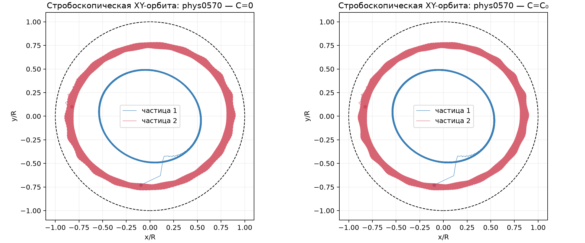
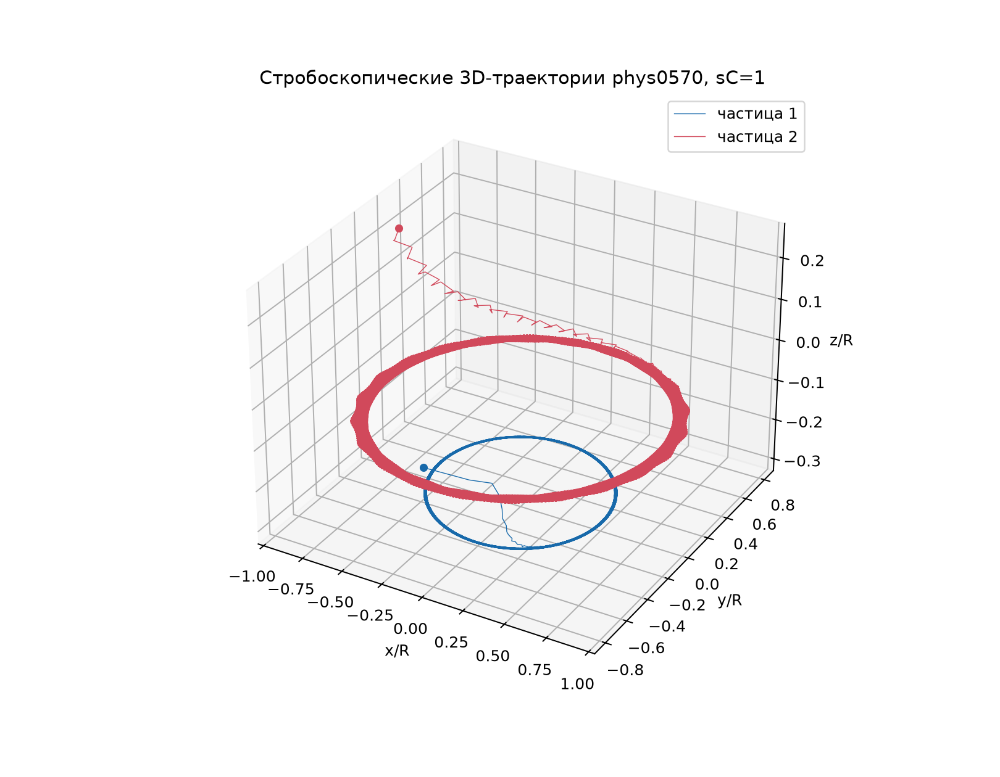
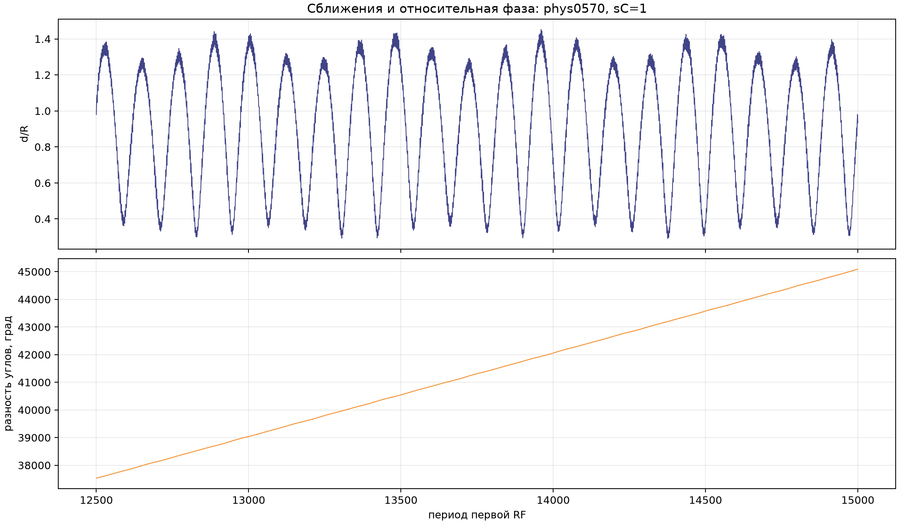
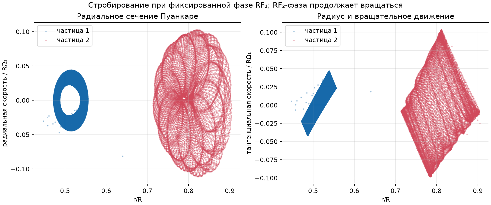
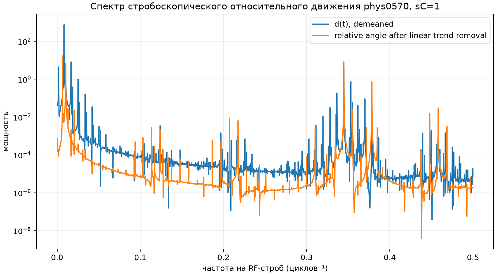
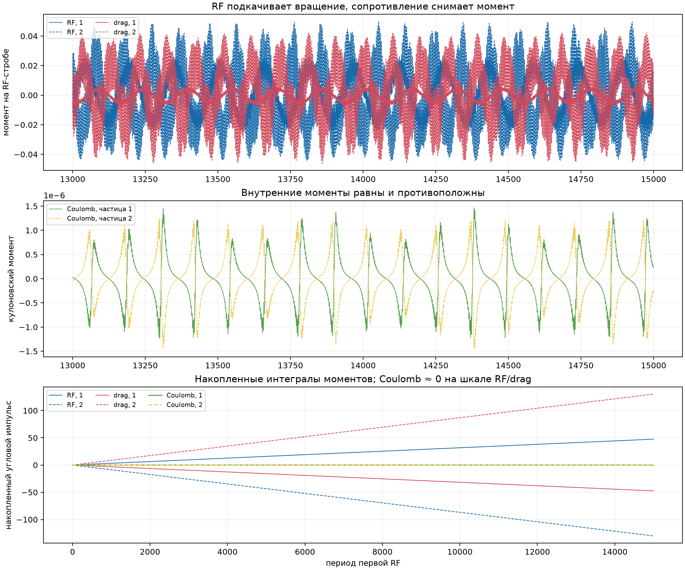
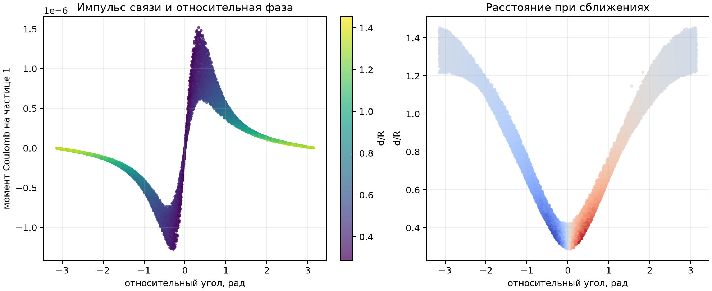
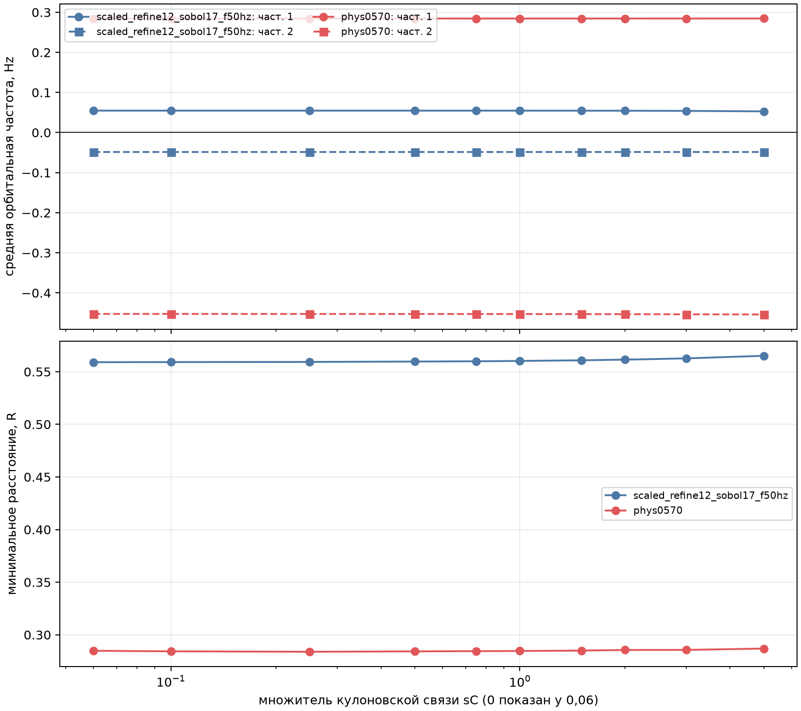

# V17C.17 — Динамика двух кулоновски взаимодействующих частиц

## Краткий вывод

Для двух ранее отобранных rest-стартов встречное вращение воспроизведено в полном восьмигармоническом поперечном MFS-поле с 3D движением, общим DC квадруполем, гравитацией, конечным размером частиц, кулоновской силой и индивидуально исправленным Cunningham сопротивлением. Главный физически ориентированный кандидат `phys0570` сохранил знаки `(+−)` на 15 000 RF-периодах и в продолжении до 50 000 периодов; частицы совершили соответственно около 161 и 257 оборотов после первых 200 периодов. Масштабированный `refine12_sobol17_f50hz` тоже сохранил `(+−)` на этих горизонтах, но его вторая микросфера слишком велика для рассматриваемого экспериментального диапазона.

Главный новый результат — количественный механизм. У выбранной пары `phys0570` кулоновские моменты при каждом сближении равны и противоположны, как требует центральность попарной силы, но их величина мала по сравнению с RF-моментами и вязким торможением. RF-поле подаёт каждой частице момент нужного знака на её радиальной ветви, сопротивление в среднем его компенсирует, а кулоновская связь лишь слабо перераспределяет угловой момент. Поэтому обнаруженная траектория — встречное движение **взаимодействующей**, но в номинальном физическом отображении почти независимой пары, а не сильный коллективный режим, созданный Coulomb.

Во всём заданном скане `sC=0…5` обе выбранные траектории остались на ветви `(+−)`. Перехода в совместное вращение или потери удержания не обнаружено. Это вывод для двух фиксированных стартов на конечном горизонте, а не доказательство отсутствия перехода во всём пространстве начальных условий и не доказательство асимптотического аттрактора.

## 1. Исходные данные и исторические проверки

Рабочий снимок создан в отдельной ветке от `research/v17c-theory-validation`; базовый commit при создании worktree: `9716e9a701b4ebd8fc3ae4b72a8aaeda9437289b`. Исторические исследования не изменялись. Ветка для этого отчёта: `research/v17c-two-particle-coulomb-dynamics`.

Для сравнения взяты два размерно связанных набора, но только один из них квалифицирован как физически ориентированный кандидат:

| Параметр | `scaled_refine12_sobol17_f50hz` | `phys0570` |
|---|---:|---:|
| (f_1), (f_2) | 50.000; 160.984 Hz | 87.812; 119.903 Hz |
| (A,B,\nu,\beta) | 0.0349241; 0.1563167; 3.2196774; 0.01538856 | 0.0337140; 0.0273593; 1.3654454; 0.00552991 |
| (s=m_1/m_2) | 0.1096376 | 5.4003802 |
| (q_2/q_1) | 3.4490536 | 0.5356176 |
| (C_0) | (9.74727\times10^{-6}) | (4.82852\times10^{-7}) |
| исправленные (\lambda_1,\lambda_2) | 0.2445231; 0.1773660 | 0.2461737; 2.4536538 |
| (a_1/R,a_2/R) | 0.0016261; 0.0107121 | 0.0012521; 0.0023041 |
| радиусы частиц | 16.261; 107.121 µm | 12.521; 23.041 µm |
| заряды | (2.94742\times10^5e; 1.01658\times10^6e) | (1.92795\times10^5e; 1.03264\times10^5e) |

Обе размерные параметризации используют (R=10\) мм, воздух при 300 K и 1 atm. Пара `phys0570` согласуется с приведёнными в V17C.12B размерами кандидатов, но это расчётная пара из параметрического сценария, не совместно измеренные частицы. `scaled_refine12_sobol17_f50hz` — математически полезная частотно-пересчитанная точка; частица 2 с радиусом около 107 µm (диаметр 214 µm) выходит за описанный там диапазон K1 и не считается подтверждённым готовым образцом.

Из четырёх ансамблей V17C.12B для каждой конфигурации взят один и тот же старт `rest`, индекс 68, из числа общих строгих `(+−)` успехов. Начальные скорости обеих частиц равны нулю. Координаты и обе RF-фазы зафиксированы в [input_configuration.json](results/input_configuration.json). Это намеренно благоприятный замороженный старт, выбранный до новой Coulomb-серии; он годится для анализа механизма, но не для оценки вероятности захвата.

V17C.12B ранее сообщала для свежих ансамблей 437/512 строгих CR для масштабированного `refine12_sobol17`, 420/512 для Local15 и 368/512 для `phys0570`. Эти ансамблевые числа — исходный контекст, не результат V17C.17. Длинные 120k–240k проверки V17C.12B были условными продолжениями уже отобранных CR-стартов.

### Аудит наследуемой реализации и частот

Новый код независимо пересчитал сохранённые исходные V17C.12B траектории **старой моделью без каких-либо исправлений**. Для обоих выбранных стартов конечные состояния совпали с архивными до (1.4\times10^{-14}) и (2.3\times10^{-14}); разность числа оборотов не превысила (4.6\times10^{-13}), а минимума расстояния — (8\times10^{-16}R). Градиент полного MFS потенциала проверен конечными разностями (максимальная ошибка (1.31\times10^{-12})); ошибка проверки действия–противодействия попарных сил равна нулю в FP64.

В аудите найдено, что архивное поле `frequency_over_rf_Hz` в старом интеграторе умножало число оборотов на жёстко заданные 100 kHz и потому не являлось физической частотой. Частота в этом отчёте пересчитана из развёрнутого угла как

\[
f_{\rm orb}=\frac{\Delta\theta}{2\pi}\,\frac{f_1}{N_{\rm late}}.
\]

Например, у старой строки `phys0570` архивные значения `+322.10, −521.69` не являются Hz: фактические обороты той строки дают приблизительно `+0.2828, −0.4582 Hz`. Эта ошибка метки не меняет старые классификации, но меняет интерпретацию опубликованных частот.

## 2. Поле, уравнения и сопротивление

Сохранён исходный полный восьмигармонический комплексный MFS-спектр V17C.12B, а не идеализированная пара ведущих мод. Пространственные индексы и семьи RF:

| Семья | (k) | модуль коэффициента MFS |
|---|---|---:|
| RF1 | −46, −22, +2, +26 | 0.0119554; 0.0957056; 1; 0.0386458 |
| RF2 | −28, −4, +20, +44 | 0.0441005; 1; 0.1765276; 0.0249199 |

Полные комплексные коэффициенты (включая относительные фазы), фазы носителей и коэффициенты (A,B) приведены в JSON. Для отрицательного (k) потенциал строится из сопряжённой поперечной координаты, для положительного — из (x+iy); носители (e^{-i(\Omega_i t+\phi_i)}) непрерывны на всём интегрировании.

Размерная исходная модель — RF сила, общий DC потенциал
\(\Phi_{DC}=V_{DC}(z^2-r^2/2)/R^2\), полная трёхмерная кулоновская сила, сопротивление и гравитация. В безразмерном RHS для второй частицы корректно применены коэффициенты (s=m_1/m_2) и (q_2/q_1); кулоновское ускорение равно (+s_C C\mathbf d/d^3) для первой и (-s s_C C\mathbf d/d^3) для второй. DC имеет нулевой азимутальный момент. Для (N=2) учитывается ровно одна уникальная попарная сила; собственного кулоновского члена нет.

### Выбранная модель сопротивления

Основной расчёт повторяет использованную в V17C.12B Schiller–Naumann поправку к собственному сопротивлению частицы, но применяет Cunningham индивидуально и в правильной конвенции:

\[
\gamma_{S,i}=6\pi\eta a_i,\qquad
\lambda_i=\lambda_{S,i}/C_{c,i},\qquad
\mathbf a_{d,i}=-\lambda_i\left(1+0.15\,Re_i^{0.687}\right)\mathbf v_i,
\quad Re_i=Re_{i,\,\mathrm{per\ speed}}|\mathbf v_i|.
\]

Индивидуальные (C_c) находятся около 1.0008–1.0065. Межчастичная гидродинамическая подвижность в основном скане выключена. Озееновскую поправку (1+3Re/16), тензор Озеена и RPY здесь заново не исследовали: это отдельная работа V17C.16. Линейно-стоксовский пилот сохранён отдельно, потому что без нелинейного сопротивления он терял `refine12` до первого RF-периода и не воспроизводил историческую модель. Он не смешан с основными результатами.

Максимальные оценки Reynolds по основному `sC=1` скану: для `phys0570` (Re_{max}=1.55,1.90), для масштабированного refine12 (2.69,3.54). Schiller–Naumann — эмпирическая поправка для конечного Reynolds, а не модель нестационарного пограничного слоя, газового скольжения при иных давлениях или межчастичной гидродинамики.

Radii конечных сфер учитывались при проверке контакта между частицами, стенкой апертуры и осевой границей. RF поле остаётся двумерным поперечным MFS-полем бесконечных электродов, то есть (E_z^{RF}=0); осевое удержание задаётся отдельным гармоническим DC-потенциалом. Это 3D траектории в таком поле, не полная 3D FEM-модель конечных электродов.

## 3. Номинальная динамика и проверка удержания

В каждой серии выполнено 15 000 RF-периодов при RK4/64. Первые 200 периодов отбрасывались при классификации и усреднении. Требование десяти оборотов выполняется с запасом; знаки средней частоты не менялись в трёх следующих друг за другом поздних окнах.

| Конфигурация, (s_C) | Частоты, Hz | Средние радиусы (r_1,r_2) | min (d/R) | Max (r_1,r_2) | Статус |
|---|---:|---:|---:|---:|---|
| refine12, 0 | +0.054746; −0.048462 | 0.55567; 0.75148 | 0.55907 | 0.97505; 0.85761 | CR |
| refine12, 1 | +0.054674; −0.048472 | 0.55571; 0.75151 | 0.56025 | 0.97750; 0.85762 | CR |
| refine12, 5 | +0.052925; −0.048423 | 0.55586; 0.75165 | 0.56514 | 0.98821; 0.85764 | CR |
| phys0570, 0 | +0.284453; −0.452398 | 0.51386; 0.80306 | 0.28481 | 0.96178; 0.92235 | CR |
| phys0570, 1 | +0.284480; −0.452721 | 0.51382; 0.80315 | 0.28463 | 0.96178; 0.92236 | CR |
| phys0570, 5 | +0.284573; −0.453801 | 0.51365; 0.80350 | 0.28693 | 0.96178; 0.92241 | CR |

Все двадцать строк заданной сетки Coulomb завершены: две конфигурации × (s_C=0,0.1,0.25,0.5,0.75,1,1.5,2,3,5). Ни одна не сменила знак вращения, не столкнулась и не вышла из расчётной области. Для `phys0570` сумма радиусов сфер равна (0.003556R), а (d_{min}=0.2846R) при (s_C=1), то есть минимальный зазор между центрами примерно в 80 раз больше суммарного радиуса. Для refine12 соответствующие числа (0.005759R) и (0.5602R), запас около 97 раз. Столкновения частиц не ограничивали режим.

На 15 000 периодах для phys0570 получено 47.95 положительных и 76.30 отрицательных оборотов после отброса транзиента; для refine12 — 16.18 и 14.35. На полном 50 000-периодном RK4/64 продолжении:

| Конфигурация | Обороты после 200 периодов | Частоты, Hz | Средний радиус | min (d/R) | Энергетическая невязка / gross RF work |
|---|---:|---:|---:|---:|---:|
| refine12, (s_C=1) | +54.43; −48.27 | +0.054644; −0.048463 | 0.55571; 0.75151 | 0.56025 | (9.70\times10^{-5}) |
| phys0570, (s_C=1) | +161.32; −256.74 | +0.284457; −0.452708 | 0.51382; 0.80315 | 0.28463 | (7.86\times10^{-6}) |

В каждом случае три поздних окна на 50 000 периодах сохраняли противоположные знаки и близкие частоты. Это продолжение одного старта, не независимый DOP853 на 50 000 периодов.

## 4. Сближения, фаза и характер движения

Внешне частицы регулярно оказываются почти на одном азимуте, но это не контактные пролёты. Для воспроизводимого подсчёта в `stroboscopic_minima.csv` относительный развёрнутый угол пересекает (2\pi k); в окне ±50 RF-периодов вокруг каждого такого пересечения выбирается минимальное 3D расстояние. Этот алгоритм фильтрует многочисленные мелкие локальные минимумы, вызванные RF-микродвижением.

Для phys0570 получилось 126 таких окон за горизонт; средний интервал — 119.18 RF-периода при (C=0) и 119.13 при (C=C_0). Это около 0.737 Hz, что совпадает с разностью \,\(|f_{orb,1}-f_{orb,2}|\approx0.7372\) Hz. Среднее расстояние в окнах пролёта около (0.324R); минимум отдельных стробоскопических выборок 0.286R, а RK4 сегментная оценка глобального минимума на всех шагах — 0.2846R. Средняя относительная скорость в окнах около (0.051R\Omega_1). Для refine12 близкие по фазе окна реже — около одного на 484–485 RF-периодов; среднее окно расстояния 0.567R.

На временном ряду расстояния доминирует частота (0.00842) цикла на один RF1-строб, то есть примерно 0.739 Hz для phys0570. Она соответствует частоте повторных относительных прохождений, а не RF-несущей. Спектр снят после транзиента; для линейно детрендированной разности углов видны несколько низкочастотных и RF2-алиасированных компонент. Стробоскопическая выборка фиксирует фазу RF1, в то время как фаза второго источника продолжает эволюционировать. Поэтому нет единого RF-периода для построения обычной монодромии; сложный спектр сам по себе не трактуется как хаос.











## 5. Что делает Coulomb

При включении фактического (C_0) частоты phys0570 сдвинулись относительно (C=0) приблизительно на +0.0097% для частицы 1 и на 0.071% по модулю для частицы 2. При (5C_0) изменения составляют около +0.042% и +0.31%. Минимальная дистанция при номинальной связи меняется на (−0.00019R), а при (5C_0) относительно нуля увеличивается примерно на 0.00212R.

Для математически оптимизированного refine12 влияние сильнее, но остаётся гладким: при (C_0) (f_1) уменьшается примерно на 0.133%, (f_2) меняется менее чем на 0.03% по модулю; при (5C_0) положительная частота ниже на 3.33%, отрицательная — на 0.081%. Минимальное расстояние увеличивается от 0.5591R до 0.5651R. В пределах просканированных коэффициентов устойчивое встречное движение не превращается в сонаправленное и не теряется.

Средняя потенциальная энергия Coulomb для `phys0570` при (C_0) — (6.40\times10^{-7}m_1R^2\Omega_1^2); для refine12 — (1.04\times10^{-5}) в тех же нормированных единицах. При (s_C=5) она возрастает линейно. На стробах медианное отношение Coulomb-ускорения к RF-ускорению для частиц phys0570 составляет (1.58\times10^{-5}) и (1.78\times10^{-5}); 95-й процентиль — (1.11\times10^{-4}) и (1.76\times10^{-4}). Максимум второго отношения выше из-за отдельных фаз, где RF-сила мала; это локальный максимум отношения, а не типичный режим. Для refine12 медианы (8.61\times10^{-5}) и (9.45\times10^{-6}).

Кулоновский момент по каждому шагу рассчитан отдельно для каждой частицы. В сумме он равен нулю с точностью FP64: остаток на 15k-траекториях порядка (10^{-19}), на 50k — менее (2\times10^{-17}). При phys0570 и (C=C_0) интегральные кулоновские моменты за 15 000 периодов составили

\[
\Delta L_{z,C,1}=-1.7847\times10^{-5},\qquad
\Delta L_{z,C,2}=+1.7847\times10^{-5}
\]

в нормировке (m_1R^2\Omega_1). При этом интегральные RF-моменты равны примерно `+47.51` и `−130.22`, а моменты drag — `−47.49` и `+130.22`. Внутренний обмен составляет менее (4\times10^{-7}) от накопленного RF-момента первой частицы и менее (2\times10^{-7}) — второй. При (5C_0) он остаётся на несколько порядков меньше внешнего RF/drag обмена. DC и вертикальная гравитация не создают (z)-момента.







Положительная частица сохраняет положительную ветвь потому, что RF на её радиусе в среднем передаёт положительный момент; для частицы 2 на другой радиальной ветви RF передаёт отрицательный момент. Вязкое сопротивление противодействует соответствующим скоростям, а внешняя двухчастотная RF-подкачка восполняет потери. Центральное отталкивание при встречных прохождениях кратковременно обменивает момент между частицами, но не может изменить их суммарный (L_z). При фактических размерах, зарядах и расстояниях связь слишком слаба, чтобы сдвинуть частицы с их RF-поддерживаемых орбит. Таким образом, причина выживания встречного движения в этой паре — радиальное разделение ветвей общего RF поля и баланс RF–drag; Coulomb не создаёт это встречное вращение и почти не меняет его.

## 6. Энергия, угловой момент и численная сходимость

Полная энергия включает кинетическую, RF потенциал, гармонический DC потенциал, (C/d) и гравитационный потенциал. Для переменного RF отдельно интегрирована явная производная (\partial\Phi_{RF}/\partial t). Проверяется равенство изменения полной энергии и суммы явной RF работы с работой сопротивления; для кинетической энергии отдельно суммируется механическая работа RF, DC, Coulomb, drag и gravity. В 3000-периодной серии phys0570 абсолютная энергетическая невязка падает с (8.87\times10^{-5}) на RK4/96 до (2.76\times10^{-5}) на RK4/128, или с (1.50\times10^{-6}) до (4.67\times10^{-7}) от gross RF work. Невязка интеграла углового момента падает с (1.60\times10^{-5}) до (5.01\times10^{-6}). Для refine12 при тех же шагах относительная энергетическая невязка — (2.63\times10^{-5}) и (9.45\times10^{-6}).

Сходимость частот на полном горизонте 15 000 периодов:

| Конфигурация | RK4/64, Hz | RK4/96, Hz | RK4/128, Hz |
|---|---:|---:|---:|
| refine12, частица 1 | +0.05467353 | +0.05468482 | +0.05468588 |
| refine12, частица 2 | −0.04847205 | −0.04846651 | −0.04846613 |
| phys0570, частица 1 | +0.28448027 | +0.28448063 | +0.28448069 |
| phys0570, частица 2 | −0.45272085 | −0.45272103 | −0.45272107 |

Результаты RK4/96 и RK4/128 согласуются лучше чем на 0.002% для частот. Сегментный минимум расстояния у phys0570 между ними отличается менее чем на (2.1\times10^{-5}R); у refine12 — менее (7.3\times10^{-5}R).

Проведена независимая 3000-периодная DOP853 проверка обеих конфигураций. Это отдельная Python RHS: MFS градиент, DC, гравитация, Coulomb и поправка сопротивления реализованы независимо от Numba RK4. Использовано `rtol=1e-9`, `atol=1e-11`, максимальный шаг (T_{RF1}/96), 16 выходных точек на RF-период. Для phys0570 разность DOP853 и RK4/64 в оборотах после 200 периодов составляет (+1.45\times10^{-5}) и (−6.45\times10^{-6}); для refine12 — (+4.78\times10^{-4}) и (+3.71\times10^{-4}). Обе схемы удерживают противоположные знаки, а стробоскопические DOP расстояния согласуются с RK4 сегментными минимумами на уровне порядка (10^{-4}R). DOP853 не доведён до 50 000 периодов.

На 50 000 периодах относительная энергетическая невязка остаётся (7.86\times10^{-6}) для phys0570 и (9.70\times10^{-5}) для refine12. В длинном балансе Coulomb моменты по-прежнему равны и противоположны; невязки полного (L_z) малы относительно суммарных интегралов больших, почти компенсирующих RF и drag моментов.

## 7. Локальная чувствительность и статус устойчивости

Для каждой пары выполнена детерминированная локальная панель из 13 возмущений вокруг выбранного rest-старта: совместные радиусы +1%, угол частицы 2 +5°, противоположные тангенциальные скорости (0.05R\Omega_1), противоположное осевое смещение 0.02R, противоположные сдвиги RF фаз 5°, затем отдельные возмущения каждого радиуса на +1%, радиальной скорости одной частицы на (0.02R\Omega_1), тангенциальной скорости одной частицы на (0.02R\Omega_1) и каждой RF-фазы на 5°. Часть этого набора была выполнена до расширения и дозапускалась с checkpoint; все 26 итоговых записей сохранены.

- `phys0570`: 11/13 локальных вариантов дали полное удержание и строгую (+−) метку на 15 000 периодах. Два неуспеха — начальный тангенциальный импульс (0.05R\Omega_1) для обеих частиц и радиальный импульс первой частицы наружу (0.02R\Omega_1). Оба вызвали радиальный выход до конца первого периода.
- `refine12`: 6/13 вариантов дали строгую CR-метку. Неуспехи связаны с ростом радиуса первой частицы, её радиальным/тангенциальным kick, сдвигом фазы RF1 и частью комбинированных возмущений; это радиальные потери в первом периоде. Смещение только второй RF-фазы или только внешнего радиуса не разрушило выбранную траекторию.

Это локальная панель стартов, не статистическая оценка бассейна. Она показывает, что phys0570 устойчивее к небольшим геометрическим и фазовым возмущениям, но радиально направленный начальный импульс может немедленно вывести систему из ловушки. Для refine12 критичен запас первой частицы до стенки: на номинальной траектории (r_{max,1}=0.9775R), и её конечный радиус дополнительно уменьшает зазор. Сходимость успешных возмущённых phys0570 запусков к близким поздним частотам поддерживает наличие повторяемой устойчивой ветви, но конечные траектории и панель из 13 стартов не доказывают асимптотическое притяжение. Показатели Ляпунова/QR здесь не рассчитывались.

## 8. Сопоставление с V17C.12B и V17C.15

V17C.12B уже обнаружила устойчивые встречные траектории в смешанном RF поле и провела длительное условное продолжение отдельных стартов, однако не давала такого количественного анализа повторных сближений и обмена (L_z) для фиксированной пары. Настоящая серия показывает, что у `phys0570` относительные прохождения повторяются с частотой, близкой разности орбитальных частот, но реальная минимальная дистанция остаётся около (0.285R); поэтому пары не испытывают тесных Coulomb-сближений.

V17C.15 исправила знак Cunningham в линейной модели и проверила его на однозарядных/одиночных частицах без Coulomb. Здесь использована индивидуальная формула (1/C_{c,i}) в двухчастичной системе и сохранена историческая Schiller–Naumann форма конечного Reynolds. Это расширяет Cunningham-контроль до пары с полной MFS структурой и кулоновской силой. Тензор межчастичной гидродинамики оставлен V17C.16.

Local15 в V17C.12B дала 420/512 на 50 Hz, но здесь её отдельную чувствительность к Coulomb не пересчитывали: заданная контролируемая сетка выполнена для `refine12` и `phys0570`. Не следует переносить измеренную здесь слабую связь или карту режимов на Local15 без нового расчёта.

## 9. Ограничения физической интерпретации

1. Базовый старт специально выбран из прежних строгих CR успехов. Эти серии не показывают, насколько часто такое состояние возникает из произвольной загрузки.
2. Множитель (s_C) — математический контроль. В реальном устройстве нельзя менять Coulomb отдельно от зарядов, RF/DC параметров и массы.
3. Перекрёстная гидродинамика, Brownian шум, взаимодействие с конечными стенками и детальная динамика газа не включены. Трение Schiller–Naumann — феноменологическое замыкание; окончательная физическая пригодность остаётся задачей V17C.16.
4. Для `phys0570` размерный сценарий попадает в приводимые диапазоны микросфер, но не основан на совместно измеренных массе/заряде конкретной пары. Электрический пробой и зарядовая стабильность заново не анализировались.
5. RF поле восстановлено поперечным MFS расчётом бесконечных электродов; DC задан отдельным идеальным гармоническим потенциалом. Краевые поля конечных электродов и реализация торцевыми электродами не решались.
6. Длительная проверка RK4/64 выполнена до 50k; DOP853 — до 3k. Асимптотическая устойчивость и строгая периодичность не заявляются.
7. При (s_C\le5) не найдено разрушения встречного вращения только для выбранных двух траекторий. Это не универсальная граница Coulomb-перехода.

## Что теперь известно о механизме

Теперь установлено численно, что для одной физически ориентированной пары встречное движение может сохраняться десятки тысяч RF-периодов с включённым Coulomb, включая старт из нулевых скоростей. При этом Coulomb не является источником устойчивости этой траектории: кулоновский момент попарно обнуляет суммарный (L_z), его индивидуальный интеграл при номинальном phys0570 на миллионы раз меньше основных внешних моментов, а удаление Coulomb почти не меняет частоты. Сохранение знаков объясняется RF-подкачкой противоположного момента на двух радиальных ветвях поля и компенсацией этой подкачки сопротивлением. Отталкивание переживается потому, что «встречные прохождения» происходят при конечном пространственном разнесении, а не при контакте или тесном столкновении.

Этого не было видно из одной только классификации CR и доли успешных траекторий V17C.12B. Одновременно стало ясно, что долгоживущая встречная пара не равна широкому устойчивому бассейну: направленные радиальные импульсы и отдельные сдвиги RF1-фазы способны вызвать ранний выход. Следующий численный шаг для V17C.16 — проверить гидродинамически связанную и более физически ограниченную пару с независимыми стартами, сохранив раздельный учёт RF-, drag- и Coulomb-моментов.

## Воспроизводимость и файлы

Основная интеграция: `run_pair_coulomb_scan.py`; анализ и графики: `analyze_pair_dynamics.py`. Ключевые данные:

- `results/input_configuration.json` — точные параметры, поле, старт и фазы.
- `results/model_and_history_audit.json` — MFS/Coulomb/RHS проверки и реплеи V17C.12B.
- `results/coulomb_scan_corrected_drag.jsonl`, `.csv` — полные 20 строк сетки.
- `results/trajectories/` — strobe состояния по RF-периодам, интегралы работ и моментов для каждой из 20 траекторий.
- `results/finite_perturbation_robustness.json` и NPZ — детерминированная панель возмущений.
- `results/long_horizon_50000p.json` и NPZ — 50k продолжения.
- `results/refined_energy_balance.json` — RK4/96 и /128 энергетические и угловые балансы.
- `results/numerical_validation.json` и `independent_dop853_*.npz` — RK4 refinement и независимая DOP853 выборка.
- `results/timeseries_*_C*.csv`, `stroboscopic_minima.csv`, `relative_motion_spectrum.csv` — относительная геометрия, силы, моменты и спектр.
- `results/stokes_only_preliminary/` — сохранённый диагностический пилот, отделённый от основного результата.
- `results/figures/` — построенные графики.

Команды воспроизведения из корня worktree:

```powershell
python research/v17c/v17c_17/run_pair_coulomb_scan.py --stage audit
python research/v17c/v17c_17/run_pair_coulomb_scan.py --stage scan --periods 15000 --steps 64 --skip 200
python research/v17c/v17c_17/run_pair_coulomb_scan.py --stage validate --periods 15000 --steps 64 --skip 200
python research/v17c/v17c_17/run_pair_coulomb_scan.py --stage balance --periods 3000 --steps 96 --skip 200
python research/v17c/v17c_17/run_pair_coulomb_scan.py --stage long --periods 50000 --steps 64 --skip 200
python research/v17c/v17c_17/run_pair_coulomb_scan.py --stage robust --periods 15000 --steps 64 --skip 200
python research/v17c/v17c_17/analyze_pair_dynamics.py
```

Расчёты запускались на Python 3.12, NumPy/SciPy/Numba, FP64. Проверки ссылочных данных и SHA исходных интеграторов находятся в `results/model_and_history_audit.json`; контрольные суммы всех новых артефактов перечислены в `MANIFEST.json`.
