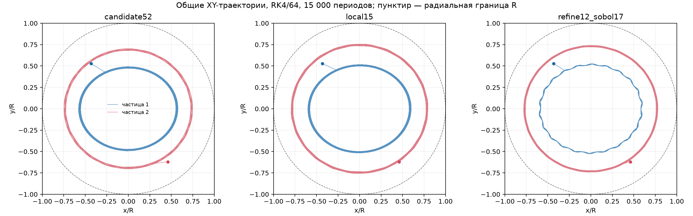
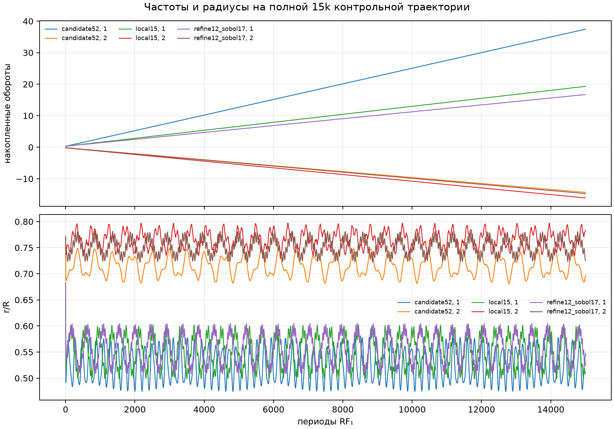
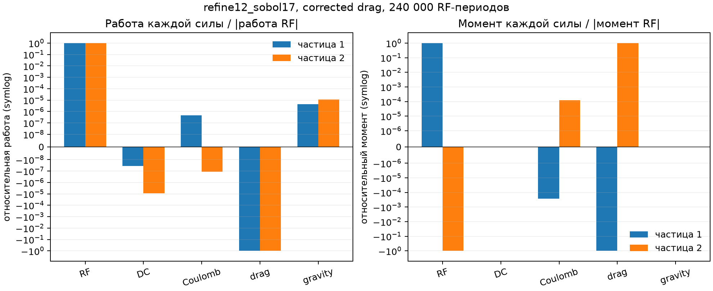
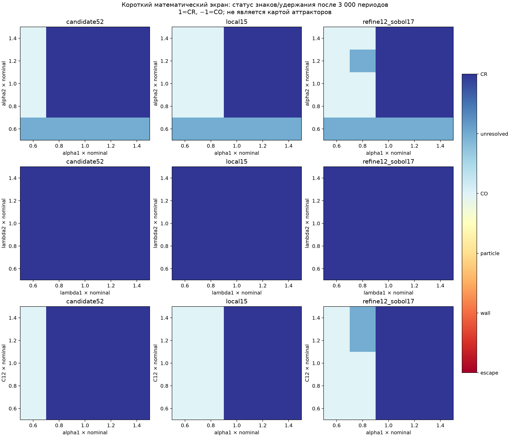
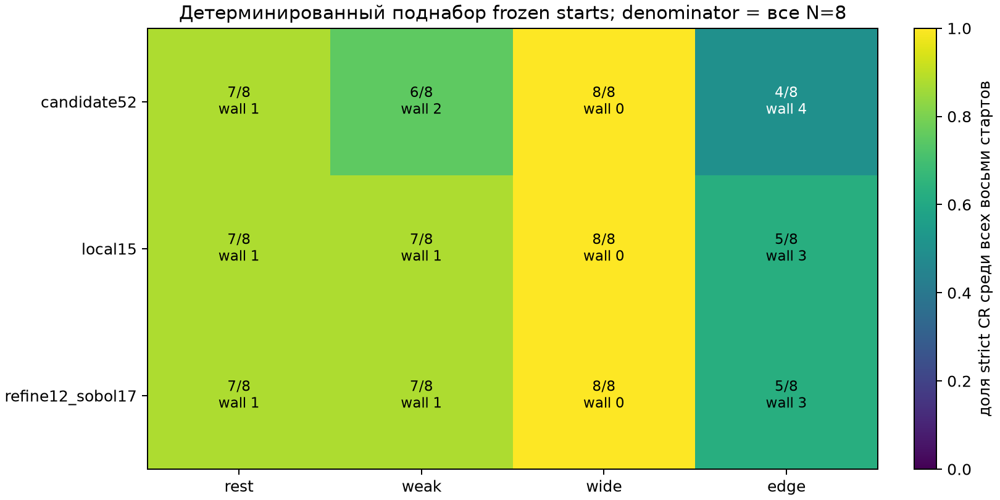
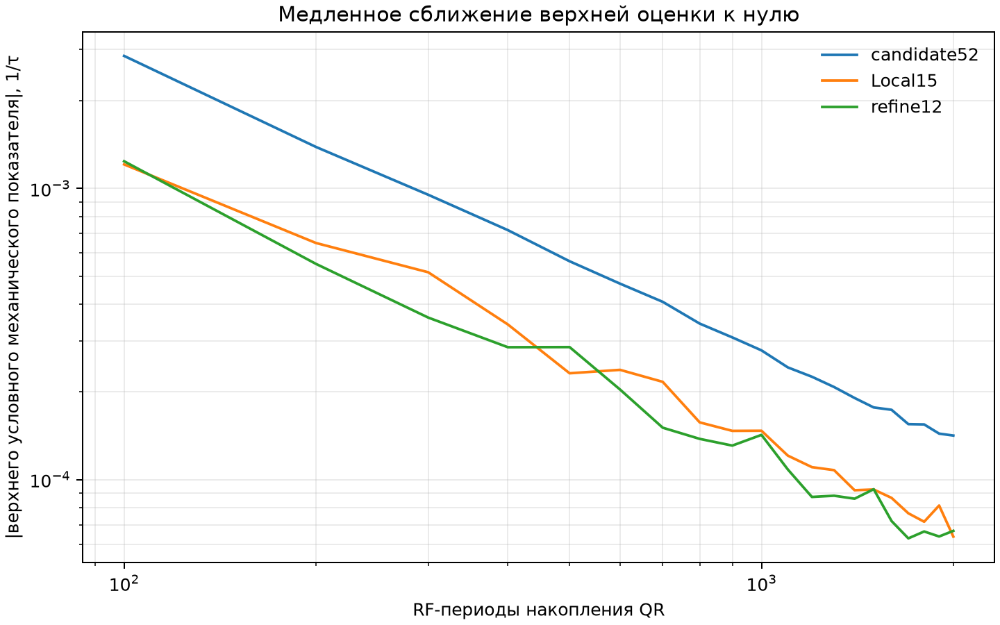

# V17C.20B — Поиск притягивающих режимов двух частиц

## Краткий вывод

Для трёх унаследованных кандидатов встречное вращение воспроизводится при полном восьмигармоническом поперечном MFS-поле, конечных размерах частиц, гравитации, осевом DC-квадруполе и взаимном кулоновском отталкивании. Оно сохраняется на общей контрольной траектории до 50 000 периодов для `candidate52` и `Local15`, а для выбранного длинного старта `refine12_sobol17` — до 240 000 периодов в переинтеграции с исправленной моделью сопротивления.

Эти расчёты подтверждают долгоживущее встречное движение, но **не доказывают аттрактор**. Малые возмущения удерживают ту же вращательную классификацию на 5 000 периодах, однако траектории не демонстрируют убедительного экспоненциального слияния. Условные механические показатели Ляпунова содержат одно очень слабое направление, оценка которого убывает примерно как `1/T`; вероятная нейтральная или квазинейтральная динамика не отделена от медленной асимптотической сходимости. Короткий параметрический экран даёт изменения режима на сечениях `alpha1–C12`, `alpha1–alpha2` и `alpha1–lambda1`, но его исходы не прошли критерий десяти оборотов и поэтому являются только предварительной картой знаков.

**Итоговый статус:** найдены устойчивые на конечном горизонте встречные траектории; притягивающее встречное движение по данным V17C.20B пока не установлено.

## Репозиторий и происхождение данных

Расчётная ветка создана от `research/v17c18b19-axial-stability-diagrams`, исходный commit `45866d0559db1615a5e2aebc521ddae90f3a0101`. Три исходных набора выбраны по результатам V17C.12B (`refine12_sobol17`, `Local15`, `candidate52`); исходные доли 437/512, 420/512 и 395/512 — это частоты строгой классификации на конкретных frozen-ансамблях, а не вероятности притяжения.

Параметры и SHА исходных MFS-данных и интеграторов сохранены в [candidate_parameters.json](results/candidate_parameters.json). Поле содержит восемь комплексных пространственных гармоник из V17C.12B и обе временные несущие. Полный вектор начального состояния и фазы находится в [start_conditions.json](results/start_conditions.json). Основной контроль использует общий покоящийся frozen-start `rest`, index 7, seed 20261850. Он был выбран из совместных успешных стартов трёх конфигураций по запасу до стенки, осевого выхода и межчастичного контакта. Это целевой контрольный старт, не случайная независимая выборка.

Архив 240 000-периодной серии V17C.12B не содержал историю состояний. Поэтому выполнена отдельная воспроизводимая переинтеграция `refine12_sobol17` от сохранённых начальных координат/фаз. Она не меняет исторические данные и явно отмечена как replay.

## Уравнения и вычислительная модель

Использованы безразмерные полные трёхмерные уравнения двух сферических частиц:

`x_i'' = (q_i/m_i) E_RF(x_i,t) + a_DC,i + a_C,i - d_i(v_i) + g_i`.

Поперечное поле восстановлено из полного комплексного MFS-спектра, а не из двух ведущих гармоник. Для каждого гармонического режима применён аналитический градиент потенциала, проверенный исходным интегратором V17C.17. Статический DC вклад — опубликованный идеальный осесимметричный квадруполь; это не решение поля конечных торцевых электродов и не полная 3D электростатика.

Кулоновские силы вычисляются попарно с противоположными знаками и индивидуальным ускорением через отношение масс. Учитываются конечные радиусы и события контакта/потери из проверенного Numba-интегратора. Трение — Cunningham-скорректированный стоксовский коэффициент `lambda_Stokes/Cc`, умноженный на Schiller–Naumann `1 + 0.15 Re^0.687`. Поправка Cunningham применяется именно делением; в V17C.17 было исправлено ошибочное историческое умножение. Межчастичное гидродинамическое взаимодействие, поляризация и индуцированные заряды здесь отключены.

В математических параметрических сечениях `alpha1`, `alpha2`, `lambda1`, `lambda2`, `mu` и `C12` менялись независимо. В этой модели `Q = mu*alpha2/alpha1` задаёт согласованный зарядный множитель в уравнениях. Поэтому точки такого скана — математические варианты, а не физически связанные пары частиц. Физическая связь параметров проверена только для трёх исходных размерных отображений.

## Три кандидата

| Конфигурация | `f1/f2`, Гц | `alpha2` | `mu=m2/m1` | `Q=q2/q1` | `C12` | `lambda1/lambda2` после `1/Cc` | Диаметры, мкм |
|---|---:|---:|---:|---:|---:|---:|---:|
| candidate52 | 45 / 130.483 | 0.39887 | 8.8436 | 3.52743 | 9.2817e-6 | 0.18609 / 0.10350 | 39.31 / 192.73 |
| Local15 | 50 / 155.590 | 0.34126 | 9.1366 | 3.11797 | 9.4631e-6 | 0.20878 / 0.12607 | 35.20 / 193.46 |
| refine12_sobol17 | 50 / 160.984 | 0.37815 | 9.1210 | 3.44905 | 9.7473e-6 | 0.24452 / 0.17737 | 32.52 / 214.24 |

Размерные параметры — legacy-отображения, а не экспериментально подтверждённые совместные пары. Для частиц 2 используется назначенная низкая плотность 127–299 кг/м³, что само по себе требует отдельной проверки материала и полого микросферического изготовления. Поэтому количественные результаты далее в первую очередь безразмерные.

## Воспроизведение и долгие траектории

Общие 15 000-периодные контрольные траектории рассчитаны RK4/64, переходный интервал 1 000 периодов. Результаты:

| Конфигурация | Обороты после пропуска, частицы 1 / 2 | Частоты, Гц | Минимальная дистанция частиц, `R` | Итог |
|---|---:|---:|---:|---|
| candidate52 | +34.683 / −13.202 | +0.11148 / −0.04243 | 0.60575 | удержаны, встречное |
| Local15 | +17.767 / −14.846 | +0.06345 / −0.05302 | 0.58833 | удержаны, встречное |
| refine12_sobol17 | +15.280 / −13.566 | +0.05457 / −0.04845 | 0.56023 | удержаны, встречное |

Частоты вычислены как число развёрнутых оборотов, умноженное на реальную частоту `f1` и делённое на длительность интервала после перехода. При медленных орбитах это существенно отличается от использования частоты RF вместо частоты орбиты.

При 50 000 периодов RK4/64 после 5 000-периодного перехода `candidate52` дал `+0.111459 / −0.042406 Hz`, средние радиусы `0.52560 / 0.71486 R`, `d_min=0.60574R`. `Local15` дал `+0.063363 / −0.053038 Hz`, `0.54930 / 0.76589R`, `d_min=0.58822R`. Все последовательные поздние контрольные окна сохраняли противоположные знаки.

Для `refine12_sobol17` выполнено 240 000 периодов, RK4/64, с контрольными точками каждые 5 000 периодов и отбрасыванием первых 20 000 периодов. Получены `+240.450 / −213.197` оборота, `+0.054648 / −0.048454 Hz`, средние радиусы `0.55572 / 0.75152R`, `d_min=0.56024R`. После отбрасывания переходных 20 000 периодов все 132 последовательных поздних частотных окна (3 окна на 5 000-периодный chunk) сохраняли противоположные знаки; всего было сохранено 48 checkpoint chunks. Это сильное подтверждение долгоживущего движения одной траектории, но не доказательство притягивающего множества.

Сохранены полные редкие временные трассы (с шагом 10 циклов для контрольной траектории и 100 циклов для длинных серий), checkpoint chunks, параметры и энергетические величины в `results/`.

## Coulomb и механика сближений

Для каждой конфигурации на одном и том же общем старте проверено `s_C = 0, 0.1, 0.25, 0.5, 0.75, 1, 1.5, 2, 3, 5` по 5 000 RF-периодов с 32 шагами на период. Все 30 коротких запусков остались удержанными и сохранили противоположные знаки в окнах. Это ещё не ten-turn validation: у медленной внешней частицы за такой отрезок набирается существенно меньше десяти оборотов.

При увеличении `s_C` от 0 до 5 минимум парной дистанции вырос:

- candidate52: `0.6048 → 0.6096R`;
- Local15: `0.5873 → 0.5922R`;
- refine12: `0.5590 → 0.5651R`.

Положительная частота внутренней частицы в этих коротких окнах слегка уменьшалась: примерно на 1.0%, 3.1% и 3.5% соответственно между `s_C=0` и `5`. Отрицательная частота внешней частицы менялась намного меньше (менее примерно 0.2% на этом окне). Встречное вращение уже есть при `s_C=0`, поэтому этот тест **не показывает**, что Coulomb создаёт или стабилизирует встречность. Он показывает небольшой, плавный отклик частот и увеличение минимального расстояния за счёт отталкивания; перехода к совместному вращению или потере удержания до `5 C12` в исследованном старте не найдено.

Для 240k refine12 внутренние кулоновские моменты равны `−0.155742` и `+0.155742` в интегральной нормировке; их сумма `−5.6e−17`, как и требуется для центральной попарной силы. Кулоновская работа по частицам `+4.55e−4` и `−4.54e−4`, а начальный/конечный безразмерный Coulomb потенциал — `9.37e−6 / 7.51e−6`. Для сравнения, RF работа `+5049.05` компенсируется drag работой `−5049.83`. Значит, Coulomb обменивает малую долю углового момента/энергии, но не является источником энергии вращения. Средний внешний RF torque балансируется диссипативным моментом; внутренний Coulomb torque только перераспределяет импульс между частицами.

Энергетический относительный остаток replay равен `9.70e−5`. `ΔLz=0.08127`, интеграл полного момента `0.13688`, остаток `−0.05561`; относительно суммы модулей больших компенсирующих индивидуальных RF/drag вкладов остаток порядка `1.5e−5`. Энергетический баланс включает явную RF-работу, DC, gravity, Coulomb и drag.

## Параметрические сечения

Проверено 504 уникальных коротких расчёта: 3 кандидата × 7 двумерных сечений × 24 нецентральные точки сетки `0.6, 0.8, 1.0, 1.2, 1.4` номинала. Сечения: `(alpha1,alpha2)`, `(alpha1,lambda1)`, `(alpha2,lambda2)`, `(lambda1,lambda2)`, `(mu,C12)`, `(alpha1,C12)`, `(alpha2,C12)`. Центральная точка не дублировалась; контроль базовой модели выполнен отдельными долгими прогонами. Дополнительно выполнены 72 однофакторных расчёта (`alpha1`, `alpha2`, `lambda1`, `lambda2`, `mu`, `C12` на множителях 0.6, 0.8, 1.2, 1.4; номинал измерен baseline). `Q` не сканировался как отдельная ось: при текущей параметризации он алгебраически задаётся как `mu*alpha2/alpha1`; независимый `Q` при фиксированных остальных коэффициентах нарушил бы связи ускорений и зарядов.

Каждая точка — 3 000 RF-периодов, RK4/32, один и тот же rest-start. Все 504 остались удержанными в этом коротком окне. Знаки разделились главным образом на сечениях `alpha1–C12`, `alpha1–alpha2` и `alpha1–lambda1`: смена со screen-CR на screen-CO возможна для части комбинаций `Local15` и `refine12`; `candidate52` также имеет screen-CO области в первых двух сечениях. Сечения `lambda1–lambda2`, `mu–C12`, `alpha2–C12` и `alpha2–lambda2` в пределах выбранной сетки дали преимущественно/полностью встречные знаки или неопределённые медленные случаи. Ни одна точка не удовлетворила 10-оборотному критерию за короткий интервал, так что нельзя делать вывод о границе бассейнов или аттракторов.

В однофакторных сериях screen-CO возникал при части значений `alpha1` (1/4 точек candidate52, 2/4 у Local15 и refine12); один из четырёх `alpha2`-множителей для каждого кандидата остался slow/unresolved. Множители `lambda1`, `lambda2`, `mu`, `C12` по отдельности на диапазоне 0.6–1.4 не сменили screen-классификацию от номинальной встречной. Это только 3 000-периодный срез одного старта; не означает нечувствительность реальных бассейнов.

Дополнительно проведён scrambled Sobol screening по шести математическим коэффициентам (`alpha1`, `alpha2`, `lambda1`, `lambda2`, `mu`, `C12`), 32 точки на конфигурацию, фиксированные seed `20261123`/`20261124`/`20261125`, диапазон множителей `[0.6,1.4]`. Все 96 коротких 3 000-периодных интегрирований удержаны, однако ни одно не накопило десять оборотов каждой частицы. Знаковые экран-классы распределились так:

| Кандидат | Screen-CR | Screen-CO | Slow | Unresolved | Удержание | 10 оборотов |
|---|---:|---:|---:|---:|---:|---:|
| candidate52 | 25 | 4 | 1 | 2 | 32/32 | 0/32 |
| Local15 | 17 | 7 | 1 | 7 | 32/32 | 0/32 |
| refine12_sobol17 | 20 | 8 | 0 | 4 | 32/32 | 0/32 |

Таким образом, совместные изменения параметров дают больше screen-CO/slow исходов, чем индивидуальные сканы `lambda`, `mu` и `C12`, где встречный знак почти неизменен. Это признак взаимодействия параметров в уравнениях и мотивация для адаптивного уточнения, но все точки остаются слишком короткими, чтобы считать их режимами или аттракторами.

Реестр покрытия точно перечисляет выполненные и отсутствующие сканы в [PARAMETER_COVERAGE.json](PARAMETER_COVERAGE.json). Независимые пары `(alpha1,lambda2)`, `(alpha2,lambda1)`, `(mu,alpha_i)`, `(Q,lambda_i)` и другие не были полностью покрыты; в физически связанном пространстве не выполнен новый LHS, поскольку три размерных mappings не идентифицируют совместно реализуемую пару и не задают допустимые интервалы материала/заряда/сопротивления.

## Признаки притяжения и бассейны

Для каждой траектории с финального длинного состояния вычислена аналитическая механическая вариационная матрица: MFS-гессиан, производная попарного Coulomb и производная Schiller–Naumann drag. На восьми контрольных состояниях максимальная относительная ошибка против центральной разности RHS составила `3.1e−9`–`6.3e−9`; интегрированное tangent-base после 20 периодов совпало с независимым проверенным RK4 состоянием с максимальной абсолютной разницей `1.8e−13`–`2.2e−13`.

Условные механические QR-спектры рассчитаны на 2 000 периодах с 32 шагами/период и QR-интервалом 20 периодов, при фиксированных внешних RF-фазах. Верхняя оценка на 2 000 периодах: `−1.42e−4`, `−6.37e−5`, `−6.67e−5` на безразмерное время для candidate52, Local15 и refine12 соответственно. Между 100 и 2 000 периодами её модуль уменьшается примерно пропорционально `1/T`. Остальные механические направления заметно отрицательны. Верхний почти нулевой показатель может соответствовать медленному направлению/дрейфу на квазипериодическом режиме; конечная оценка не позволяет доказать строго отрицательный асимптотический показатель. Условная система фиксирует две внешние фазы и не равна полному 14-мерному спектру тора.

Проведено по шесть механических конечных возмущений на кандидата: сдвиг координаты на `1e−6` текущего радиуса (радиально/тангенциально для каждой частицы) либо скорость `1e−3` от оценённой секулярной скорости. Все 18 испытаний сохранили удержание и provisional-CR до 5 000 периодов; конечное расстояние между парными траекториями колебалось в пределах примерно `0.13–1.28` от начального в зависимости от кандидата и направления perturbation. Это не демонстрирует однозначного притяжения к общей траектории и не было рассчитано как независимые initial-condition basin fractions.

Дополнительно изменялась каждая RF-фаза на `+1°` отдельно. Все шесть запусков удержаны и удовлетворили строгой ten-turn CR-классификации после 15 000 периодов, с малыми сдвигами среднего радиуса и частоты. Это локальная проверка робастности по фазе, не бассейновая оценка.

Дополнительно выполнен систематический поднабор frozen-start: 8 состояний из каждого ансамбля (`rest`, `weak`, `wide`, `edge`) по индексам `0,16,…,112`, 15 000 периодов RK4/64, переход 1 000 периодов. Все состояния учитываются в знаменателе. Единственный неуспех в этом малом срезе — контакт со стенкой.

| Кандидат | Rest | Weak | Wide | Edge | Strict CR / 32 |
|---|---:|---:|---:|---:|---:|
| candidate52 | 7/8 (1 wall) | 6/8 (2 wall) | 8/8 | 4/8 (4 wall) | 25/32 |
| Local15 | 7/8 (1 wall) | 7/8 (1 wall) | 8/8 | 5/8 (3 wall) | 27/32 |
| refine12_sobol17 | 7/8 (1 wall) | 7/8 (1 wall) | 8/8 | 5/8 (3 wall) | 27/32 |

Это доли из детерминированной выборки `N=8` на ансамбль, а не IID оценка вероятности и не мера сходимости к одной орбите. Поднабор показывает неоднородность удержания: выбранные `wide` старты благоприятны, а `edge` чаще теряются на стенке. Кулоновских контактов, совместного вращения и неопределённых исходов в этой выборке нет. Исходные старты и SHA сохранены в `results/basin_ensemble_checkpoint.jsonl` и `basin_ensemble_summary.json`.

Исторические V12B доли на `N=512` — внешняя справочная статистика. Ни старые, ни эти N=8 данные нельзя трактовать как вероятность притяжения: они классифицируют движение из стартов, а не измеряют схождение к одному инвариантному режиму.

## Численные и физические ограничения

Поле — проверенный поперечный 2D MFS-спектр бесконечно длинных электродов; движение — 3D, но торцевых RF-эффектов и самостоятельного FEM решения в этой ветке нет. DC задан гармоническим идеальным квадруполем, а не электродной 3D-геометрией. Это совпадает с областью исследования V20B и не подтверждает требование V17C.18B–19 по конечным торцевым электродам.

Номинальные размерные карты используют сухой воздух при 1 атм; `Kn` для этих размеров мал, Cunningham близок к единице. По сохранённым RK4/64 контрольным трассам максимальная безразмерная скорость около `0.052–0.080 RΩ1`; соответствующая оценка `Re` составляет приблизительно `0.50–0.58` для частицы 1 и `1.91–2.29` для частицы 2. Поэтому нелинейная поправка Schiller–Naumann заметна, но не доминирует. Эти числа относятся только к выбранным траекториям, не ко всему бассейну. Большие заряды (около `0.3–1.2 млн e` по legacy map), неопознанные низкоплотные частицы, высокие электродные напряжения и поверхность поля порядка `9–10 MV/m` не подтверждены экспериментом. Поляризация и межчастичная гидродинамика выключены.

Независимая реализация Python RHS + SciPy DOP853 завершила по 3 000 периодов на каждом общем начальном состоянии, `rtol=1e−9`, `atol=1e−11`, `max_step=T_RF/96`; число вызовов RHS — 3.46–3.61 млн на траекторию. Все интервалы сохраняют встречные знаки и согласуются с RK4 по частотам. Контрольный шаг RK4/128 для тех же стартов дал максимальные расхождения частот с DOP853 `1.26e−7`, `1.03e−7`, `1.30e−8 Hz` соответственно; максимум покоординатного расхождения конечного состояния RK4/128 с DOP853 составил `3.74e−5`, `1.68e−5`, `2.17e−6` в безразмерных единицах. Для RK4/64 расхождение конечного состояния с RK4/128 на том же 3 000-периодном окне было `2.36e−3`, `2.07e−3`, `2.02e−3`. Таким образом, частотная классификация устойчива при уточнении шага, но сам фазовый вектор на длинном интервале чувствителен к накопленной ошибке RK4/64; для окончательного количественного сравнения траекторий нужен более мелкий шаг или сравнение после сдвига вдоль квазипериодического режима. Подробные данные — `results/independent_dop853_validation.json` и `results/step_refinement_3000p.json`.

## Что стало известно

В ранее подобранных режимах Coulomb не нужен, чтобы получить противоположные вращательные знаки: они сохраняются и при `C=0` на заданном старте. Взаимная сила на исследованных значениях слегка сдвигает частоты и увеличивает дистанцию сближения, но интегральный внутренний torque точно сокращается в сумме и на много порядков слабее компенсирующихся RF/drag моментов. Согласие трёх долгих траекторий, локальная сохранность знаков после малых механических/фазовых возмущений и отсутствие короткого перехода даже до `5 C12` поддерживают картину долговременных driven counterrotating режимов; данных для заключения об их притяжении или о крупном бассейне пока нет.

В сравнении с V17C.12B–15 добавлено не ещё одно число старых успешных стартов, а повторная длинная интеграция с исправленным Cunningham/finite-Re drag, количественный баланс внутренних моментов, механический tangent/QR аудит, локальные perturbation tests и чувствительность знаков к парному Coulomb. По сравнению с V17C.17 это сравнение расширено на три selected field/particle configurations и параметрические сечения. Оно не заменяет физическую теорию, межчастичную гидродинамику и рабочие режимы V17C.16.

## Следующий этап

Сначала завершить независимую DOP853-проверку и небольшой frozen-start ансамбль; затем исследовать отталкивание/притяжение не только знака оборотов, но и статистического состояния: медианные частоты, радиусы, относительные фазы и их дисперсии. Для поиска аттрактора нужны starts с несколькими механическими состояниями при **одинаковых двух RF-фазах**, близкие пары с более длинным наблюдением, полный расширенный tangent system с фазовыми координатами и более длинное окно, чем текущие 2 000–5 000 периодов. Кандидаты следует считать доказанными аттракторами только если результаты не зависят от временного интервала и возмущения сходятся к одной driven инвариантной статистике.
