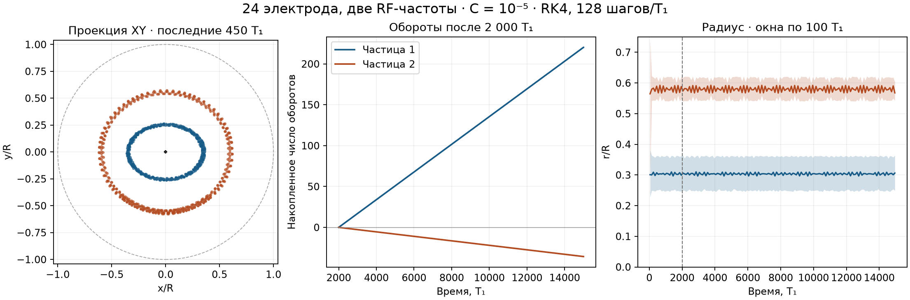

# V17C.5 — независимая проверка встречного вращения

**Вердикт: CONFIRMED** для заданной численной модели и исследованного горизонта 15 000 периодов основной RF. Это подтверждает длительное встречное вращение в модели бесконечных цилиндрических электродов с заданным спектром MFS и идеальным DC-квадруполем; само по себе это не доказывает реализуемость конечной экспериментальной ловушки.

## Что было проверено

Из `V17C_dual_frequency_counterrotation.zip` извлечены точные параметры, спектр и начальное состояние. Все 31 перечисленных в архиве файла прошли проверку SHA-256. Независимо реализовано полное безразмерное уравнение движения двух частиц: градиент обоих RF-носителей, трёхмерный DC-квадруполь, парная кулоновская сила и диссипация. Отдельная реализация DOP853 не импортирует RHS исходного расчёта. Архивные коэффициенты MFS имеют граничную невязку около 1e-10; нормированные коэффициенты p=32 и p=48 отличаются не более чем на 4.81e-9.

Номинальные параметры: 24 электрода, a/D=0.05, B/D=1.10, R=0.95D; f1=100 kHz, f2=√2 f1; U2/U1=2.72581454; m2/m1=4.02216956; одинаковые положительные заряды; C=1e-5; λ1=λ2=0.012; VDC/U1=0.34035939. Использован полный архивный поперечный спектр с отсечением |k|≤48 и указанный в `input/config.json` старт.

## Номинальная траектория

Первые 2 000 периодов отброшены. На оставшихся 13 000 периодах RK4 с 128 шагами на период дал соответственно **+220.22714** и **−35.67909 оборота**, **+1694.05494 Hz** и **−274.45452 Hz**. Средние stroboscopic радиусы: **0.303619R** и **0.579547R**. Обе частицы оставались внутри апертуры; максимальные радиусы на внутренних шагах — 0.41748R и 0.79014R. В трёх последовательных поздних окнах частоты были (+1693.87, −274.38), (+1695.32, −274.74), (+1692.97, −274.25) Hz. Это существенно больше порога десяти оборотов для каждой частицы.

Независимый DOP853 на полном интервале воспроизвёл **+220.22719/−35.67906 оборота**, частоты **+1694.05531/−274.45431 Hz** и практически те же средние радиусы **0.303619R/0.579547R** (`rtol=2e-11`, `atol=2e-13`, `max_step=π/12`). Максимальное расхождение DOP853 и RK4-128 по компонентам состояния в моменты целых периодов — 2.31e-4, конечное — 9.48e-5. Сравнение RK4-64 и RK4-128 даёт максимум 5.36e-3, конечное 2.93e-3; средние stroboscopic радиусы между шагами совпадают лучше 3.4e-7R. Поэтому траектория не побитово совпадает при грубом RK4, но интегратор и уменьшение шага сохраняют частоты и радиальную локализацию.

Проверка развёртки: непрерывный угол сверён с интегралом dθ/dτ=(x vy−y vx)/r²; максимальное расхождение — **9.5e-11 оборота**. Полный DOP853 сначала показывает переходный процесс: короткая начальная выборка не годится для оценки установившегося знака. Поздние окна и полный интервал после релаксации дают устойчивые противоположные знаки. Отброшенные 2 000 периодов соответствуют примерно 151 времени затухания линейной модели.

## Энергия и связь

На позднем участке RK4-128 RF-работа составляет +2.22373 и +4.45414 в единицах m1 R² Ω1², работа трения −2.22309 и −4.45016; DC- и кулоновские вклады существенно меньше. Максимальная невязка полного энергетического баланса RK4 — 2.79e-6, или 3.62e-7 накопленной RF-работы. Для независимого DOP853 соответствующие значения 2.29e-9 и 2.98e-10. Поздняя RF-работа многократно превышает начальную кинетическую энергию, поэтому вращение поддерживается RF-полем, а не остатком стартового импульса.

Скан связи (RK4-64, те же начальные данные, 15 000 периодов):

| C | Частоты, Hz (частица 1 / 2) | Результат |
|---:|---:|---|
| 0 | +1829.284 / −281.123 | встречное вращение сохраняется |
| 5e-6 | +1806.285 / −280.341 | встречное вращение сохраняется |
| 1e-5 | +1694.045 / −274.462 | встречное вращение сохраняется |
| 2e-5 | −158.746 / −158.488 | встречное вращение исчезает, обе вращаются отрицательно |

Таким образом, кулоновская связь влияет на частоты и при удвоении выбранного C синхронизирует знаки, но номинальное встречное вращение не является режимом, который возникает только благодаря кулоновской силе: оно сохраняется и при C=0. При номинальном C частицы всё же взаимодействуют в модели; их минимальное расстояние на RK4-128 равно 0.2252R, а средняя безразмерная кулоновская энергия около 2.07e-5. Этот результат не следует описывать как коллективно порождённое вращение.

При архивной квадратичной поправке к трению F=−λv(1+0.5|v|) частоты равны +1659.064/−274.788 Hz. Увеличение обоих начальных радиусов на 1% даёт +1694.077/−274.456 Hz; сочетание двух возмущений — +1659.038/−274.785 Hz. Во всех трёх проверках удержание и знаки сохранились.

## Ограничения интерпретации

Использовано заданное в архиве безразмерное феноменологическое сопротивление. Oseen-подобный тест меняет одночастичное сопротивление; это не межчастичный гидродинамический тензор. Для частиц разной массы одинаковые безразмерные λ и параметр поправки нельзя одновременно вывести из одних и тех же радиусов сфер в общей жидкости. Архив не задаёт размеры частиц, жидкость/газ и давление, поэтому физическую применимость Stokes/Oseen и число Кнудсена установить нельзя.

Выполнен быстрый независимый 2D FEM-кроссчек поперечных гармоник (P1, две отдельные RF-базисные задачи). Он согласуется с ведущими MFS-коэффициентами примерно на 0.24–0.31% на мелкой сетке, но не является полномасштабной 3D FEM-моделью. Конечные электроды, торцевое поле, пробой и физические единицы конкретного устройства не моделировались. Результаты означают численное подтверждение указанной модели, а не готовое экспериментальное утверждение.

## Воспроизводимость и файлы

Код воспроизведения RK4, отдельный DOP853, архивный аудит, конфигурация, контрольные ряды, диагностика связи и трения, сравнение и график включены в этот каталог и ZIP. Запуск: `python rk/reproduce.py`, `python dop/check.py`, `python compare.py`, `python summarize.py`, `python package_results.py` (SciPy/NumPy/Matplotlib требуются для соответствующих скриптов). Полные исходные и конечные состояния и выборки траекторий сохранены в NPZ.

